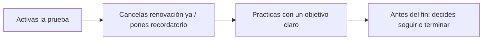

# Cómo aprovechar una prueba gratuita sin olvidar cancelarla

Parte de: [[16-Laboratorios-Practica/07 Herramientas de pago con plan gratuito o prueba/_Índice Herramientas de pago con plan gratuito o prueba|Herramientas de pago con plan gratuito o prueba]]

> [!info] Cómo avanzar
> `progreso`: **pendiente** → **viendo** (estudiando) → **visto** (contestaste la autoevaluación sin abrir las respuestas) → **dominado** (hiciste el laboratorio o lo aplicaste de verdad).

## Contenido

### Qué es
Es una pequeña disciplina para usar las **pruebas gratuitas** (free trials) de herramientas de pago (observabilidad, IDEs, SaaS) sin terminar con un cobro que no querías. Muchas pruebas piden tarjeta y se **renuevan solas** a plan de pago al vencer; el objetivo es exprimir el periodo gratuito y cancelar a tiempo, o cancelar la renovación desde el inicio.

### Cómo funciona

### Qué haces el mismo día que activas una prueba
Tres cosas, de inmediato:

1. **Anota en el calendario** un recordatorio **2–3 días antes** del fin de la prueba.
2. **Revisa cómo se cancela** (a veces está escondido) antes de necesitarlo.
3. Si la plataforma lo permite, **cancela la renovación automática de inmediato**: muchas pruebas siguen activas hasta su fecha de fin aunque ya hayas cancelado la renovación, así que no pierdes nada y te quitas el riesgo.

### Qué medio de pago conviene usar
Una **tarjeta virtual o con límite bajo** (muchos bancos permiten crear tarjetas desechables o con tope). Así, si un cobro se te escapa, el daño es pequeño o la transacción simplemente se rechaza. Nunca uses la tarjeta principal para pruebas que no piensas continuar.

### Cómo planeas la prueba para aprovecharla
Llega con un **objetivo y un laboratorio preparado**: qué vas a probar, con qué datos y en qué orden, **antes** de activarla. Si activas la prueba y recién entonces piensas qué hacer, gastas los días explorando la interfaz. Ten listos los pasos para no desperdiciar el reloj.

### Cómo empezar paso a paso
1. Define el objetivo concreto (por ejemplo: "ver trazas de mi API .NET en [[Datadog - prueba gratuita]]").
2. Prepara el entorno y los datos antes de activar.
3. Activa la prueba y, el mismo día, cancela la renovación o pon el recordatorio.
4. Ejecuta tu laboratorio en los primeros días (no lo dejes para el final).
5. Antes del fin, decide: ¿pasas a un plan gratuito, a pago, o terminas? Quita agentes/integraciones si terminas.

### Ejemplo
Para probar una herramienta de observabilidad: antes de activar, ten tu API corriendo con [[OpenTelemetry]] listo para exportar. Activas la prueba, conectas el exportador, ves las trazas el primer día, documentas en tu bitácora y, al terminar, **quitas el agente** para no dejar datos saliendo (ver [[Datadog - prueba gratuita]]).

### Cuándo aplicarlo y cuándo no
Aplícalo en **toda** prueba que pida tarjeta o se renueve sola. Si una herramienta tiene **plan gratuito permanente** (como [[Grafana Cloud - plan gratuito]], [[New Relic - plan gratuito]] o [[SonarCloud]]), no hay prisa de cancelar, aunque igual conviene vigilar el consumo para no pasar a cobro.

### Errores comunes
- **No anotar la fecha de fin.** Es la causa número uno de cobros sorpresa.
- **Usar la tarjeta principal.** Un olvido se vuelve un cargo grande.
- **Activar sin plan.** Gastas los días explorando en vez de practicar.
- **Terminar sin quitar agentes/integraciones.** Pueden seguir enviando datos o generando costo.

### Para profundizar
- [Datadog: prueba de 14 días vía AWS Marketplace (ejemplo de condiciones de una prueba)](https://docs.datadoghq.com/integrations/guide/aws-marketplace-datadog-trial/)
- [New Relic: qué incluye su plan gratuito permanente](https://newrelic.com/pricing/free-tier)

## Autoevaluación

Contesta primero en voz alta o en papel; luego despliega la respuesta.

> [!question]- ¿Qué haces el mismo día que activas una prueba?
> Anotar en el calendario un recordatorio 2–3 días antes del fin, revisar cómo se cancela y, si se puede, cancelar la renovación automática de inmediato (muchas pruebas siguen activas hasta su fecha).

> [!question]- ¿Qué medio de pago conviene usar?
> Una tarjeta virtual o con límite bajo, para que un cobro olvidado no sea grande.

> [!question]- ¿Cómo planeas la prueba para aprovecharla?
> Llegar con un objetivo y un laboratorio preparado (qué vas a probar y en qué orden) antes de activarla, para no gastar los días explorando.

