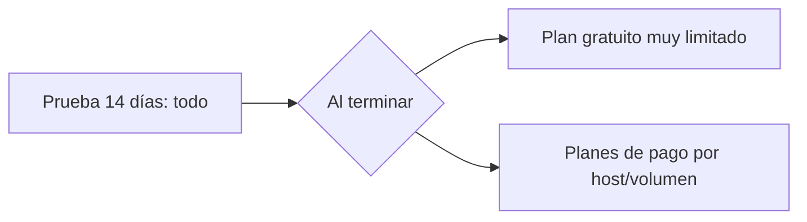

# Datadog - prueba gratuita

Parte de: [[16-Laboratorios-Practica/07 Herramientas de pago con plan gratuito o prueba/_Índice Herramientas de pago con plan gratuito o prueba|Herramientas de pago con plan gratuito o prueba]]

> [!info] Cómo avanzar
> `progreso`: **pendiente** → **viendo** (estudiando) → **visto** (contestaste la autoevaluación sin abrir las respuestas) → **dominado** (hiciste el laboratorio o lo aplicaste de verdad).

## Contenido

### Qué es
Datadog es una plataforma de **observabilidad** de nivel empresarial: reúne métricas de infraestructura, **APM** (trazas de aplicaciones), logs, monitoreo de red, de bases de datos y más, en un solo lugar con dashboards y alertas. Es potente y cara; por eso lo habitual para aprenderla es su **prueba gratuita**.

### Qué ofrece la prueba
Acceso temporal a **la plataforma completa** (infraestructura, APM, logs) por un número limitado de días: Datadog ofrece una **prueba de 14 días** de todas las funciones (verificar en la página oficial). Es tiempo suficiente para instrumentar una app, ver trazas y armar un dashboard.

### Qué hay después de la prueba
Al terminar la prueba quedan dos caminos:
- Un **plan gratuito muy limitado** (por ejemplo, infraestructura para unos pocos hosts con retención corta; los límites exactos cambian, verificar en la página oficial).
- **Planes de pago** por host y por volumen de datos, que es donde Datadog se vuelve caro.

### Qué cuidado tiene
Al acabar la prueba, **quita los agentes** que instalaste en tus máquinas y **anota la fecha de fin** para no pasar a un plan de pago sin querer (ver [[Cómo aprovechar una prueba gratuita sin olvidar cancelarla]]). Un agente olvidado sigue enviando datos y puede generar costo o exponer información.

### Cómo empezar paso a paso
1. Antes de activar, ten tu app lista para instrumentar (por ejemplo con [[OpenTelemetry]] o el agente de Datadog para .NET).
2. Activa la prueba y pon el recordatorio de fin.
3. Instala el agente en una máquina de prueba y conecta tu app.
4. Explora APM: busca trazas lentas, errores y dependencias.
5. Antes del día 14, documenta lo aprendido y **desinstala el agente**.

### Ejemplo
Instrumentas Itzamna.Dionisio para mandar trazas a Datadog y descubres que una consulta a SQL Server domina el tiempo de respuesta. Esa es la clase de hallazgo que buscas: ver, en una traza, qué paso de la petición tarda. Conecta con [[Métricas, trazas y logs]] y con tu área de [[_Índice Observabilidad]].

### Cuándo usarlo y cuándo no
Úsalo para **conocer** una plataforma de observabilidad líder y comparar con alternativas. Para practicar observabilidad sin reloj, [[Grafana Cloud - plan gratuito]] o [[New Relic - plan gratuito]] tienen planes gratuitos permanentes más generosos para aprender. Datadog es referencia del mercado, pero su fuerte no es el uso gratuito prolongado.

### Errores comunes
- **Dejar agentes instalados tras la prueba.** Siguen enviando datos y pueden costar.
- **No anotar la fecha de fin.** Riesgo de pasar a pago.
- **Activar sin plan de práctica.** 14 días se van rápido.
- **Mandar datos sensibles en logs.** Fíltralos ([[Logs y datos sensibles]]).

Un apunte sobre el plan: como Datadog cobra por host y por volumen de datos, úsalo en la prueba para *entender* cómo se ve una plataforma líder (dashboards, APM, correlación de logs y trazas) más que para dejarlo corriendo. Para uso gratuito sostenido, tus opciones reales son [[Grafana Cloud - plan gratuito]] y [[New Relic - plan gratuito]].

### Para profundizar
- [Datadog: prueba gratuita](https://www.datadoghq.com/free-datadog-trial/)
- [APM y trazas](https://docs.datadoghq.com/tracing/)

## Autoevaluación

Contesta primero en voz alta o en papel; luego despliega la respuesta.

> [!question]- ¿Qué ofrece la prueba?
> Acceso temporal a la plataforma completa (infraestructura, APM, logs) por un número limitado de días (verificar en la página oficial).

> [!question]- ¿Qué hay después de la prueba?
> Un plan gratuito muy limitado (pocos hosts y retención corta) o planes de pago por host y por volumen (verificar en la página oficial).

> [!question]- ¿Qué cuidado tiene?
> Quitar los agentes al terminar la prueba y anotar la fecha de fin (ver [[Cómo aprovechar una prueba gratuita sin olvidar cancelarla]]).

