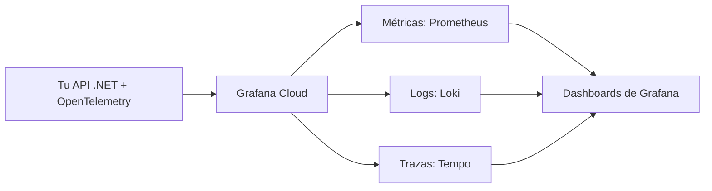

# Grafana Cloud - plan gratuito

Parte de: [[16-Laboratorios-Practica/07 Herramientas de pago con plan gratuito o prueba/_Índice Herramientas de pago con plan gratuito o prueba|Herramientas de pago con plan gratuito o prueba]]

> [!info] Cómo avanzar
> `progreso`: **pendiente** → **viendo** (estudiando) → **visto** (contestaste la autoevaluación sin abrir las respuestas) → **dominado** (hiciste el laboratorio o lo aplicaste de verdad).

## Contenido

### Qué es
Grafana Cloud es la versión gestionada del stack de observabilidad de Grafana Labs: **Grafana** (dashboards) sobre **Prometheus/Mimir** (métricas), **Loki** (logs) y **Tempo** (trazas), todo administrado por ellos para que no montes la infraestructura. Tiene un **plan gratuito permanente**, lo que lo hace excelente para aprender observabilidad sin costo.

### Qué ofrece


Grafana administrado con métricas, logs y trazas, con **cuotas mensuales gratuitas** y **retención limitada**. Según la información vigente (verificar en la página oficial): del orden de **10,000 series de métricas**, **50 GB de logs** y **50 GB de trazas** al mes, con **14 días de retención** y **3 usuarios**. También incluye algo de pruebas de carga con k6.

### Para qué te sirve
Para **practicar observabilidad de una API .NET con [[OpenTelemetry]]** sin montar tu propio stack de Prometheus + Loki + Grafana. Exportas métricas, logs y trazas a Grafana Cloud y armas dashboards, todo gratis dentro de las cuotas. Es el complemento práctico de tu [[_Índice Observabilidad]].

### Qué cuidado tiene
Dos cuidados:
1. **Controlar cuántas métricas y logs envías.** La **cardinalidad alta** (muchas etiquetas con muchos valores distintos, por ejemplo un `user_id` como etiqueta) multiplica las series y **agota la cuota** rápido. Usa etiquetas acotadas.
2. **No mandar datos sensibles en logs** (contraseñas, tokens, datos personales): fíltralos antes de exportar ([[Logs y datos sensibles]]).

### Cómo empezar paso a paso
1. Crea una cuenta gratuita en Grafana Cloud.
2. En tu API .NET, configura el **exportador OTLP** de OpenTelemetry apuntando al endpoint de Grafana Cloud (con el token como secreto).
3. Envía primero trazas; verifica que aparezcan en Tempo.
4. Añade métricas y logs; crea un dashboard con latencia y tasa de errores.
5. Vigila el uso para no pasar las cuotas.

### Ejemplo
Configurar OpenTelemetry en una API .NET para exportar por OTLP (el endpoint y el token de Grafana Cloud van como variables de entorno):

```csharp
builder.Services.AddOpenTelemetry()
    .WithTracing(t => t.AddAspNetCoreInstrumentation().AddOtlpExporter())
    .WithMetrics(m => m.AddAspNetCoreInstrumentation().AddOtlpExporter());
```

### Cuándo usarlo y cuándo no
Úsalo para aprender observabilidad gratis y de forma permanente, sobre todo si te interesa el stack Prometheus/Loki/Tempo. Para conocer una plataforma comercial distinta, [[New Relic - plan gratuito]] o la prueba de [[Datadog - prueba gratuita]]. Grafana Cloud destaca por su plan gratuito estable y por ser el estándar abierto.

### Errores comunes
- **Cardinalidad alta.** Etiquetas con muchos valores agotan la cuota de series.
- **Mandar logs con datos sensibles.** Fíltralos antes.
- **Dejar el token en el código.** Es un secreto.
- **No vigilar el consumo.** Al pasar la cuota, se corta la ingesta hasta el siguiente periodo.

Un apunte sobre el ecosistema: al estar basado en proyectos abiertos (Prometheus, Loki, Tempo), lo que aprendas aquí se traslada a un stack que podrías autoalojar más adelante. Empieza exportando solo trazas de una API de prueba, añade métricas y logs poco a poco, y vigila el panel de uso para no rebasar las cuotas mensuales.

### Para profundizar
- [Grafana Cloud](https://grafana.com/products/cloud/)
- [Precios y cuotas](https://grafana.com/pricing/)
- [OpenTelemetry con Grafana Cloud](https://grafana.com/docs/opentelemetry/)

## Autoevaluación

Contesta primero en voz alta o en papel; luego despliega la respuesta.

> [!question]- ¿Qué ofrece?
> Grafana administrado con métricas (Prometheus), logs (Loki) y trazas (Tempo), con cuotas mensuales gratuitas y retención limitada (verificar en la página oficial).

> [!question]- ¿Para qué te sirve?
> Para practicar observabilidad de una API .NET con OpenTelemetry sin montar tu propio stack.

> [!question]- ¿Qué cuidado tiene?
> Controlar cuántas métricas y logs envías (cardinalidad alta agota la cuota) y no mandar datos sensibles en logs (ver [[Logs y datos sensibles]]).

