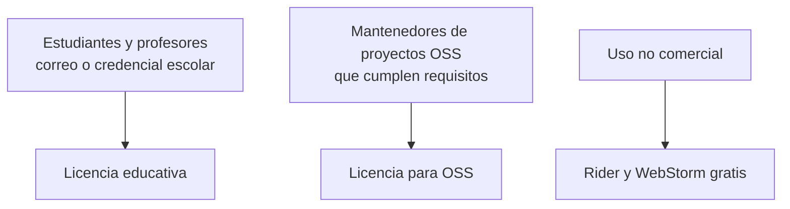

# JetBrains - licencias para estudiantes y proyectos de código abierto

Parte de: [[16-Laboratorios-Practica/07 Herramientas de pago con plan gratuito o prueba/_Índice Herramientas de pago con plan gratuito o prueba|Herramientas de pago con plan gratuito o prueba]]

> [!info] Cómo avanzar
> `progreso`: **pendiente** → **viendo** (estudiando) → **visto** (contestaste la autoevaluación sin abrir las respuestas) → **dominado** (hiciste el laboratorio o lo aplicaste de verdad).

## Contenido

### Qué es
JetBrains hace IDEs muy valorados (IntelliJ IDEA, **Rider** para .NET, **WebStorm** para web, PyCharm, etc.), normalmente de pago por suscripción. Pero ofrece **varias vías para usarlos gratis**: licencias para estudiantes y profesores, licencias para mantenedores de proyectos de código abierto, y **uso no comercial gratuito** de algunos IDEs. Conviene conocerlas para no pagar si tu caso califica.

### Qué programas gratuitos tiene JetBrains

- **Licencias educativas**: gratis para estudiantes y profesores que verifiquen con correo o credencial escolar; dan acceso a casi todos los productos mientras dure la condición.
- **Licencias para proyectos de código abierto**: para mantenedores que cumplan requisitos (actividad, licencia abierta, etc.).
- **Uso no comercial gratuito**: desde **octubre de 2024**, **Rider** y **WebStorm** (y después también CLion, RubyMine y otros) son **gratis para uso no comercial**. (Verificar alcance y condiciones en la página oficial.)

### Qué cuidado tiene la licencia no comercial
La licencia **no comercial** **no cubre trabajo para clientes ni para tu empleo**. En los términos de JetBrains, "no comercial" significa que **no obtienes beneficio económico** del trabajo: si te pagan por lo que haces (incluso en una organización sin fines de lucro), necesitas una **licencia comercial**. Para tu empleo como desarrollador .NET, usar Rider gratis no está permitido; la licencia comercial la paga (o la provee) la empresa. Además, con la licencia no comercial la **telemetría de uso anónimo es obligatoria** (no se puede desactivar), aunque los datos detallados de código sí se pueden apagar.

### Qué alternativa gratuita hay para .NET
Si no calificas a una licencia gratuita y no quieres pagar Rider para trabajo comercial, tienes alternativas sin costo:
- **Visual Studio Community** (con sus condiciones de uso: individuos, código abierto, educación y organizaciones pequeñas; verificar los límites).
- **VS Code con C# Dev Kit** (verifica las condiciones de licencia del Dev Kit).

### Cómo empezar paso a paso
1. Identifica tu caso: ¿estudiante?, ¿mantienes un proyecto OSS?, ¿uso personal no comercial?
2. Para educativa: solicita con tu correo/credencial escolar en el programa de estudiantes.
3. Para OSS: aplica con el proyecto que cumpla los requisitos.
4. Para no comercial: instala Rider/WebStorm y elige la opción de uso no comercial al activar.
5. Para trabajo comercial: usa una licencia comercial o una alternativa gratuita (VS Community, VS Code).

### Ejemplo
Para tus proyectos personales de portafolio puedes usar Rider gratis bajo la licencia no comercial. Para el trabajo en Itzamna.Dionisio (que es remunerado), usa la licencia comercial que provea tu empresa, o VS Code con C# Dev Kit / Visual Studio Community según corresponda.

### Cuándo usarlo y cuándo no
Aprovecha las licencias gratuitas si eres estudiante, mantienes OSS o es uso personal. Para trabajo pagado, no uses la licencia no comercial: ahí van la comercial o las alternativas gratuitas. Elige el IDE por comodidad; los tres (Rider, VS, VS Code) son válidos para .NET.

### Errores comunes
- **Usar la licencia no comercial para el trabajo.** No lo permite; necesitas la comercial.
- **Creer que "no comercial" es por ser sin fines de lucro.** Lo que cuenta es si te pagan.
- **Esperar desactivar la telemetría anónima.** En la no comercial es obligatoria.
- **No verificar las condiciones de VS Community.** También tiene límites de uso.

### Para profundizar
- [JetBrains: licencias para estudiantes](https://www.jetbrains.com/community/education/)
- [Licencias para proyectos de código abierto](https://www.jetbrains.com/community/opensource/)
- [Rider y WebStorm gratis para uso no comercial](https://blog.jetbrains.com/blog/2024/10/24/webstorm-and-rider-are-now-free-for-non-commercial-use/)

## Autoevaluación

Contesta primero en voz alta o en papel; luego despliega la respuesta.

> [!question]- ¿Qué programas gratuitos tiene JetBrains?
> Licencias educativas para estudiantes y profesores con correo o credencial escolar, licencias para mantenedores de proyectos de código abierto que cumplan requisitos, y algunos IDEs gratuitos para uso no comercial (como Rider y WebStorm) (verificar en la página oficial).

> [!question]- ¿Qué cuidado tiene la licencia no comercial?
> No cubre trabajo para clientes ni para tu empleo; para eso necesitas una licencia comercial.

> [!question]- ¿Qué alternativa gratuita hay para .NET?
> Visual Studio Community (con sus condiciones de uso) o VS Code con C# Dev Kit (verificar en la página oficial).

