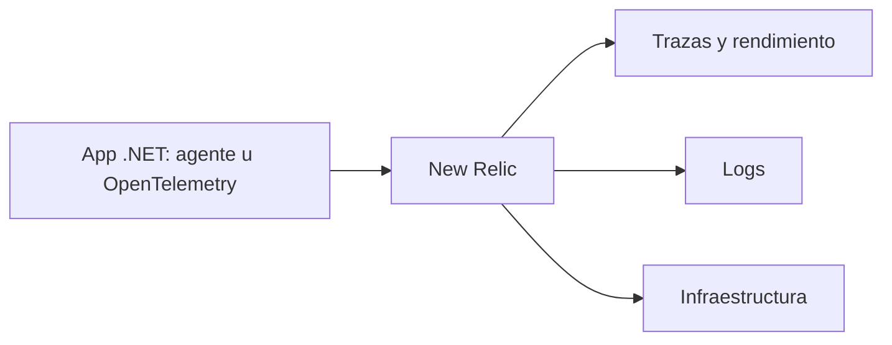

# New Relic - plan gratuito

Parte de: [[16-Laboratorios-Practica/07 Herramientas de pago con plan gratuito o prueba/_Índice Herramientas de pago con plan gratuito o prueba|Herramientas de pago con plan gratuito o prueba]]

> [!info] Cómo avanzar
> `progreso`: **pendiente** → **viendo** (estudiando) → **visto** (contestaste la autoevaluación sin abrir las respuestas) → **dominado** (hiciste el laboratorio o lo aplicaste de verdad).

## Contenido

### Qué es
New Relic es una plataforma de **observabilidad** (APM, logs, infraestructura, monitoreo de navegador y más) que destaca por tener un **plan gratuito permanente** relativamente generoso, pensado para que un desarrollador individual pueda usarla de verdad sin pagar. Es una buena opción para aprender APM sobre una app real.

### Qué ofrece

Según la información vigente (verificar en la página oficial): **100 GB de datos ingeridos al mes** gratis desde cualquier fuente (métricas, eventos, logs, trazas), **un usuario "full platform"** con acceso completo más usuarios básicos ilimitados, y una retención por defecto de al menos **8 días**. Es suficiente para instrumentar y observar una API personal.

### Para qué te sirve
Para **ver trazas y rendimiento de una app .NET** con su agente o con [[OpenTelemetry]], y aprender APM: encontrar endpoints lentos, errores, consultas pesadas y dependencias. Complementa tu [[_Índice Observabilidad]] con una herramienta comercial de uso gratuito continuo.

### Cómo empezar paso a paso
1. Crea una cuenta gratuita en New Relic.
2. Instala el **agente de .NET** o configura el exportador OTLP de OpenTelemetry con tu *license key* (como secreto).
3. Genera tráfico en tu API y espera a que aparezcan las trazas en APM.
4. Explora: transacciones lentas, tasa de errores, mapa de dependencias.
5. Crea una alerta simple (por ejemplo, error rate alto) y un dashboard.

### Qué cuidado tiene
El costo se basa en **datos ingeridos y usuarios**: si **pasas los 100 GB/mes** o agregas usuarios full, se cobra o se corta según tu configuración (verificar en la página oficial). Por eso **filtra lo que envías**: no mandes logs ruidosos ni datos sensibles, y controla el volumen para no superar la cuota gratuita ([[Logs y datos sensibles]]).

### Ejemplo
Instrumentas Itzamna.Dionisio con el agente de New Relic y, en el mapa de APM, ves que un endpoint de reportes llama muchas veces a la base (problema N+1). Ese hallazgo guía una optimización concreta, el tipo de valor práctico que buscas al aprender observabilidad.

### Cuándo usarlo y cuándo no
Úsalo para aprender APM con una plataforma comercial sin costo continuo y con buena cuota. Si prefieres el stack abierto (Prometheus/Loki/Tempo), [[Grafana Cloud - plan gratuito]]. Para conocer Datadog, su prueba. New Relic brilla por su plan gratuito de 100 GB que permite uso real sostenido.

### Errores comunes
- **Pasar los 100 GB sin notarlo.** Controla el volumen de ingesta.
- **Mandar logs con datos sensibles.** Fíltralos.
- **Dejar la license key en el repo.** Es un secreto.
- **Agregar usuarios full sin querer.** Solo uno es gratuito.

### Para profundizar
- [New Relic: plan gratuito](https://newrelic.com/pricing/free-tier)
- [Instrumentar .NET](https://docs.newrelic.com/docs/apm/agents/net-agent/)
- [OpenTelemetry con New Relic](https://docs.newrelic.com/docs/opentelemetry/)

## Autoevaluación

Contesta primero en voz alta o en papel; luego despliega la respuesta.

> [!question]- ¿Qué ofrece?
> Plataforma de observabilidad (APM, logs, infraestructura, navegador) con una cantidad mensual de datos ingeridos gratis y un usuario con acceso completo (verificar en la página oficial).

> [!question]- ¿Para qué te sirve?
> Para ver trazas y rendimiento de una app .NET con su agente o con OpenTelemetry y aprender APM.

> [!question]- ¿Qué cuidado tiene?
> El costo se basa en datos ingeridos y usuarios: si pasas la cuota, se cobra o se corta según tu configuración (verificar en la página oficial). Filtra lo que envías.

