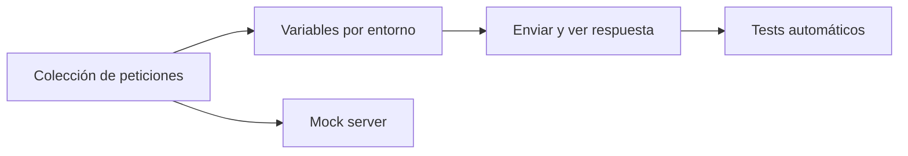

# Postman - plan gratuito

Parte de: [[16-Laboratorios-Practica/07 Herramientas de pago con plan gratuito o prueba/_Índice Herramientas de pago con plan gratuito o prueba|Herramientas de pago con plan gratuito o prueba]]

> [!info] Cómo avanzar
> `progreso`: **pendiente** → **viendo** (estudiando) → **visto** (contestaste la autoevaluación sin abrir las respuestas) → **dominado** (hiciste el laboratorio o lo aplicaste de verdad).

## Contenido

### Qué es
Postman es una herramienta para **probar y documentar APIs**: organiza peticiones en **colecciones**, maneja **variables por entorno** (dev, prod), permite escribir **pruebas automáticas** en JavaScript sobre las respuestas y crear **mocks** (servidores simulados). Es muy usada para explorar una API, compartir ejemplos y automatizar pruebas de endpoints.

### Para qué sirve


Probar tu API .NET endpoint por endpoint, guardar ejemplos reutilizables, validar respuestas con assertions y documentar el contrato para el equipo.

### Qué límites tiene el plan gratuito
El plan gratuito ha cambiado varias veces; en **marzo de 2026** Postman ajustó sus planes y el **Free quedó limitado a un solo usuario** (ya no permite crear un equipo ni invitar colaboradores). A cambio, operaciones antes limitadas como **ejecuciones de colecciones y uso de mocks** pasaron a ser **ilimitadas en todos los planes**. Para colaborar en equipo necesitas un plan de pago. Los detalles cambian seguido (verificar en la página oficial).

### Qué cuidado de seguridad hay
Las **colecciones y entornos se sincronizan a la nube de Postman**. El riesgo: guardar **tokens o contraseñas reales** como valores compartidos, o dejar un workspace **público** con secretos dentro. Dos medidas:

1. No guardes secretos reales como valores en el entorno sincronizado; usa variables locales o de tipo *secret*, y revisa que tus workspaces **no sean públicos**.
2. Para trabajo totalmente local sin nube, considera alternativas como **archivos `.http`** en VS Code (que ya usas en tu flujo) o **Bruno**, que guardan las peticiones en el propio repositorio.

### Cómo empezar paso a paso
1. Crea una cuenta y un workspace **privado**.
2. Crea una colección para tu API y un **entorno** con la URL base y un token como variable *secret*.
3. Agrega peticiones (GET, POST) usando `{{baseUrl}}` y `{{token}}`.
4. Escribe un test simple en la pestaña **Tests**.
5. Ejecuta la colección completa con el Collection Runner.

### Ejemplo
Un test que valida el código de estado y un campo de la respuesta:

```javascript
// Pestaña Tests de una petición en Postman
pm.test("Devuelve 201 y un id", function () {
  pm.response.to.have.status(201);
  const json = pm.response.json();
  pm.expect(json).to.have.property("id");
});
```

Para tu flujo, el equivalente local son archivos `.http` versionados junto al código de Itzamna.Dionisio.

### Cuándo usarlo y cuándo no
Úsalo para explorar APIs, compartir colecciones y automatizar pruebas de endpoints. Si prefieres que las peticiones vivan en el repo y sin nube, usa **`.http`** en VS Code o **Bruno**. Postman brilla en colaboración (ya de pago) y en su ecosistema de pruebas y documentación.

### Errores comunes
- **Guardar secretos reales sincronizados.** Pueden quedar en la nube o en un workspace público.
- **Workspace público sin querer.** Revisa la visibilidad.
- **Depender del equipo gratuito.** Desde 2026 el Free es de un solo usuario.
- **No usar entornos.** Mezclas URLs y tokens de dev y prod.

### Para profundizar
- [Postman](https://www.postman.com/)
- [Planes de Postman](https://learning.postman.com/docs/billing/about-plans/)
- [Bruno (alternativa local)](https://www.usebruno.com/)

## Autoevaluación

Contesta primero en voz alta o en papel; luego despliega la respuesta.

> [!question]- ¿Para qué sirve Postman?
> Para probar APIs: colecciones de peticiones, variables por entorno, pruebas automáticas y mocks.

> [!question]- ¿Qué límites tiene el plan gratuito?
> Límites en colaboración, ejecuciones de colecciones y mocks; las condiciones han cambiado varias veces (verificar en la página oficial).

> [!question]- ¿Qué cuidado de seguridad hay?
> Las colecciones y entornos se sincronizan a la nube de Postman: no guardes tokens o contraseñas reales como valores compartidos y revisa que tus workspaces no sean públicos. Alternativas locales: archivos `.http` en VS Code o Bruno.

