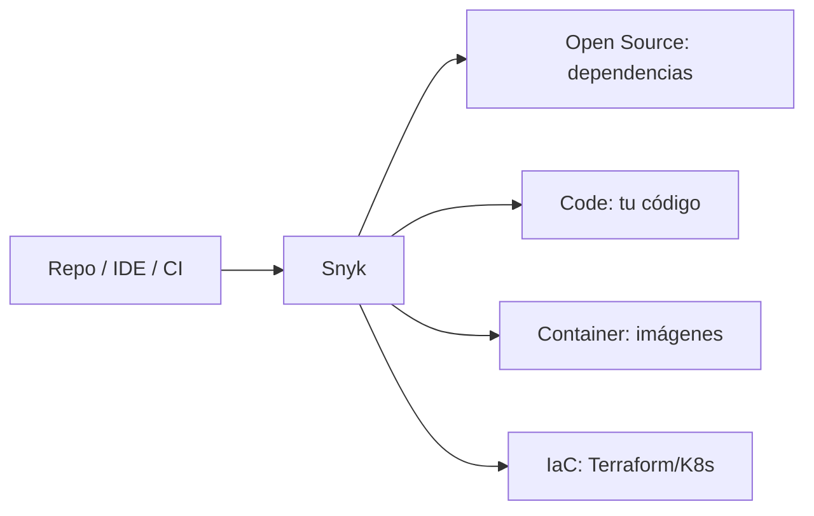

# Snyk - plan gratuito

Parte de: [[16-Laboratorios-Practica/07 Herramientas de pago con plan gratuito o prueba/_Índice Herramientas de pago con plan gratuito o prueba|Herramientas de pago con plan gratuito o prueba]]

> [!info] Cómo avanzar
> `progreso`: **pendiente** → **viendo** (estudiando) → **visto** (contestaste la autoevaluación sin abrir las respuestas) → **dominado** (hiciste el laboratorio o lo aplicaste de verdad).

## Contenido

### Qué es
Snyk es una plataforma de **seguridad para desarrolladores** que escanea tu proyecto en busca de vulnerabilidades y las integra en tu flujo (repositorio, IDE, pipeline). Cubre cuatro frentes: **SCA** (dependencias de código abierto), **SAST** (tu propio código, con Snyk Code), **contenedores** (imágenes Docker) e **infraestructura como código** (Terraform, Kubernetes). Tiene un plan gratuito pensado para desarrolladores individuales y proyectos pequeños.

### Qué ofrece Snyk

Detecta dependencias vulnerables (y sugiere a qué versión subir), fallas en tu código, imágenes base con CVE conocidos y malas configuraciones de infraestructura. Se conecta con GitHub, Azure DevOps y el IDE.

### Qué límites tiene el plan gratuito
Un **número mensual limitado de pruebas por producto**. Según la información vigente (verificar en la página oficial): alrededor de **200 pruebas** de Open Source, **100** de Code, **300** de IaC y **100** de Container al mes, con hasta ~5 proyectos. Suficiente para asegurar un proyecto personal o aprender; para uso de equipo se necesita plan de pago.

### Qué cuidado tiene
Dos cuidados:
1. **Revisa qué permisos le das sobre tus repos** al conectarlo (idealmente, solo los repositorios necesarios y con permisos mínimos).
2. **No apliques sus sugerencias de actualización a ciegas**: subir una dependencia de versión **mayor** para cerrar una vulnerabilidad puede **romper la app** por cambios incompatibles. Verifica con pruebas antes de fusionar el *fix*.

### Cómo empezar paso a paso
1. Crea una cuenta gratuita (puedes usar tu login de GitHub).
2. Conecta un repositorio o instala la extensión de Snyk en VS Code.
3. Deja que escanee y revisa los hallazgos ordenados por severidad.
4. Para cada dependencia vulnerable, mira la versión sugerida y **prueba** antes de subirla.
5. Opcional: agrega el escaneo a tu pipeline de CI.

### Ejemplo
Snyk detecta que un paquete NuGet de Itzamna.Dionisio tiene una vulnerabilidad conocida y sugiere subir a la siguiente versión. Antes de aceptar, corres las pruebas de integración para confirmar que el cambio no rompe nada. Esto conecta con [[Componentes y dependencias vulnerables]] y [[Escaneo de dependencias y de secretos]].

### Cuándo usarlo y cuándo no
Úsalo para asegurar las dependencias y el código de un proyecto personal, y para aprender SCA/SAST. Para análisis de calidad y cobertura más amplio, [[SonarCloud]]. Snyk destaca en seguridad de dependencias y en su integración con el IDE y el repo. Para equipos grandes, evalúa el plan de pago.

### Errores comunes
- **Aplicar fixes de versión mayor sin probar.** Pueden romper la app.
- **Darle acceso a todos tus repos.** Concede el mínimo necesario.
- **Agotar las pruebas del mes en ejecuciones repetidas.** Planifica los escaneos.
- **Ignorar los hallazgos de severidad alta.** Son los que más importan.

### Para profundizar
- [Snyk](https://snyk.io/)
- [Planes de Snyk](https://snyk.io/plans/)
- [Qué cuenta como una prueba](https://docs.snyk.io/working-with-snyk/what-counts-as-a-test)

## Autoevaluación

Contesta primero en voz alta o en papel; luego despliega la respuesta.

> [!question]- ¿Qué ofrece Snyk?
> Escaneo de dependencias (SCA), de código (SAST), de contenedores y de infraestructura como código, integrado con el repo y el IDE.

> [!question]- ¿Qué límites tiene el plan gratuito?
> Un número mensual limitado de pruebas por producto (verificar en la página oficial).

> [!question]- ¿Qué cuidado tiene?
> Revisar qué permisos le das sobre tus repos y no tomar sus sugerencias de actualización sin probar: subir de versión mayor puede romper la app.

