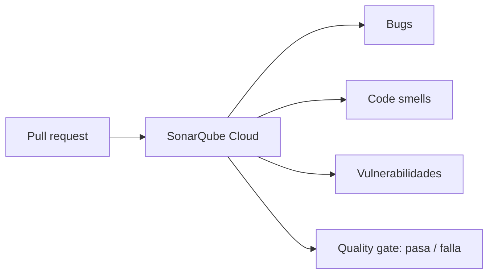

# SonarCloud

Parte de: [[16-Laboratorios-Practica/07 Herramientas de pago con plan gratuito o prueba/_Índice Herramientas de pago con plan gratuito o prueba|Herramientas de pago con plan gratuito o prueba]]

> [!info] Cómo avanzar
> `progreso`: **pendiente** → **viendo** (estudiando) → **visto** (contestaste la autoevaluación sin abrir las respuestas) → **dominado** (hiciste el laboratorio o lo aplicaste de verdad).

## Contenido

### Qué es
SonarCloud es el servicio en la nube de SonarSource para **análisis estático de código**: revisa tu proyecto en busca de **bugs**, **code smells** (malos olores de diseño), **vulnerabilidades** y mide la **cobertura** de pruebas, integrándose con GitHub, Azure DevOps, GitLab y Bitbucket. Desde el rebranding de SonarSource, ahora se llama **SonarQube Cloud**. Analiza cada pull request y te da un veredicto antes de fusionar.

### Qué ofrece gratis

Análisis **gratuito de proyectos públicos** (open source), y un plan gratuito con límites para **proyectos privados** (hasta **50,000 líneas de código**, sin tarjeta ni expiración, según la información vigente; verificar en la página oficial). Soporta muchos lenguajes, incluido **C#**, y se integra con tu pipeline.

### Qué es un quality gate
Un **quality gate** es un conjunto de **condiciones** que el análisis de un pull request debe cumplir para considerarse "aprobado". Por ejemplo: *sin vulnerabilidades nuevas*, *sin bugs nuevos* y *cobertura mínima en el código nuevo*. Si el PR no cumple, el quality gate **falla** y puedes configurar que eso **bloquee la fusión**. La filosofía de Sonar es *Clean as You Code*: se enfoca en el **código nuevo** de cada PR, no en toda la deuda histórica, para que mejores sin frenarte.

### Cómo empezar paso a paso
1. Entra con tu cuenta de GitHub o Azure DevOps a SonarQube Cloud.
2. Importa el repositorio del proyecto (público, o privado dentro del límite).
3. Configura el análisis en tu pipeline (hay tareas para Azure Pipelines y GitHub Actions).
4. Define o ajusta el **quality gate** (por ejemplo, cobertura mínima en código nuevo).
5. Abre un PR y revisa el reporte y el veredicto del gate.

### Ejemplo
En un pipeline de Azure DevOps para Itzamna.Dionisio, agregas las tareas de preparación, build con cobertura y análisis de SonarQube Cloud. Si el PR introduce una vulnerabilidad o baja la cobertura del código nuevo bajo el umbral, el quality gate falla y el PR se marca como no apto hasta corregirlo. Conecta con [[Análisis estático (SonarQube y linters)]].

### Cuándo usarlo y cuándo no
Úsalo para mantener calidad y seguridad del código de forma continua, sobre todo en proyectos públicos (gratis) o privados pequeños. Para seguridad de **dependencias** específicamente, [[Snyk - plan gratuito]]. Para proyectos privados grandes, revisa el límite de líneas o considera SonarQube autoalojado (Community Edition).

### Errores comunes
- **Analizar todo el histórico y abrumarse.** El enfoque es el código nuevo (Clean as You Code).
- **Pasar el límite de líneas en privado.** El plan gratuito tiene tope; revisa antes.
- **Ignorar el quality gate.** Si no bloquea la fusión, se vuelve decorativo.
- **No medir cobertura.** Sin ella, el gate no puede exigir pruebas en código nuevo.

### Para profundizar
- [SonarQube Cloud](https://www.sonarsource.com/products/sonarcloud/)
- [Quality gates (documentación)](https://docs.sonarsource.com/sonarqube-cloud/)
- [Clean as You Code](https://www.sonarsource.com/solutions/clean-as-you-code/)

## Autoevaluación

Contesta primero en voz alta o en papel; luego despliega la respuesta.

> [!question]- ¿Qué es SonarCloud?
> El servicio en la nube de SonarSource para análisis estático (calidad, bugs, code smells, vulnerabilidades y cobertura) integrado con GitHub, Azure DevOps y otros. Ahora se llama SonarQube Cloud.

> [!question]- ¿Qué ofrece gratis?
> Análisis de proyectos públicos y un plan gratuito con límites para privados (verificar en la página oficial).

> [!question]- ¿Qué es un quality gate?
> Un conjunto de condiciones (por ejemplo, sin vulnerabilidades nuevas y cobertura mínima en código nuevo) que hace fallar el análisis de un pull request si no se cumplen.

