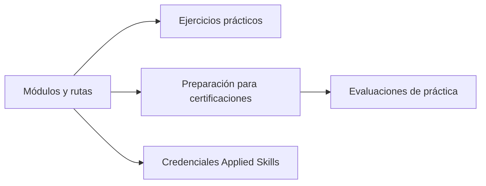

# Microsoft Learn - rutas gratuitas de Azure

Parte de: [[16-Laboratorios-Practica/08 Práctica de otras áreas/_Índice Práctica de otras áreas|Práctica de otras áreas]]

> [!info] Cómo avanzar
> `progreso`: **pendiente** → **viendo** (estudiando) → **visto** (contestaste la autoevaluación sin abrir las respuestas) → **dominado** (hiciste el laboratorio o lo aplicaste de verdad).

## Contenido

### Qué es
Microsoft Learn es la plataforma oficial y **gratuita** de capacitación de Microsoft. Ofrece **módulos** y **rutas de aprendizaje** (learning paths) con teoría, ejercicios prácticos y evaluaciones, además de colecciones de preparación para certificaciones y credenciales **Applied Skills**. Para un desarrollador .NET que trabaja con Azure, es el recurso central para aprender y prepararse a exámenes sin costo.

### Qué ofrece Microsoft Learn

Rutas gratuitas sobre Azure (fundamentos, desarrollo, DevOps, IA), ejercicios guiados, **evaluaciones de práctica** para certificaciones y **Applied Skills** (credenciales basadas en hacer tareas reales, no solo responder preguntas). Todo el contenido de aprendizaje es gratuito.

### Qué es el sandbox de Learn (importante)
El **sandbox de Learn** era una **suscripción temporal de Azure** que se creaba para ciertos ejercicios, **sin tarjeta**, y se destruía sola al terminar el tiempo. **Atención: los sandboxes ya se retiraron.** Microsoft confirma en su FAQ que **"los sandboxes ya no están disponibles"**: para completar los ejercicios de los módulos ahora necesitas tu **propia suscripción de Azure** (una **cuenta gratuita de 30 días** con crédito, o una de pago por uso). Por eso, esta nota lo marca explícitamente: no esperes el botón de "Activar sandbox"; sigue la guía de "usar tu propia suscripción".

### Qué cuidado tiene
Como los ejercicios corren en **tu suscripción**, ahí **sí puede haber costos** si creas recursos de pago. Cuidados:
- Usa la **cuenta gratuita de Azure** (200 USD por 30 días + servicios gratis 12 meses + servicios siempre gratis) y pon **presupuesto con alerta** ([[Cómo evitar cobros inesperados en la nube (presupuestos y alertas)]]).
- **Borra el grupo de recursos** al terminar cada ejercicio para no dejar nada encendido.
- Revisa en qué región creas recursos.

### Cómo empezar paso a paso
1. Entra a Microsoft Learn con tu cuenta Microsoft.
2. Elige una ruta (por ejemplo, la de preparación de una certificación de Azure Developer).
3. Para los ejercicios, crea una **cuenta gratuita de Azure** y configura un presupuesto el día uno.
4. Sigue el ejercicio en tu suscripción; al terminar, **borra el grupo de recursos**.
5. Haz las **evaluaciones de práctica** antes del examen real.

### Ejemplo
Para preparar una certificación de desarrollador en Azure, combinas los módulos de Learn (gratis) con ejercicios en tu cuenta gratuita: despliegas una App Service o una Function, la pruebas y luego borras su grupo de recursos. Conecta con tu área de certificaciones (por ejemplo la sucesora de [[AZ-204 Azure Developer Associate (retirado el 31 de julio de 2026)]]).

### Cuándo usarlo y cuándo no
Úsalo como recurso principal para aprender Azure y preparar sus certificaciones: es oficial, gratuito y actualizado. Para práctica libre de nube con recursos temporales ajenos a tu cuenta, [[Google Cloud Skills Boost (laboratorios con credenciales temporales)]] (en Google) sigue ofreciendo credenciales efímeras. Para Azure, ahora la práctica va sobre tu propia suscripción.

### Errores comunes
- **Buscar el sandbox retirado.** Ya no existe; usa tu suscripción.
- **No poner presupuesto en tu cuenta.** Los ejercicios en tu suscripción pueden costar.
- **Olvidar borrar el grupo de recursos.** Deja recursos encendidos cobrando.
- **Saltarse las evaluaciones de práctica.** Son el mejor termómetro antes del examen.

### Para profundizar
- [Microsoft Learn](https://learn.microsoft.com/training/)
- [FAQ: los sandboxes ya no están disponibles](https://learn.microsoft.com/training/support/faq?pivots=sandbox)
- [Ejecutar ejercicios en tu propia suscripción](https://learn.microsoft.com/training/support/use-your-own-subscription)

## Autoevaluación

Contesta primero en voz alta o en papel; luego despliega la respuesta.

> [!question]- ¿Qué ofrece Microsoft Learn?
> Rutas y módulos gratuitos con ejercicios, colecciones de preparación para certificaciones, evaluaciones de práctica y credenciales Applied Skills (verificar en la página oficial).

> [!question]- ¿Qué es el sandbox de Learn?
> Era una suscripción temporal de Azure que se creaba para ciertos ejercicios, sin tarjeta, y se destruía sola al terminar el tiempo. **Ya se retiró**: Microsoft Learn indica que los sandboxes ya no están disponibles y que los ejercicios se hacen en tu propia suscripción (cuenta gratuita de 30 días o pago por uso).

> [!question]- ¿Qué cuidado tiene?
> Como ya no hay sandbox, todos los ejercicios corren en tu suscripción y ahí sí puede haber costos. Usa la cuenta gratuita (o Azure for Students / créditos de Visual Studio), pon presupuesto con alerta el primer día, trabaja en un grupo de recursos desechable y bórralo al terminar cada ejercicio.

