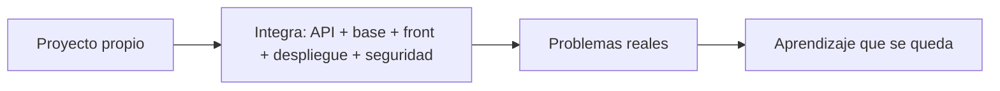

# Proyectos propios como laboratorio de aprendizaje

Parte de: [[16-Laboratorios-Practica/08 Práctica de otras áreas/_Índice Práctica de otras áreas|Práctica de otras áreas]]

> [!info] Cómo avanzar
> `progreso`: **pendiente** → **viendo** (estudiando) → **visto** (contestaste la autoevaluación sin abrir las respuestas) → **dominado** (hiciste el laboratorio o lo aplicaste de verdad).

## Contenido

### Qué es
Es la idea de usar tus **propios proyectos** (un side project, una app para tu equipo de fotografía, una herramienta personal) como el mejor laboratorio para aprender. A diferencia de un ejercicio aislado, un proyecto real te obliga a **integrar** muchos temas a la vez y a resolver problemas que los tutoriales no muestran. Es donde el conocimiento de la bóveda se vuelve habilidad.

### Por qué un proyecto propio es buen laboratorio

Te obliga a **integrar temas** (API, base de datos, front, despliegue, seguridad, observabilidad) y a enfrentar problemas reales: un despliegue que falla, una migración que rompe datos, un secreto que no debía estar en el repo. Esa fricción es justo lo que un ejercicio de libro no da, y lo que de verdad enseña.

### Cómo lo conviertes en aprendizaje medible
No basta con "hacer un proyecto". Hazlo medible:

1. **Define qué notas de la bóveda** vas a llevar a `dominado` con ese proyecto (por ejemplo: [[Dapper]], [[JWT y autenticación con Bearer]], despliegue en [[Render]]).
2. **Crea un laboratorio por cada tema** que apliques, con criterios de terminado verificables.
3. Lleva **bitácora** del avance y de los problemas resueltos ([[Cómo llevar una bitácora de laboratorios resueltos]]).
4. Al cerrar cada tema aplicado, actualiza su `progreso` a `dominado`.

### Qué cuidados tener
- **Alcance pequeño** para terminarlo: un proyecto enorme se abandona. Define un MVP y crécelo.
- **Secretos fuera del repo desde el inicio** ([[Secretos en repositorios]]): no esperes a "limpiarlo después".
- **Presupuesto y alertas** si lo despliegas en la nube ([[Cómo evitar cobros inesperados en la nube (presupuestos y alertas)]]).

### Cómo empezar paso a paso
1. Elige un proyecto útil y de alcance acotado (algo que de verdad usarías).
2. Lista los temas de la bóveda que quieres practicar con él.
3. Para cada tema, define un pequeño lab con criterios de terminado.
4. Versiona en Git desde el commit uno, con los secretos fuera del repo.
5. Despliégalo en una plataforma gratuita ([[Render]], [[Vercel]], [[Oracle Cloud - Always Free]]) con presupuesto si aplica.

### Ejemplo
Una app para organizar tus grabaciones del DJI Osmo Pocket 4P: API .NET con Dapper (practicas [[Dapper]] y SQL en archivos), front React + Vite (practicas [[React Router]]), login con JWT (practicas [[JWT y autenticación con Bearer]]) y despliegue en Render (practicas despliegue). Cada parte lleva una o varias notas a `dominado`.

### Cuándo usarlo y cuándo no
Úsalo como el laboratorio integrador por excelencia, sobre todo cuando ya tienes bases de varios temas y quieres unirlos. Para aprender un concepto aislado desde cero, un ejercicio dirigido (una room de [[TryHackMe]], un lab de la bóveda) es más eficiente. El proyecto propio brilla al **integrar**.

### Errores comunes
- **Alcance gigante.** Se abandona; empieza con un MVP.
- **Dejar la seguridad "para después".** Secretos fuera del repo desde el inicio.
- **No medir el aprendizaje.** Sin notas asociadas, es solo tiempo invertido.
- **Desplegar sin presupuesto.** Riesgo de cobros en la nube.

### Para profundizar
- [The Twelve-Factor App (buenas prácticas para apps desplegables)](https://12factor.net/es/)
- [GitHub: cómo ignorar archivos (.gitignore)](https://docs.github.com/get-started/getting-started-with-git/ignoring-files)

## Autoevaluación

Contesta primero en voz alta o en papel; luego despliega la respuesta.

> [!question]- ¿Por qué un proyecto propio es buen laboratorio?
> Te obliga a integrar temas (API, base, front, despliegue, seguridad) y a enfrentar problemas reales que un ejercicio aislado no muestra.

> [!question]- ¿Cómo lo conviertes en aprendizaje medible?
> Define qué notas de la bóveda vas a llevar a `dominado` con ese proyecto y crea un laboratorio por cada tema que apliques.

> [!question]- ¿Qué cuidados tener?
> Alcance pequeño para terminarlo, secretos fuera del repo desde el inicio, presupuesto y alertas si lo despliegas en la nube.

