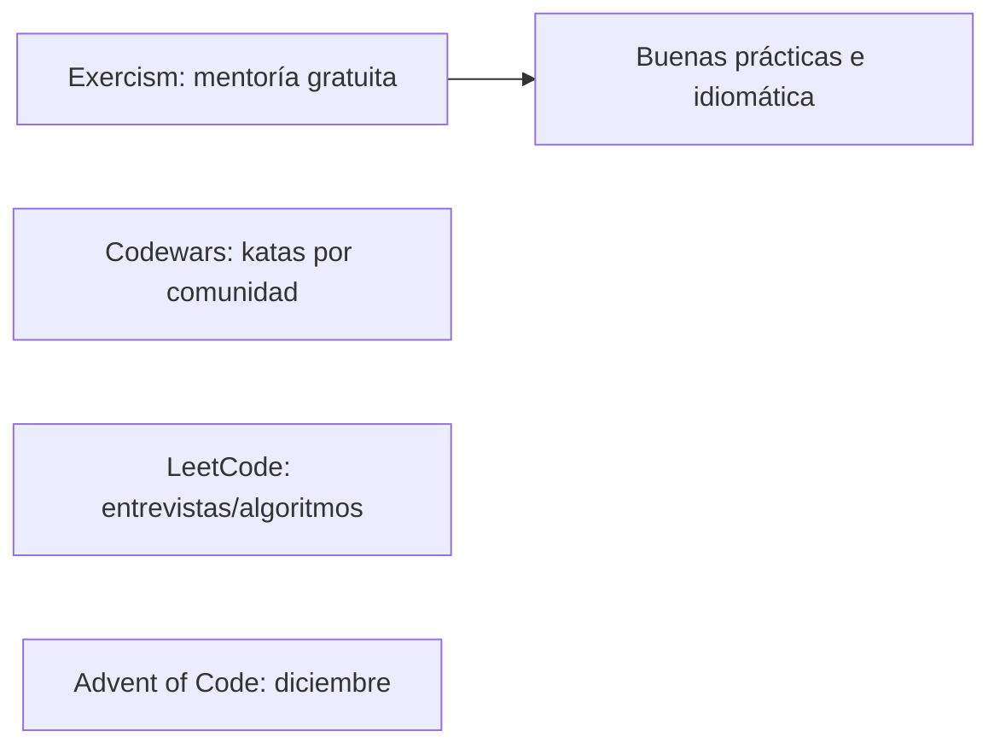

# Retos de JavaScript y CSharp (plataformas de práctica)

Parte de: [[16-Laboratorios-Practica/08 Práctica de otras áreas/_Índice Práctica de otras áreas|Práctica de otras áreas]]

> [!info] Cómo avanzar
> `progreso`: **pendiente** → **viendo** (estudiando) → **visto** (contestaste la autoevaluación sin abrir las respuestas) → **dominado** (hiciste el laboratorio o lo aplicaste de verdad).

## Contenido

### Qué es
Son plataformas en línea donde resuelves **ejercicios de programación** (katas, retos algorítmicos) para practicar un lenguaje, repasar estructuras de datos o preparar entrevistas. Para ti, las útiles son las que soportan **C#** y **JavaScript**. No sustituyen un proyecto real, pero afilan la soltura con el lenguaje y la lógica.

### Qué plataformas puedes usar

- **Exercism**: tracks de C# y JavaScript con **mentoría gratuita** (una persona revisa tu solución).
- **Codewars**: katas creadas por la comunidad, con muchas soluciones para comparar.
- **LeetCode**: enfocado en algoritmos y preparación de entrevistas.
- **Advent of Code**: un reto diario cada **diciembre**, excelente para practicar en el lenguaje que elijas.

### Cuál conviene para aprender buenas prácticas
**Exercism**, porque un **mentor revisa tu solución** y comenta estilo e idiomática del lenguaje (cómo se escribe "a la C#" o "a la JavaScript", no solo si pasa las pruebas). Esa retroalimentación sobre *cómo* resolviste, y no solo *si* resolviste, es lo que más mejora tu código. Codewars ayuda a comparar enfoques; LeetCode, a algoritmos de entrevista.

### Qué cuidado hay
No obsesionarse con la **solución más corta o más "lista"**: en el trabajo real importa la **legibilidad** y el mantenimiento, no exprimir una línea. Compara soluciones por claridad, no por brevedad. Y si participas en **Advent of Code**, revisa sus reglas sobre **compartir las entradas** (inputs) y sobre el uso de IA en la tabla de líderes (leaderboard), que están reguladas.

### Cómo empezar paso a paso
1. Crea cuenta en **Exercism** y elige el track de C# (o JavaScript).
2. Resuelve los primeros ejercicios y **solicita mentoría** en los que quieras retroalimentación.
3. Aplica los comentarios del mentor y vuelve a enviar.
4. Para algoritmos de entrevista, complementa con LeetCode (empieza por "Easy").
5. En diciembre, intenta Advent of Code en C# para practicar de forma lúdica.

### Ejemplo
Resuelves un kata de manipulación de cadenas en C#. Tu primera versión funciona pero usa un bucle largo; el mentor de Exercism te sugiere LINQ. Reescribes con `Where`/`Select` y entiendes por qué es más idiomático. Ese aprendizaje se traslada directo a tu código en Itzamna.Dionisio.

### Cuándo usarlo y cuándo no
Úsalo para afinar el lenguaje, repasar estructuras de datos y preparar entrevistas. Para aprender a **construir sistemas** (integración, despliegue, seguridad), un [[Proyectos propios como laboratorio de aprendizaje]] rinde más. Combina ambos: katas para el lenguaje, proyectos para la ingeniería.

### Errores comunes
- **Buscar la solución más corta.** Prioriza legibilidad.
- **No pedir mentoría en Exercism.** Es su mayor ventaja gratuita.
- **Copiar soluciones sin entenderlas.** No afianza nada.
- **Compartir inputs de Advent of Code.** Va contra sus reglas.

Un apunte sobre constancia: es mejor un reto diario corto que una maratón ocasional. Lleva un registro simple (qué resolviste, qué patrón practicaste) y, cada cierto tiempo, vuelve a un reto que te costó para ver si ahora lo resuelves con más soltura. Esa repetición espaciada fija el lenguaje mucho más que acumular ejercicios nuevos.

### Para profundizar
- [Exercism (tracks de C# y JavaScript)](https://exercism.org/)
- [Advent of Code](https://adventofcode.com/)
- [Codewars](https://www.codewars.com/)

## Autoevaluación

Contesta primero en voz alta o en papel; luego despliega la respuesta.

> [!question]- ¿Qué plataformas puedes usar?
> Exercism (con mentoría gratuita en sus tracks de C# y JavaScript), Codewars, LeetCode y Advent of Code (cada diciembre).

> [!question]- ¿Cuál conviene para aprender buenas prácticas?
> Exercism, porque un mentor revisa tu solución y comenta estilo e idiomática del lenguaje.

> [!question]- ¿Qué cuidado hay?
> No obsesionarse con la solución más corta: compara soluciones por legibilidad. Revisa las reglas de Advent of Code sobre compartir entradas y usar IA en la tabla de líderes.

