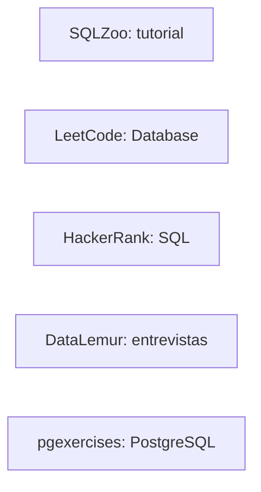

# Retos de SQL (plataformas de práctica)

Parte de: [[16-Laboratorios-Practica/08 Práctica de otras áreas/_Índice Práctica de otras áreas|Práctica de otras áreas]]

> [!info] Cómo avanzar
> `progreso`: **pendiente** → **viendo** (estudiando) → **visto** (contestaste la autoevaluación sin abrir las respuestas) → **dominado** (hiciste el laboratorio o lo aplicaste de verdad).

## Contenido

### Qué es
Son plataformas en línea con **ejercicios de SQL**: consultas sobre bases de ejemplo, de dificultad creciente, para practicar `SELECT`, `JOIN`, agregaciones, subconsultas, CTEs y funciones de ventana. Muy útiles para alguien que trabaja a diario con SQL Server y quiere afilar consultas o preparar entrevistas.

### Qué plataformas puedes usar


- **SQLZoo**: tutorial interactivo, bueno para empezar.
- **LeetCode (sección Database)** y **HackerRank (SQL)**: retos tipo entrevista.
- **DataLemur**: enfocado en preguntas de entrevistas de datos.
- **pgexercises**: ejercicios sobre PostgreSQL, muy didáctico.

### Qué cuidado tiene practicar ahí si trabajas con SQL Server
La mayoría de estas plataformas usan **MySQL o PostgreSQL**, y la **sintaxis cambia** respecto a **T-SQL** (SQL Server). Diferencias que te morderán:

- Limitar filas: `LIMIT n` (MySQL/Postgres) vs **`TOP n`** o `OFFSET ... FETCH` (T-SQL).
- Funciones de fecha y de texto distintas (`NOW()` vs `GETDATE()`, concatenación, etc.).
- Comillas de identificadores y algunas funciones de ventana con matices.

Cuando la plataforma lo permita, **elige T-SQL / SQL Server**; si no, resuelve en el dialecto disponible y **traduce** la solución a T-SQL mentalmente.

### Cómo sacarles más provecho
Después de resolver un reto, **reprodúcelo en SQL Server** con datos parecidos y revisa el **plan de ejecución**: así ves cómo se comporta tu consulta en tu motor real. Anota el **patrón** que practicaste (funciones de ventana, CTEs, agregaciones condicionales) para reconocerlo luego en el trabajo. Conecta con [[Funciones de ventana]] y con tu práctica en [[Lab 3 - CTE y funciones de ventana en Tienda]].

### Cómo empezar paso a paso
1. Empieza por **SQLZoo** para repasar lo básico de forma guiada.
2. Pasa a **HackerRank/LeetCode** para retos tipo entrevista.
3. Elige el dialecto más cercano (o T-SQL si está disponible).
4. Resuelve, y luego **reescribe la consulta en SQL Server** y mira el plan de ejecución.
5. Anota el patrón y, si aplica, crea un mini-lab en tu base local.

### Ejemplo
Un reto pide el "top 3 de clientes por ventas". En PostgreSQL usarías `LIMIT 3`; en T-SQL sería:

```sql
-- Equivalente en T-SQL: TOP en vez de LIMIT
SELECT TOP (3) ClienteId, SUM(Total) AS Ventas
FROM   Pedidos
GROUP  BY ClienteId
ORDER  BY Ventas DESC;
```

Traducir cada solución así es parte del ejercicio y te mantiene fluido en el dialecto que usas en el trabajo.

### Cuándo usarlo y cuándo no
Úsalo para afinar SQL y preparar entrevistas de datos. Para practicar sobre **tu** esquema y tus procedimientos, monta una base local con SQL Server Developer/Express y resuelve problemas reales. Las plataformas dan variedad; tu base local da realismo.

### Errores comunes
- **Olvidar que el dialecto cambia.** `LIMIT` no existe en T-SQL.
- **No revisar el plan de ejecución.** Pierdes la lección de rendimiento.
- **Memorizar soluciones.** Entiende el patrón, no la respuesta exacta.
- **No traducir a T-SQL.** Te oxidas en el dialecto que usas a diario.

### Para profundizar
- [SQLZoo](https://sqlzoo.net/)
- [pgexercises](https://pgexercises.com/)
- [Documentación de T-SQL (Microsoft Learn)](https://learn.microsoft.com/sql/t-sql/language-reference)

## Autoevaluación

Contesta primero en voz alta o en papel; luego despliega la respuesta.

> [!question]- ¿Qué plataformas puedes usar?
> SQLZoo, LeetCode (sección Database), HackerRank (SQL), DataLemur y pgexercises (PostgreSQL), entre otras.

> [!question]- ¿Qué cuidado tiene practicar ahí si trabajas con SQL Server?
> Muchas usan MySQL o PostgreSQL: la sintaxis cambia (`LIMIT` vs `TOP`/`OFFSET FETCH`, funciones de fechas). Elige T-SQL cuando la plataforma lo permita o traduce la solución.

> [!question]- ¿Cómo sacarles más provecho?
> Después de resolver, revisar el plan de ejecución en SQL Server con los mismos datos y anotar el patrón (ventanas, CTEs, agregaciones condicionales).

