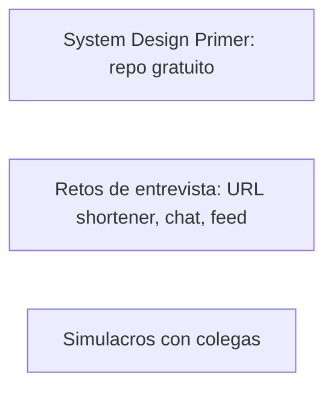

# Retos de diseño de sistemas

Parte de: [[16-Laboratorios-Practica/08 Práctica de otras áreas/_Índice Práctica de otras áreas|Práctica de otras áreas]]

> [!info] Cómo avanzar
> `progreso`: **pendiente** → **viendo** (estudiando) → **visto** (contestaste la autoevaluación sin abrir las respuestas) → **dominado** (hiciste el laboratorio o lo aplicaste de verdad).

## Contenido

### Qué es
El **diseño de sistemas** (system design) es la disciplina de proponer la arquitectura de un sistema grande a partir de requisitos: qué componentes hay, cómo se comunican, dónde se guardan los datos y cómo se escala. Practicarlo con **retos** (diseñar un acortador de URLs, un chat, un feed) es clave para entrevistas de nivel senior y para pensar mejor tus propios sistemas.

### Dónde practicar diseño de sistemas

- **System Design Primer**: un repositorio gratuito en GitHub con teoría, ejemplos y ejercicios resueltos; es el recurso de referencia.
- **Retos de entrevista**: diseñar sistemas clásicos (acortador de URLs, chat, timeline, almacenamiento de archivos).
- **Simulacros con colegas**: explicar tu diseño en voz alta a otra persona, que es como es la entrevista real.

### Cómo se practica un reto
Un método ordenado para no perderte:

1. **Aclara requisitos** funcionales (qué hace) y no funcionales (cuántos usuarios, latencia, disponibilidad).
2. **Estima la carga**: peticiones por segundo, almacenamiento, ancho de banda (ver [[Estimaciones rápidas (carga, almacenamiento y costo)]]).
3. **Dibuja los componentes**: clientes, balanceador, servicios, base de datos, caché, colas.
4. **Elige el almacenamiento** y justifícalo (SQL vs NoSQL, por qué).
5. **Identifica cuellos de botella** y discute **trade-offs** (consistencia vs disponibilidad, costo vs latencia).

### Qué error común hay
Saltar **directo a tecnologías** ("uso Kafka, Redis y Cassandra") **sin aclarar requisitos ni números**. En una entrevista (y en la vida real) el valor no está en nombrar herramientas, sino en **justificar las decisiones**: por qué esa base, por qué una caché aquí, qué pasa si se cae un componente. Primero requisitos y estimaciones; la tecnología viene después y debe seguirse de ellos.

### Cómo empezar paso a paso
1. Lee las secciones iniciales del **System Design Primer**.
2. Elige un reto clásico (empieza por el **acortador de URLs**; ver [[Caso - acortador de URLs]]).
3. Sigue el método: requisitos → estimación → componentes → almacenamiento → cuellos de botella.
4. Dibuja el diagrama (en papel o con una herramienta) y escribe los trade-offs.
5. Explícaselo a un colega o grábate; pulir la comunicación es parte del ejercicio.

### Ejemplo
Para un acortador de URLs, el flujo mental: requisitos (generar código corto, redirigir, millones de lecturas); estimación (ratio lecturas/escrituras alto); componentes (API, base clave-valor, caché para los más usados); almacenamiento (una base rápida de lecturas); cuellos de botella (la redirección debe ser muy rápida, de ahí la caché). Conecta con tu área de [[_Índice Diseño de sistemas]].

### Cuándo usarlo y cuándo no
Úsalo para prepararte a entrevistas de senior y para razonar mejor tus arquitecturas. Para practicar **implementación** (código, despliegue), un [[Proyectos propios como laboratorio de aprendizaje]]. El diseño de sistemas es sobre todo razonamiento y comunicación; practícalo explicando, no solo leyendo.

### Errores comunes
- **Nombrar tecnologías sin justificar.** El valor está en el porqué.
- **Saltarse las estimaciones.** Sin números, el diseño es arbitrario.
- **Olvidar los requisitos no funcionales.** Latencia y disponibilidad definen la arquitectura.
- **No practicar en voz alta.** La entrevista es comunicación, no solo diagrama.

### Para profundizar
- [The System Design Primer (GitHub)](https://github.com/donnemartin/system-design-primer)
- [Microsoft Azure Architecture Center](https://learn.microsoft.com/azure/architecture/)

## Autoevaluación

Contesta primero en voz alta o en papel; luego despliega la respuesta.

> [!question]- ¿Dónde practicar diseño de sistemas?
> El repositorio gratuito System Design Primer en GitHub, ejercicios de entrevistas (diseñar un acortador de URLs, un chat, un feed) y simulacros con colegas.

> [!question]- ¿Cómo se practica un reto?
> Aclarar requisitos funcionales y no funcionales, estimar carga, dibujar componentes, elegir almacenamiento, identificar cuellos de botella y discutir trade-offs.

> [!question]- ¿Qué error común hay?
> Saltar directo a tecnologías ("uso Kafka") sin aclarar requisitos ni números. El valor está en justificar las decisiones.

