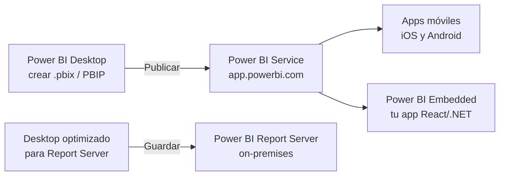

# Ecosistema de Power BI (Desktop, Service, Mobile, Report Server y Embedded)

Parte de: [[17-Power-BI/01 Fundamentos/_Índice Fundamentos|Fundamentos]]

> [!info] Cómo avanzar
> `progreso`: **pendiente** → **viendo** (estudiando) → **visto** (contestaste la autoevaluación sin abrir las respuestas) → **dominado** (hiciste el laboratorio o lo aplicaste de verdad).

## Contenido

### Qué es
Power BI no es un solo programa sino una familia de piezas que cubren el ciclo completo: **crear** el informe, **publicarlo y compartirlo**, **consumirlo** en cualquier dispositivo y, si hace falta, **incrustarlo** en tu propia aplicación o **alojarlo en tus servidores**. Entender qué hace cada pieza evita errores de diseño, como prometer un informe "en la intranet sin nube" cuando el cliente solo tiene licencias para el Service.

### Cómo funciona

- **Power BI Desktop**: aplicación gratuita para Windows donde te conectas a datos, transformas con Power Query, modelas y escribes DAX, y diseñas el informe. Produce archivos `.pbix` o proyectos `.pbip`. Es la herramienta del autor.
- **Power BI Service** (`app.powerbi.com`): el servicio en la nube (SaaS, hoy dentro de Microsoft Fabric). Ahí viven las áreas de trabajo, los modelos semánticos publicados, las actualizaciones programadas, las aplicaciones, los paneles, las suscripciones y la seguridad. Es donde se **comparte y gobierna**.
- **Power BI Mobile**: apps para **iOS** (iPhone, iPad, incluso Apple Watch) y **Android** para consumir informes y paneles, con diseños móviles si el autor los preparó. La app para Windows se retiró el 31 de diciembre de 2023; en Windows se usa el navegador.
- **Power BI Report Server**: servidor **local** (on-premises), superconjunto de SQL Server Reporting Services, que publica informes de Power BI e informes paginados (`.rdl`) dentro de tu red. Usa una versión específica de Desktop "optimizada para Report Server", con menos funciones que el Service (no hay paneles, aplicaciones ni muchas novedades de la nube).
- **Power BI Embedded**: la capacidad de incrustar informes en una aplicación propia usando el API REST y el cliente JavaScript. Hay dos escenarios: *embed for your organization* (el usuario inicia sesión con su cuenta de Entra ID y necesita licencia según la capacidad) y *embed for your customers* (la aplicación es dueña de los datos, autentica con una entidad de servicio y los usuarios finales no requieren licencia de Power BI). Requiere una capacidad (SKU A de Azure o F de Fabric, entre otras).

### Ejemplo
Para Itzamna.Clio (front en React) quieres mostrar a tus clientes un tablero de ventas sin que tengan cuenta de Microsoft:

1. Diseñas el informe en **Desktop** con datos de SQL Server.
2. Lo publicas al **Service** en un área de trabajo asignada a una capacidad.
3. Tu API .NET obtiene un *embed token* con una entidad de servicio y aplica RLS por cliente.
4. React lo pinta con `powerbi-client-react`. Eso es **Embedded**, escenario *app owns data*.

Si, en cambio, el cliente es un hospital que por normativa no puede sacar datos de su red, la opción sería **Report Server**, y el modelo de licencias cambia por completo.

### Cuándo usarlo y cuándo no
- **Service**: opción por defecto para colaborar, programar actualizaciones y distribuir con apps.
- **Report Server**: solo cuando hay una restricción real de nube. Su licencia viene con SQL Server Enterprise con Software Assurance (versiones anteriores a 2025), con licencias por núcleo de SQL Server 2025, con capacidades P de Premium o con instancias reservadas de Fabric F64 o mayores; publicar informes de Power BI ahí requiere Pro. Confirma con tu distribuidor antes de comprometerte.
- **Embedded**: cuando el informe debe vivir dentro de tu producto. Si solo es para empleados, compartir desde el Service o incrustar en Teams/SharePoint suele bastar.
- **Mobile**: para consumo; no se crean informes desde el teléfono.

### Errores comunes
- **Pensar que Desktop es para compartir.** Mandar el `.pbix` por correo duplica datos, pierde la seguridad y nadie sabe cuál es la versión buena. Publica al Service.
- **Usar el Desktop normal para Report Server.** Los archivos no son compatibles; hay que instalar la edición para Report Server, que tiene su propio ciclo de versiones.
- **Esperar en Report Server todo lo del Service** (Copilot, paneles, apps, dataflows). No existe allí.
- **Elegir Embedded "para ahorrar licencias" sin calcular la capacidad.** El costo se mueve a la capacidad; haz números.

### Para profundizar
- [Comparación de Power BI Desktop y el servicio Power BI](https://learn.microsoft.com/es-mx/power-bi/fundamentals/service-service-vs-desktop)
- [¿Qué es Power BI Report Server?](https://learn.microsoft.com/es-mx/power-bi/report-server/get-started)
- [Aplicaciones móviles de Power BI](https://learn.microsoft.com/es-mx/power-bi/consumer/mobile/mobile-apps-for-mobile-devices)
- [Capacidad y SKU en Power BI Embedded](https://learn.microsoft.com/es-mx/power-bi/developer/embedded/embedded-capacity)

Relacionado: [[Licencias de Power BI (Free, Pro, Premium por usuario y capacidades)]], [[Power BI Embedded (incrustar en una aplicación React o .NET)]], [[Informes paginados (Report Builder)]].

## Autoevaluación

Contesta primero en voz alta o en papel; luego despliega la respuesta.

> [!question]- ¿Para qué sirve cada pieza: Desktop, Service y Mobile?
> **Desktop**: app de Windows gratuita para conectar, transformar, modelar y diseñar informes (.pbix/.pbip). **Service** (app.powerbi.com): publicar, compartir, programar actualizaciones, apps y permisos. **Mobile**: consumir informes y paneles en el teléfono.

> [!question]- ¿Cuándo se usa Power BI Report Server en vez del Service?
> Cuando la organización necesita publicar informes **en sus propios servidores** (on-premises) por requisitos de nube o regulación. Tiene su propia versión de Desktop y menos funciones que el Service.

> [!question]- ¿Qué es Power BI Embedded?
> Incrustar informes de Power BI dentro de una aplicación propia (web, .NET, React) usando la API REST y el cliente JavaScript, normalmente con capacidad dedicada. Los detalles de capacidad/licencia: (verificar en la página oficial).

