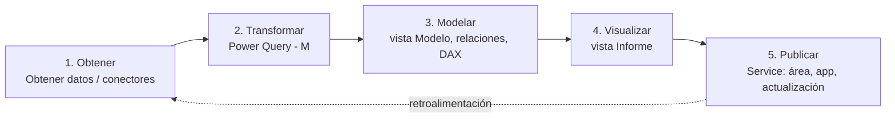

# Flujo de trabajo (obtener, transformar, modelar, visualizar y publicar)

Parte de: [[17-Power-BI/01 Fundamentos/_Índice Fundamentos|Fundamentos]]

> [!info] Cómo avanzar
> `progreso`: **pendiente** → **viendo** (estudiando) → **visto** (contestaste la autoevaluación sin abrir las respuestas) → **dominado** (hiciste el laboratorio o lo aplicaste de verdad).

## Contenido

### Qué es
Todo proyecto de Power BI sigue, con variaciones, el mismo flujo de cinco etapas: **obtener** datos, **transformarlos**, **modelarlos**, **visualizarlos** y **publicarlos**. Cada etapa tiene su herramienta y su lenguaje, y hacer cada cosa en la etapa correcta es lo que separa un informe mantenible de uno frágil.

### Cómo funciona

1. **Obtener**: eliges conector (Excel, CSV, carpeta, SQL Server, Web/API, SharePoint, Fabric) y modo de almacenamiento (Import, DirectQuery…). Ver [[Conectores y orígenes de datos (Excel, CSV, SQL Server, Web y API)]].
2. **Transformar**: en el **Editor de Power Query** limpias, tipas, combinas y das forma a las tablas. Cada clic genera un paso en **M**. Si el origen es SQL Server, muchos pasos se traducen a SQL (*query folding*).
3. **Modelar**: en la vista **Modelo** relacionas hechos con dimensiones (modelo estrella), ocultas claves, defines tabla de calendario, jerarquías y seguridad; en **DAX** escribes medidas.
4. **Visualizar**: en la vista **Informe** diseñas páginas, visuales, segmentaciones, interacciones y navegación.
5. **Publicar**: subes al **Service**, configuras credenciales, puerta de enlace si el origen es local, actualización programada, permisos y distribución (aplicación, suscripciones).

### Ejemplo
Informe de siniestros con origen en SQL Server:

| Etapa | Qué haces | Herramienta |
|---|---|---|
| Obtener | Te conectas a `vw_FactPagoSiniestro` y a las vistas de dimensiones | Conector SQL Server, modo Import |
| Transformar | Quitas columnas de auditoría, tipas fechas, combinas catálogos de ramo | Power Query (M), plegado a SQL |
| Modelar | Relaciones 1:* con `DimFecha`, `DimRamo`, `DimAjustador`; medidas `[Monto Pagado]`, `[Siniestralidad %]` | Vista Modelo, DAX |
| Visualizar | Página de resumen con KPIs y otra de detalle con drill through | Vista Informe |
| Publicar | Área "Siniestros - Prod", gateway, 4 actualizaciones al día, app para directores | Power BI Service |

**¿Limpieza en Power Query o en DAX?** La regla (conocida como la "máxima de Roche"): *transforma lo más arriba posible y lo más abajo que sea necesario*. Limpiar, tipar, quitar espacios, unir catálogos y crear columnas por fila va en **Power Query** (o mejor aún, en la vista SQL de origen): se calcula una vez al actualizar, se comprime bien y no ensucia el modelo. **DAX** se reserva para lo que depende del **contexto del usuario**: totales, porcentajes, comparativos de tiempo, rankings. Una columna calculada DAX para limpiar texto funciona, pero ocupa memoria y se recalcula en cada actualización del modelo.

### Cuándo usarlo y cuándo no
- Sigue el flujo completo siempre que el informe sea para otras personas o se vaya a actualizar.
- Para una exploración de una sola vez puedes saltarte rigor (por ejemplo, no hacer calendario), pero no lo publiques así.
- Si ya existe un **modelo semántico corporativo**, te saltas las etapas 1–3: te conectas a él (conexión dinámica) y solo visualizas.

### Errores comunes
- **Saltarse el modelado y usar una tabla plana gigante.** Un solo Excel con 60 columnas (cliente, producto, región, fecha, importes…) "funciona" al principio, pero: el modelo pesa más (texto repetido millones de veces), las medidas se complican, no puedes agregar una segunda tabla de hechos (presupuesto) sin duplicar, los totales por dimensión se rompen y la inteligencia de tiempo no funciona bien sin calendario. El modelo estrella resuelve todo eso.
- **Transformar con DAX lo que debió hacerse en Power Query.** Modelo más pesado y lento.
- **Diseñar visuales antes de tener medidas correctas.** Primero cifras validadas contra el origen, luego diseño.
- **Publicar sin configurar actualización ni puerta de enlace.** El informe queda congelado en el día que lo subiste.
- **No versionar.** Guarda como proyecto PBIP y súbelo a Git (ver [[TMDL y proyectos PBIP]]).

### Para profundizar
- [Tutorial: de Excel a un informe en Power BI](https://learn.microsoft.com/es-mx/power-bi/fundamentals/desktop-getting-started)
- [Información general de Power Query](https://learn.microsoft.com/es-mx/power-query/power-query-what-is-power-query)
- [Guía de modelado: esquema de estrella](https://learn.microsoft.com/es-mx/power-bi/guidance/star-schema)

Relacionado: [[Mapa de lenguajes de Power BI (DAX, M, SQL, R, Python, Vega-Lite, TypeScript y JSON)]], [[Modelo estrella (hechos y dimensiones)]], [[Publicar y compartir informes]].

## Autoevaluación

Contesta primero en voz alta o en papel; luego despliega la respuesta.

> [!question]- Enumera las etapas del flujo típico y la herramienta de cada una.
> Obtener (conectores) → Transformar (Power Query/M) → Modelar (relaciones, DAX) → Visualizar (vista Informe) → Publicar y compartir (Service).

> [!question]- ¿Dónde conviene hacer una limpieza: en Power Query o con DAX?
> Lo más cerca posible del origen: en la base de datos o en Power Query. DAX es para cálculos analíticos (medidas). Limpiar con columnas calculadas en DAX ocupa memoria y complica el modelo.

> [!question]- ¿Qué pasa si te saltas el modelado y pones todo en una tabla plana gigante?
> Funciona al principio, pero crecen el tamaño y la duplicación, las medidas se vuelven difíciles (p. ej. contar clientes distintos) y es más difícil reutilizar dimensiones. El modelo estrella suele ser mejor.

## Práctica

- [[Lab 1 - Primer informe de Power BI desde Excel o CSV]]

