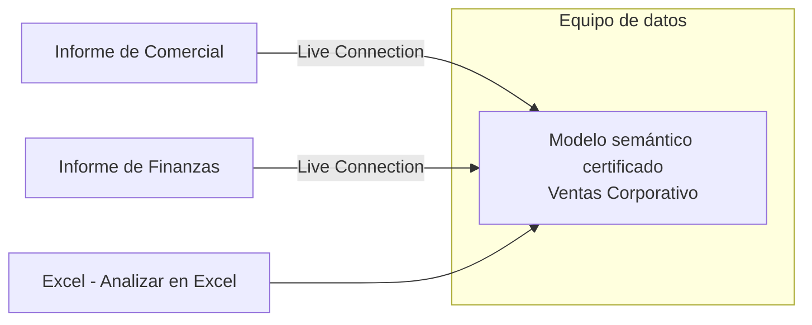

# Conexión dinámica (Live Connection) en Power BI

Parte de: [[Import, DirectQuery, Dual, Live Connection y Direct Lake]]

> [!info] Cómo avanzar
> `progreso`: **pendiente** → **viendo** (estudiando) → **visto** (contestaste la autoevaluación sin abrir las respuestas) → **dominado** (hiciste el laboratorio o lo aplicaste de verdad).

## Contenido

### Qué es
Una **conexión dinámica** (*Live Connection*) es cuando el informe **no tiene modelo propio**: se conecta a un **modelo semántico ya existente** —publicado en el Service, en Azure Analysis Services o en SQL Server Analysis Services— y usa sus tablas, relaciones y medidas tal cual. El archivo `.pbix` resultante solo contiene páginas y visuales; todo el cálculo lo hace el modelo remoto.

### Cómo funciona

En Desktop: *Obtener datos > Modelos semánticos de Power BI* (o *Analysis Services* con la opción *Conectar en vivo*). Al conectarte:

- Desaparece el botón de **Transformar datos**: no hay Power Query.
- La vista **Tabla** no está disponible y la vista **Modelo** es de solo lectura.
- Ves las tablas y medidas del modelo; las relaciones, la seguridad RLS y los cálculos son los del modelo remoto.
- **Sí** puedes crear **medidas a nivel de informe** (viven en el `.pbix`, no en el modelo), además de cálculos visuales.

**Qué no puedes hacer con Live Connection pura**: agregar tablas propias (un Excel de metas), crear columnas calculadas, cambiar relaciones, editar Power Query, cambiar tipos de datos o definir roles de seguridad. Si necesitas algo de eso, conviertes la conexión en **modelo compuesto** (*Hacer cambios en este modelo*), que crea un modelo local con DirectQuery al modelo remoto; ver [[Modelos compuestos]].

### Ejemplo
En una aseguradora, el equipo de datos publica el modelo `Siniestros - Corporativo` en el área "BI - Modelos", con medidas validadas (`[Monto Pagado]`, `[Siniestralidad %]`, `[Días Promedio de Cierre]`) y RLS por dirección regional. Lo marca como **certificado**.

Tú, en el área de Autos, necesitas un informe propio:

1. Desktop → *Modelos semánticos de Power BI* → eliges `Siniestros - Corporativo`.
2. Diseñas tus páginas con sus medidas.
3. Agregas una medida de informe: `Pagado vs Meta = [Monto Pagado] / 1500000` (temporal, hasta que la meta exista en el modelo).
4. Publicas tu informe en tu área; no se duplica el modelo ni los datos. La RLS se aplica sola a cada lector.

### Cuándo usarlo y cuándo no
**Para qué sirve en un equipo**: separar responsabilidades. Un equipo mantiene **un** modelo con la "versión única de la verdad" (definiciones, seguridad, actualización) y muchos autores construyen informes encima sin copiar datos ni redefinir medidas. Reduce duplicación, costo de actualización y discrepancias entre áreas.

- **Úsala** cuando existe un modelo compartido que ya tiene lo que necesitas.
- **No la uses** si te falta información que no está en el modelo: pide que la agreguen o usa modelo compuesto, sin abusar de él.
- Para análisis ad hoc en Excel, *Analizar en Excel* hace lo mismo con tablas dinámicas.

### Errores comunes
- **Buscar Power Query** y pensar que algo está roto: en conexión dinámica no existe.
- **Descargar el modelo y republicarlo** "para poder editarlo": se crea una copia que se desincroniza.
- **Abusar de medidas de informe**: si varias personas las necesitan, deben vivir en el modelo.
- **Permisos**: necesitas permiso de **compilación** (*Build*) sobre el modelo para conectar.

### Para profundizar
- [Conectarse a modelos semánticos en el servicio Power BI desde Desktop](https://learn.microsoft.com/es-mx/power-bi/connect-data/desktop-report-lifecycle-datasets)
- [Analysis Services en Power BI Desktop](https://learn.microsoft.com/es-mx/power-bi/connect-data/desktop-analysis-services-tabular-data)
- [Permiso de compilación para modelos semánticos compartidos](https://learn.microsoft.com/es-mx/power-bi/connect-data/service-datasets-build-permissions)

Relacionado: [[Modelos semánticos (antes datasets)]], [[Certificación y promoción de contenido]].

## Autoevaluación

Contesta primero en voz alta o en papel; luego despliega la respuesta.

> [!question]- ¿Qué no puedes hacer con Live Connection pura?
> Usar Power Query o agregar tablas propias; sí puedes crear medidas locales del informe.

> [!question]- ¿Para qué sirve en un equipo?
> Para tener un modelo semántico central certificado y muchos informes conectados a él ("un modelo, muchos informes").

