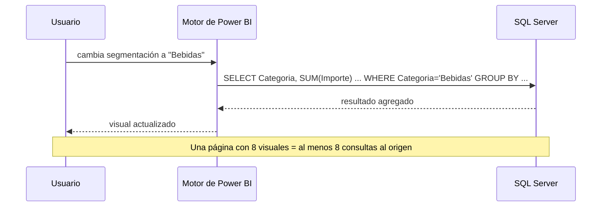

# Modo de almacenamiento DirectQuery

Parte de: [[Import, DirectQuery, Dual, Live Connection y Direct Lake]]

> [!info] Cómo avanzar
> `progreso`: **pendiente** → **viendo** (estudiando) → **visto** (contestaste la autoevaluación sin abrir las respuestas) → **dominado** (hiciste el laboratorio o lo aplicaste de verdad).

## Contenido

### Qué es
En **DirectQuery** el modelo guarda solo la **estructura** (tablas, columnas, relaciones, medidas) y **no copia los datos**. Cada vez que un visual se pinta o un usuario cambia un filtro, Power BI traduce la consulta DAX a la consulta nativa del origen (SQL en SQL Server) y la envía en ese momento. Los datos siempre están al día, a cambio de depender por completo del rendimiento del origen.

### Cómo funciona


- Las transformaciones de Power Query deben poder **plegarse** a SQL; si un paso no se pliega, no se permite.
- El motor intenta enviar consultas ya agregadas, pero cada visual, cada total y cada interacción genera una o varias.
- Hay un **límite de filas** que una consulta intermedia puede devolver (del orden de un millón); medidas que obligan a traer detalle fallan.
- Las credenciales del origen y una **puerta de enlace** (si es local) se usan en cada consulta, no solo al actualizar.

### Ejemplo
Tablero operativo de un centro de distribución que debe mostrar pedidos de los últimos 15 minutos. La tabla `Pedido` tiene 300 millones de filas en SQL Server con índice columnstore.

```sql
-- Vista pensada para DirectQuery: columnas mínimas, sin funciones costosas
CREATE OR ALTER VIEW bi.vw_PedidoDQ AS
SELECT p.IdPedido, p.FechaHora, CAST(p.FechaHora AS date) AS Fecha,
       p.IdAlmacen, p.IdProducto, p.Cantidad, p.Importe
FROM dbo.Pedido AS p;
GO
-- Índice columnstore para que los GROUP BY que manda Power BI sean rápidos
CREATE NONCLUSTERED COLUMNSTORE INDEX ncci_Pedido
ON dbo.Pedido (FechaHora, IdAlmacen, IdProducto, Cantidad, Importe);
```

En Power BI: `Pedido` en DirectQuery, `Almacen` y `Producto` en **Dual**, y la página con pocos visuales y la opción *Reducción de consultas* activada (aplicar filtros con botón).

### Cuándo usarlo y cuándo no
**Tiene sentido** cuando:
- Necesitas datos casi al instante y la actualización programada o incremental no alcanza.
- El volumen es tan grande que no cabe en la capacidad.
- Una política exige que los datos no salgan del origen o que se aplique la seguridad de la base por usuario (SSO).
- El origen está optimizado para análisis (columnstore, Synapse, Fabric Warehouse, Databricks).

**No lo uses** si el origen es un OLTP sin índices adecuados, si el informe tiene muchas páginas y visuales, o si "tiempo real" en realidad significa "cada hora": Import con actualización frecuente es más rápido y barato.

**Si el origen es lento**, el informe es lento: no hay memoria intermedia que lo disimule (hay caché, pero limitada). Además, muchos usuarios a la vez multiplican la carga sobre la base de producción, lo que puede afectar a la aplicación transaccional.

### Errores comunes
- **Limitaciones de M**: pasos como *Agregar columna de índice*, pivotar o funciones de texto complejas no se pliegan y no se permiten en DirectQuery.
- **Limitaciones de DAX**: columnas calculadas restringidas a expresiones que se traduzcan a SQL; algunas funciones de inteligencia de tiempo generan consultas pesadas. Sin tabla de calendario adecuada, todo empeora.
- **Medidas que piden detalle fila por fila** (`SUMX` sobre millones) y chocan con el límite de filas.
- **Demasiados visuales por página**: cada uno es una consulta.
- **No revisar el SQL generado**: usa el *Analizador de rendimiento* y el Profiler/Extended Events de SQL Server para verlo.

### Para profundizar
- [Uso de DirectQuery en Power BI Desktop](https://learn.microsoft.com/es-mx/power-bi/connect-data/desktop-use-directquery)
- [Guía de modelos DirectQuery](https://learn.microsoft.com/es-mx/power-bi/guidance/directquery-model-guidance)
- [DirectQuery en Power BI: cuándo usarlo](https://learn.microsoft.com/es-mx/power-bi/connect-data/desktop-directquery-about)

Relacionado: [[Modo de almacenamiento Dual]], [[Query folding]], [[Agregaciones]].

## Autoevaluación

Contesta primero en voz alta o en papel; luego despliega la respuesta.

> [!question]- ¿Cuándo tiene sentido DirectQuery?
> Datos muy grandes para importar, necesidad de datos casi en tiempo real, o reglas que impiden copiar los datos fuera del origen.

> [!question]- ¿Qué pasa con el rendimiento si el origen es lento?
> Cada visual genera consultas al origen; si la base es lenta o no tiene índices, el informe será lento. Hay que optimizar el origen (índices, vistas) y reducir visuales por página.

> [!question]- Menciona una limitación típica de DirectQuery.
> Algunas transformaciones de Power Query no se pueden traducir a SQL y no se permiten; ciertas funciones DAX tienen peor rendimiento; hay límites de filas devueltas por consulta.

