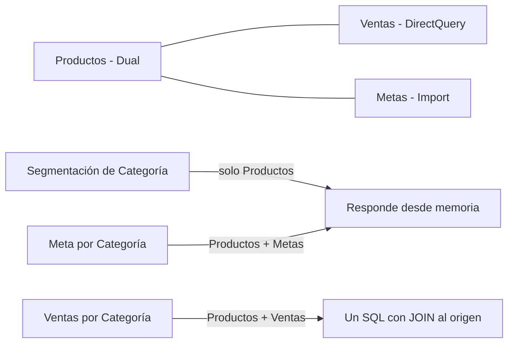

# Modo de almacenamiento Dual

Parte de: [[Import, DirectQuery, Dual, Live Connection y Direct Lake]]

> [!info] Cómo avanzar
> `progreso`: **pendiente** → **viendo** (estudiando) → **visto** (contestaste la autoevaluación sin abrir las respuestas) → **dominado** (hiciste el laboratorio o lo aplicaste de verdad).

## Contenido

### Qué es
**Dual** es un modo de almacenamiento por tabla en el que la tabla está **importada a memoria y, a la vez, disponible como DirectQuery**. El motor decide en cada consulta cuál usar: si la consulta solo involucra tablas Import o Dual, la responde desde memoria; si se combina con una tabla DirectQuery del mismo origen, la trata como DirectQuery para mandar todo junto al origen en un solo SQL.

### Cómo funciona

Por qué importa: si `Productos` estuviera en **Import** y `Ventas` en **DirectQuery**, las dos tablas pertenecerían a "grupos de origen" distintos. La relación entre ellas sería **limitada**: el motor tendría que traer la lista de productos de memoria y mandarla como filtro (a veces una lista enorme de valores) al SQL, con peor rendimiento y semántica distinta en blancos. En **Dual**, `Productos` pertenece a los dos mundos y la relación con `Ventas` es normal.

Al actualizar, la parte importada de la tabla Dual se refresca como cualquier tabla Import; mientras tanto, la parte DirectQuery siempre lee el origen. Por eso puede haber un pequeño desfase si el catálogo cambia entre actualizaciones.

### Ejemplo
Modelo de ventas de Itzamna.Dionisio con hechos en DirectQuery:

| Tabla | Filas | Modo | Por qué |
|---|---|---|---|
| `Ventas` | 80 M | DirectQuery | Se necesita el día en curso |
| `Productos` | 2 000 | **Dual** | Segmentaciones rápidas y JOIN eficiente con Ventas |
| `Calendario` | 3 650 | **Dual** | Igual que Productos |
| `Sucursales` | 120 | **Dual** | Igual |
| `Metas` | 600 | Import | Excel, no hay DirectQuery posible |

Para cambiarlo: vista **Modelo** → selecciona la tabla → panel *Propiedades* → *Avanzado* → **Modo de almacenamiento: Dual**. Si cambias una tabla DirectQuery a Dual, Power BI te sugerirá hacerlo también con las tablas relacionadas.

### Cuándo usarlo y cuándo no
**Úsalo en**:
- **Dimensiones** (catálogos pequeños o medianos: productos, clientes, fechas, sucursales) que se relacionan con hechos en DirectQuery y también se usan solas en segmentaciones o con tablas Import.
- Modelos con **agregaciones**: la dimensión en Dual permite que la tabla de agregación importada responda sin ir al origen.

**No lo uses en**:
- Tablas de **hechos** grandes: estarías importando lo que querías dejar en el origen.
- Tablas cuyo origen no soporta DirectQuery (Excel, CSV, API): solo pueden ser Import.
- Modelos 100 % Import: no aporta nada.

### Errores comunes
- **Dejar dimensiones en Import** en un modelo con hechos DirectQuery y sufrir relaciones limitadas y consultas lentas.
- **Poner Dual a todo** "por si acaso": aumenta tamaño y tiempo de actualización sin beneficio.
- **Dual con orígenes distintos**: la ventaja del JOIN solo existe si la dimensión y el hecho vienen del **mismo origen**.
- **Olvidar actualizar** la parte importada: catálogos desactualizados frente a hechos al día.

### Para profundizar
- [Modo de almacenamiento en Power BI Desktop (Dual)](https://learn.microsoft.com/es-mx/power-bi/transform-model/desktop-storage-mode)
- [Relaciones de modelo: relaciones limitadas](https://learn.microsoft.com/es-mx/power-bi/transform-model/desktop-relationships-understand)
- [Agregaciones definidas por el usuario](https://learn.microsoft.com/es-mx/power-bi/transform-model/aggregations-advanced)

Relacionado: [[Modo de almacenamiento DirectQuery]], [[Modelos compuestos]].

## Autoevaluación

Contesta primero en voz alta o en papel; luego despliega la respuesta.

> [!question]- ¿Qué hace el modo Dual?
> La tabla se importa y también puede consultarse en DirectQuery; el motor elige según la consulta.

> [!question]- ¿A qué tablas se suele aplicar?
> A dimensiones relacionadas con hechos en DirectQuery (y con agregaciones importadas), para que las relaciones no queden limitadas.

