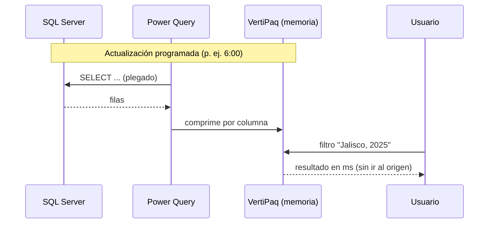

# Modo de almacenamiento Import

Parte de: [[Import, DirectQuery, Dual, Live Connection y Direct Lake]]

> [!info] Cómo avanzar
> `progreso`: **pendiente** → **viendo** (estudiando) → **visto** (contestaste la autoevaluación sin abrir las respuestas) → **dominado** (hiciste el laboratorio o lo aplicaste de verdad).

## Contenido

### Qué es
En **modo Import**, Power BI copia los datos del origen al propio modelo y los guarda comprimidos en columnas dentro del motor **VertiPaq** (en memoria). Los visuales consultan esa copia, no el origen. Es el modo por defecto y el que da el mejor rendimiento y todas las funciones de M y DAX.

### Cómo funciona
1. Al **actualizar**, Power Query ejecuta las consultas M (plegadas a SQL cuando se puede), trae las filas y VertiPaq las comprime columna por columna (codificación por diccionario, por valor y RLE).
2. El modelo comprimido vive en el `.pbix` y, ya publicado, en la memoria de la capacidad del Service.
3. Cada vez que el usuario filtra, el motor responde desde memoria, en milisegundos, sin tocar el origen.
4. Los datos son tan recientes como la **última actualización**. En el Service se programa: con Pro hasta 8 actualizaciones al día; con PPU o capacidad, hasta 48 (verifica límites vigentes en [[Actualización programada]]).



**¿Qué determina el tamaño del modelo?** Sobre todo la **cardinalidad** (cuántos valores distintos tiene cada columna), más que el número de filas. Una columna `Estatus` con 4 valores se comprime casi a nada aunque tenga 50 millones de filas; una columna `IdTransaccion` o un `DateTime` con segundos, con un valor distinto por fila, ocupa muchísimo. También pesan las columnas de texto largas y las columnas que nadie usa.

### Ejemplo
Tabla de pagos de siniestros de 20 millones de filas. Versión inicial: 1.8 GB. Optimización:

```m
let
    Origen = Sql.Database("srv-sql01", "Siniestros"),
    Pagos = Origen{[Schema = "bi", Item = "vw_FactPago"]}[Data],
    // 1. solo las columnas que usa el informe (no traer Comentario ni Usuario)
    Cols = Table.SelectColumns(Pagos, {"FechaPago", "IdSiniestro", "IdRamo", "IdEstado", "Monto"}),
    // 2. separar fecha de hora reduce la cardinalidad
    SoloFecha = Table.TransformColumns(Cols, {{"FechaPago", DateTime.Date, type date}}),
    // 3. moneda con 4 decimales fijos comprime mejor que decimal flotante
    Tipos = Table.TransformColumnTypes(SoloFecha, {{"Monto", Currency.Type}})
in
    Tipos
```

Quitar columnas de texto libre, convertir `DateTime` a `Date` y redondear importes bajan el modelo a una fracción. Además, desactivar **Fecha/hora automática** elimina tablas ocultas de calendario.

### Cuándo usarlo y cuándo no
- **Úsalo** como primera opción: modelos de hasta unos cuantos GB, datos que pueden tener la latencia de la última actualización, orígenes lentos o que no soportan DirectQuery (Excel, API).
- Combínalo con **[[Actualización incremental]]** para tablas grandes que crecen por fecha.
- **No lo uses** si el negocio exige ver la última transacción al segundo, si el volumen no cabe en la capacidad o si hay una política que prohíbe copiar los datos fuera del origen. Ahí evalúa DirectQuery, modelo compuesto o Direct Lake.

**Ventaja principal frente a DirectQuery**: velocidad y libertad. Las consultas se resuelven en memoria en milisegundos y tienes todo DAX, todas las transformaciones de M y ninguna carga extra sobre el origen en horario laboral.

### Errores comunes
- **Importar `SELECT *`** con columnas de auditoría, GUIDs y comentarios. Ocupan mucho y no se usan.
- **Fechas con hora** cuando solo se analiza por día.
- **Columnas calculadas DAX** en tablas enormes; mejor en M o SQL.
- **Olvidar la puerta de enlace** para orígenes locales: el Service no podrá actualizar.
- **Superar el límite de tamaño** de Pro (1 GB por modelo publicado) sin darte cuenta hasta publicar; revisa el tamaño con VertiPaq Analyzer.

### Para profundizar
- [Modo de almacenamiento en Power BI Desktop](https://learn.microsoft.com/es-mx/power-bi/transform-model/desktop-storage-mode)
- [Técnicas de reducción de datos para el modelado de importación](https://learn.microsoft.com/es-mx/power-bi/guidance/import-modeling-data-reduction)
- [Actualización de datos en Power BI](https://learn.microsoft.com/es-mx/power-bi/connect-data/refresh-data)

Relacionado: [[Cómo funciona el motor VertiPaq]], [[Rendimiento - Performance Analyzer y VertiPaq Analyzer]].

## Autoevaluación

Contesta primero en voz alta o en papel; luego despliega la respuesta.

> [!question]- ¿Dónde viven los datos en modo Import y qué implica para la actualización?
> En el modelo, comprimidos por VertiPaq. Hay que actualizar (manual o programada) para ver datos nuevos.

> [!question]- ¿Qué afecta más el tamaño de un modelo Import?
> La cardinalidad de las columnas (valores distintos) más que el número de filas: IDs únicos, fechas con hora y textos largos pesan mucho.

> [!question]- Ventaja principal de Import frente a DirectQuery.
> Rendimiento de consulta y DAX/M completo sin restricciones.

