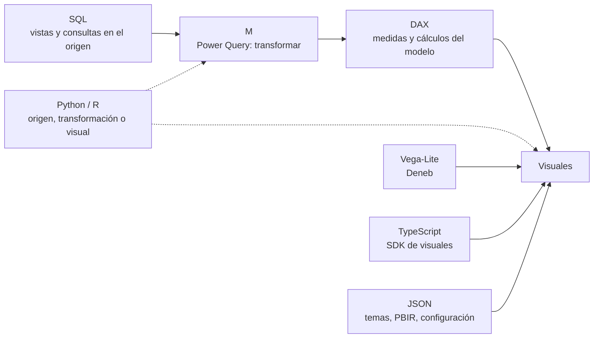

# Mapa de lenguajes de Power BI (DAX, M, SQL, R, Python, Vega-Lite, TypeScript y JSON)

Parte de: [[17-Power-BI/01 Fundamentos/_Índice Fundamentos|Fundamentos]]

> [!info] Cómo avanzar
> `progreso`: **pendiente** → **viendo** (estudiando) → **visto** (contestaste la autoevaluación sin abrir las respuestas) → **dominado** (hiciste el laboratorio o lo aplicaste de verdad).

## Contenido

### Qué es
Power BI usa varios lenguajes, cada uno en una capa distinta. Saber cuál toca cada problema evita resolver con DAX lo que es de M, o con Python lo que hace un visual nativo. Como desarrollador .NET ya conoces SQL, TypeScript y JSON; aquí ves dónde encajan.

### Cómo funciona


| Lenguaje | Capa | Para qué | Dónde lo escribes |
|---|---|---|---|
| **SQL** | Origen | Filtrar, unir y preparar datos *antes* de que lleguen a Power BI; vistas que estabilizan el contrato | SQL Server (vistas, procedimientos), consulta nativa en el conector |
| **M** (Power Query) | Transformación | Conectar, limpiar, tipar, combinar, consumir API. Se ejecuta al **actualizar** | Editor de Power Query, editor avanzado |
| **DAX** | Modelo | Medidas, columnas y tablas calculadas, seguridad RLS, consultas. Se ejecuta al **consultar** (cada vez que un visual se pinta) | Vista Informe/Tabla, vista de consultas DAX, Tabular Editor |
| **Python / R** | Transformación o visual | Estadística, modelos y gráficas especiales con matplotlib/ggplot2 | Paso *Ejecutar script*, visual de Python/R |
| **Vega-Lite / Vega** | Visual | Gramática de gráficas declarativa en JSON para visuales a la medida sin compilar | Visual **Deneb** |
| **TypeScript** | Visual | Crear un visual propio empaquetado (`.pbiviz`) con D3 u otra librería | SDK de visuales (`pbiviz`) en VS Code |
| **JSON** | Configuración | Temas de informe, formato PBIR de informes, especificaciones de Deneb, archivos de proyecto | Archivos `.json` del tema o del proyecto PBIP |

Además, el **modelo** puede guardarse como **TMDL** (lenguaje de definición de modelos tabulares, texto tipo YAML), útil para Git.

**M vs DAX en una frase**: M prepara las tablas una vez por actualización; DAX calcula respuestas cada vez que alguien filtra.

### Ejemplo
Mismo requerimiento, "ventas netas por categoría del año actual", repartido en capas:

```sql
-- SQL: vista estable en el origen
CREATE OR ALTER VIEW bi.vw_Ventas AS
SELECT v.IdVenta, v.Fecha, v.IdProducto, v.Cantidad, v.PrecioUnitario, v.Descuento
FROM dbo.Venta AS v
WHERE v.Estatus <> 'CANCELADA';
```

```m
// M: tipar y calcular columna por fila
let
    Origen = Sql.Database("srv-sql01", "Dionisio"),
    Ventas = Origen{[Schema = "bi", Item = "vw_Ventas"]}[Data],
    Neto = Table.AddColumn(Ventas, "ImporteNeto",
        each [Cantidad] * [PrecioUnitario] - [Descuento], Currency.Type)
in
    Neto
```

```dax
-- DAX: la medida responde al filtro de categoría y año del visual
Ventas Netas = SUM ( Ventas[ImporteNeto] )
Ventas Netas YTD = TOTALYTD ( [Ventas Netas], Calendario[Fecha] )
```

Y si quieres una gráfica de "bala" que no existe nativa, la haces con **Vega-Lite** en Deneb; el color corporativo va en el **tema JSON**.

### Cuándo usarlo y cuándo no
- **SQL** cuando tienes acceso al origen y quieres que la lógica sea reutilizable por otros sistemas.
- **M** cuando no controlas el origen (Excel, API) o la regla es propia del informe.
- **DAX** solo para lo que depende del filtro del usuario.
- **Python/R**: no son la primera opción; en el Service tienen requisitos (puerta de enlace personal para scripts en origen, librerías soportadas) y no siempre se actualizan. Úsalos para algo que nativo no resuelva.
- **Vega-Lite** antes que **TypeScript** para un visual a la medida: es más rápido de hacer; TypeScript cuando necesitas un visual reutilizable y distribuible.

### Errores comunes
- **Columnas calculadas DAX para limpiar datos** (mejor M o SQL).
- **Confundir sintaxis**: M distingue mayúsculas (`Table.AddColumn`), DAX no; en M las listas van con `{}` y los registros con `[]`.
- **SQL nativo pegado en el conector** que rompe el plegado de los pasos siguientes; mejor una vista.
- **Visual de Python** para algo que hace un gráfico de dispersión nativo.

### Para profundizar
- [Referencia del lenguaje M de Power Query](https://learn.microsoft.com/es-mx/powerquery-m/)
- [Referencia de DAX](https://learn.microsoft.com/es-mx/dax/)
- [Deneb (sitio oficial)](https://deneb-viz.github.io/)
- [Herramientas para desarrollar visuales de Power BI](https://learn.microsoft.com/es-mx/power-bi/developer/visuals/develop-power-bi-visuals)

Relacionado: [[Lenguaje M - let e in]], [[DAX - qué es y para qué sirve]], [[Deneb (Vega y Vega-Lite)]], [[SDK de visuales de Power BI (TypeScript y pbiviz)]], [[Temas y archivos JSON de tema]].

## Autoevaluación

Contesta primero en voz alta o en papel; luego despliega la respuesta.

> [!question]- ¿Para qué sirve cada lenguaje: M, DAX y SQL?
> **M**: transformar datos en Power Query (antes de cargar). **DAX**: medidas, columnas y tablas calculadas en el modelo; también consultas (EVALUATE). **SQL**: consultar la base de origen (vistas, consultas nativas).

> [!question]- ¿Dónde aparecen Vega-Lite, TypeScript y JSON?
> **Vega/Vega-Lite**: especificaciones de gráficos en Deneb. **TypeScript**: SDK para programar visuales propios (pbiviz). **JSON**: temas de informe, definición de informes en PBIP y especificaciones de Deneb.

> [!question]- ¿R y Python en Power BI se usan para qué?
> Como orígenes/transformaciones en Power Query (scripts) y como visuales de R/Python. Requieren tener el intérprete instalado en Desktop y tienen limitaciones en el Service (verificar en la documentación).

