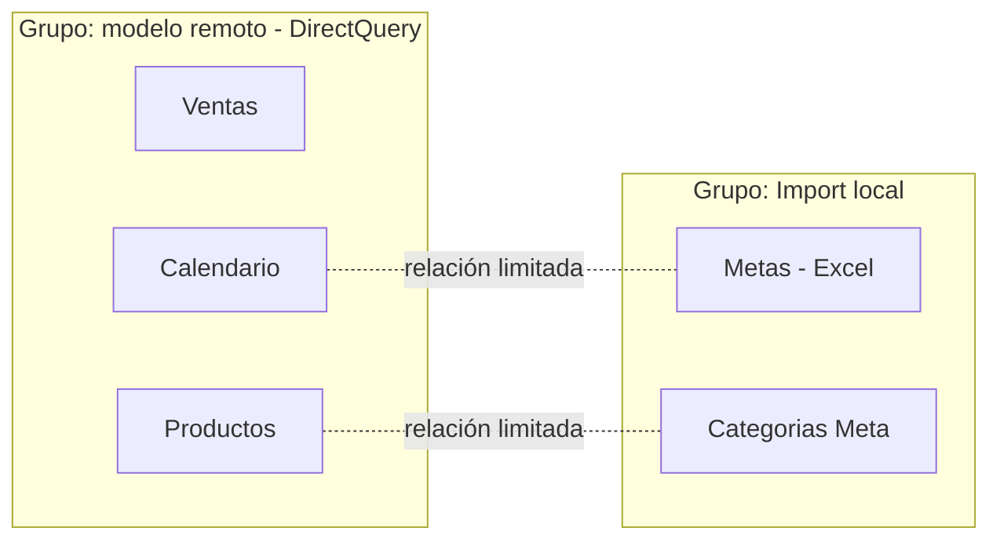

# Modelos compuestos

Parte de: [[17-Power-BI/01 Fundamentos/_Índice Fundamentos|Fundamentos]]

> [!info] Cómo avanzar
> `progreso`: **pendiente** → **viendo** (estudiando) → **visto** (contestaste la autoevaluación sin abrir las respuestas) → **dominado** (hiciste el laboratorio o lo aplicaste de verdad).

## Contenido

### Qué es
Un **modelo compuesto** es un modelo semántico que combina **más de un grupo de origen** (*source group*). Hay dos formas:

1. **Mezclar modos de almacenamiento** en un mismo modelo: unas tablas en Import, otras en DirectQuery y otras en Dual.
2. **DirectQuery a un modelo semántico** de Power BI o Analysis Services (*DirectQuery for Power BI semantic models*): tomas un modelo publicado, lo "encadenas" y le agregas tablas propias, columnas o medidas.

Sirve para extender modelos sin copiarlos y para equilibrar frescura y rendimiento.

### Cómo funciona
Cada **grupo de origen** es un conjunto de tablas que el motor puede consultar junto: todas las tablas Import forman un grupo; cada origen DirectQuery forma otro. Las tablas **Dual** pertenecen a ambos.



- Las relaciones **dentro** de un grupo son **regulares**: se resuelven con la semántica normal (la tabla del lado uno tiene una fila "en blanco" virtual para claves huérfanas, filtros eficientes).
- Las relaciones **entre** grupos son **limitadas** (antes llamadas "débiles"). También lo son las relaciones muchos a muchos. En una relación limitada el motor no puede garantizar que el lado "uno" sea único, hace un *join* tipo interno al momento de consultar, **no agrega la fila en blanco** para valores sin correspondencia (esas filas simplemente no aparecen en el total por dimensión) y, entre orígenes distintos, tiene que mandar listas de valores como filtro, lo que cuesta rendimiento. Funciones como `RELATED` no funcionan a través de ellas.
- La línea de una relación limitada en la vista Modelo se dibuja con paréntesis/semicírculos en los extremos.

### Ejemplo
Tienes el modelo certificado `Ventas Corporativo` y Comercial quiere comparar contra sus metas mensuales por categoría, que viven en `Metas2026.xlsx`.

1. Desktop → *Modelos semánticos de Power BI* → `Ventas Corporativo` (empieza como Live Connection).
2. Abajo a la derecha, **Hacer cambios en este modelo** → confirma. Ahora tienes un modelo local con las tablas remotas en DirectQuery.
3. *Obtener datos > Excel* → importa `Metas` (`Año`, `NumMes`, `Categoria`, `Meta`).
4. Para relacionar a un grano compatible, crea en Import una tabla puente de categorías y relaciónala con `Productos[Categoria]` y con `Metas[Categoria]` (o usa `TREATAS` en la medida).
5. Medida:

```dax
Cumplimiento % =
DIVIDE ( [Ventas Netas], SUM ( Metas[Meta] ) )
```

Requisitos: el administrador debe permitir en la configuración del inquilino las conexiones DirectQuery a modelos semánticos de Power BI, y tú necesitas permiso de compilación sobre el modelo remoto. Las RLS del modelo remoto siguen aplicándose.

### Cuándo usarlo y cuándo no
- **Úsalo** para enriquecer un modelo corporativo con datos pequeños y propios (metas, agrupaciones, tipos de cambio), o para tener hechos en DirectQuery y dimensiones en Dual.
- **Úsalo** con agregaciones: tabla agregada en Import, detalle en DirectQuery.
- **No lo uses** como atajo para no pedir cambios al dueño del modelo cuando el dato le sirve a todos: agrégalo al modelo origen.
- **Evita cadenas largas** (modelo sobre modelo sobre modelo): hay un límite de profundidad y cada salto agrega latencia.

### Errores comunes
- **Ignorar las relaciones limitadas** y sorprenderse porque los totales no cuadran o falta la fila "(En blanco)".
- **Dimensiones en Import junto a hechos DirectQuery** cuando podrían ser Dual.
- **Relacionar a granos incompatibles** (metas mensuales por categoría contra ventas diarias por producto) sin tabla puente o sin `TREATAS`.
- **Esperar que los usuarios finales vean datos** sin permiso sobre el modelo remoto: necesitan acceso a ambos.

### Para profundizar
- [Uso de modelos compuestos en Power BI Desktop](https://learn.microsoft.com/es-mx/power-bi/transform-model/desktop-composite-models)
- [Guía de modelos compuestos](https://learn.microsoft.com/es-mx/power-bi/guidance/composite-model-guidance)
- [Relaciones de modelo en Power BI Desktop (regulares y limitadas)](https://learn.microsoft.com/es-mx/power-bi/transform-model/desktop-relationships-understand)

Relacionado: [[Import, DirectQuery, Dual, Live Connection y Direct Lake]], [[DAX - USERELATIONSHIP, TREATAS y CROSSFILTER]], [[Granularidad de una tabla de hechos]].

## Autoevaluación

Contesta primero en voz alta o en papel; luego despliega la respuesta.

> [!question]- ¿Qué es un modelo compuesto?
> Un modelo que combina tablas con distintos modos de almacenamiento (Import, DirectQuery, Dual) o que combina un modelo semántico remoto (DirectQuery a un modelo de Power BI/AS) con tablas locales.

> [!question]- Caso: usas un modelo corporativo certificado pero necesitas agregar tu tabla de metas en Excel. ¿Cómo?
> Conectar al modelo semántico y elegir *Hacer cambios en este modelo* (DirectQuery al modelo de Power BI); luego importar el Excel y relacionarlo. Requiere que el administrador lo permita.

> [!question]- ¿Qué es una relación limitada (antes "débil") y por qué importa?
> Una relación entre tablas de distintos grupos de origen (islas). No garantiza integridad del lado "uno" y puede comportarse distinto con valores en blanco y en rendimiento. Se minimiza con tablas Dual.

