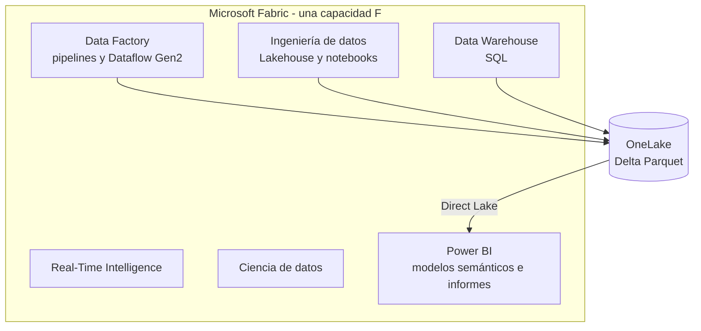

# Power BI y Microsoft Fabric

Parte de: [[17-Power-BI/01 Fundamentos/_Índice Fundamentos|Fundamentos]]

> [!info] Cómo avanzar
> `progreso`: **pendiente** → **viendo** (estudiando) → **visto** (contestaste la autoevaluación sin abrir las respuestas) → **dominado** (hiciste el laboratorio o lo aplicaste de verdad).

## Contenido

### Qué es
**Microsoft Fabric** es la plataforma de análisis de datos de Microsoft, ofrecida como servicio (SaaS), que junta en un mismo lugar la ingesta, la ingeniería de datos, el almacén, la analítica en tiempo real, la ciencia de datos y la visualización. **Power BI es una de las cargas de trabajo (experiencias) de Fabric**: el mismo portal (`app.powerbi.com` o `app.fabric.microsoft.com`), las mismas áreas de trabajo y el mismo modelo de capacidades. Dicho de otro modo, Fabric no reemplaza a Power BI: lo rodea con todo lo que antes vivía en servicios separados de Azure (Data Factory, Synapse, Data Explorer).

### Cómo funciona

- **OneLake** es, en una frase, *el lago de datos único y lógico de toda la organización*: uno por inquilino (tenant), donde todos los elementos de Fabric guardan sus tablas en formato abierto **Delta Parquet**. Es "el OneDrive de los datos": no copias datos entre servicios, todos leen el mismo almacenamiento, y además puedes crear **accesos directos** (shortcuts) a datos que viven en ADLS Gen2, S3 u otros lugares.
- **Capacidades F.** Fabric se compra como capacidad (SKUs F2, F4, … F64, …) con pago por uso o reservada. La capacidad da cómputo a todas las cargas: refrescar un modelo de Power BI, correr un notebook o un pipeline consume de la misma bolsa de *capacity units*.
- **Direct Lake.** El modo de almacenamiento que solo existe dentro de Fabric: el modelo semántico lee las tablas Delta de OneLake con el motor en memoria, sin copia de importación. Ver [[Direct Lake]].
- **Transición de Premium.** Microsoft dejó de vender nuevas capacidades P de Power BI Premium y está moviendo a los clientes a SKUs F; los contratos EA vigentes pueden renovar hasta que termine el acuerdo. Los informes y modelos siguen funcionando igual en F64 o mayor.

### Ejemplo
Escenario en una empresa de distribución con SQL Server en sitio:

- **Sin Fabric**: Power BI Desktop importa con una puerta de enlace las tablas de ventas, publicas al Service con licencias Pro y programas 8 actualizaciones al día. Funciona perfecto y no necesitas nada más.
- **Con Fabric**: un pipeline copia cada hora los pedidos a un **Lakehouse**, un notebook o un Dataflow Gen2 construye la capa "oro" (`fact_ventas`, `dim_producto`), y un modelo semántico **Direct Lake** apunta a esas tablas. El área de finanzas consulta el mismo Lakehouse con SQL y el equipo de ciencia de datos con Spark, sin copias.

La decisión depende del volumen, de cuántos equipos consumen los mismos datos y de si quieres pagar una capacidad.

### Cuándo usarlo y cuándo no
- **Si solo haces informes con Desktop y Pro**, no necesitas comprar Fabric. Sigues usando el Service (que técnicamente es parte de Fabric) con tus licencias por usuario. Los elementos de Fabric que no son de Power BI (Lakehouse, Warehouse, notebooks) sí requieren capacidad.
- **Considera Fabric** cuando tienes volúmenes grandes, varios equipos que necesitan los mismos datos curados, necesidad de ingeniería de datos (Spark, pipelines) o quieres Direct Lake.
- **Considera la capacidad F64 o mayor** si muchos lectores solo consumen: en F64+ los usuarios con licencia gratuita pueden ver contenido; en F2–F32 cada lector necesita Pro o PPU.

### Errores comunes
- **Creer que "migrar a Fabric" obliga a rehacer los informes.** Los modelos e informes de Power BI siguen siendo los mismos; cambia la capacidad que los hospeda.
- **Encender una capacidad F pequeña para "probar" y dejarla prendida.** El pago por uso cobra mientras está activa; puedes pausarla desde Azure.
- **Duplicar datos en OneLake** en lugar de usar accesos directos.
- **Confundir OneLake con OneDrive.** OneLake guarda tablas Delta para análisis, no documentos de usuario.

### Para profundizar
- [¿Qué es Microsoft Fabric?](https://learn.microsoft.com/es-mx/fabric/fundamentals/microsoft-fabric-overview)
- [OneLake, el OneDrive de los datos](https://learn.microsoft.com/es-mx/fabric/onelake/onelake-overview)
- [Licencias de Microsoft Fabric](https://learn.microsoft.com/es-mx/fabric/enterprise/licenses)
- [Migración de Power BI Premium a Fabric](https://learn.microsoft.com/es-mx/power-bi/support/premium-migration-overview)

Relacionado: [[Fabric - Lakehouse, Warehouse y OneLake]], [[Licencias de Power BI (Free, Pro, Premium por usuario y capacidades)]].

## Autoevaluación

Contesta primero en voz alta o en papel; luego despliega la respuesta.

> [!question]- ¿Qué relación hay entre Power BI y Microsoft Fabric?
> Fabric es la plataforma de análisis de Microsoft que reúne ingeniería de datos, almacén, ciencia de datos, tiempo real y BI sobre un mismo almacenamiento (OneLake). Power BI es la experiencia de BI dentro de Fabric; los workspaces de Power BI son workspaces de Fabric.

> [!question]- Si solo hago informes con Power BI Desktop y Pro, ¿necesito Fabric?
> No necesariamente. Fabric aporta lakehouses, warehouses, notebooks y Direct Lake, que requieren capacidad de Fabric. Un flujo clásico (Desktop → Service, modelo Import) funciona sin usar artículos de Fabric. Licenciamiento: (verificar en la página oficial).

> [!question]- ¿Qué es OneLake en una frase?
> El "data lake único" de la organización en Fabric, donde se guardan las tablas en formato Delta/Parquet y que todos los motores (SQL, Spark, Power BI) leen sin copiar datos.

