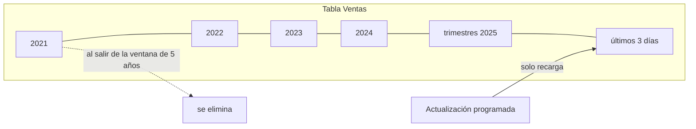

# Actualización incremental

Parte de: [[17-Power-BI/02 Power Query y el lenguaje M/_Índice Power Query y el lenguaje M|Power Query y el lenguaje M]]

> [!info] Cómo avanzar
> `progreso`: **pendiente** → **viendo** (estudiando) → **visto** (contestaste la autoevaluación sin abrir las respuestas) → **dominado** (hiciste el laboratorio o lo aplicaste de verdad).

## Contenido

### Qué es
La **actualización incremental** divide una tabla grande del modelo en **particiones por fecha** y, en cada actualización programada, **solo recarga las particiones recientes** (por ejemplo, los últimos 3 días), dejando intacto el histórico (por ejemplo, 5 años). Así una tabla de 300 millones de filas no se recarga completa cada noche: se cargan unos cuantos miles. Funciona con licencias **Pro**, PPU, capacidades Premium/Fabric y Embedded; la opción de agregar una partición en **tiempo real con DirectQuery** requiere Premium, PPU o Embedded (según Microsoft Learn, revisado en noviembre de 2026).

### Cómo funciona


**Lo que configuras en Desktop**:
1. Dos parámetros de Power Query **tipo Fecha/Hora** con nombres exactos (distinguen mayúsculas): **`RangeStart`** y **`RangeEnd`**. Dales valores que traigan poca data en Desktop, por ejemplo un mes.
2. Un **filtro** en la tabla de hechos sobre la columna de fecha usando esos parámetros: inicio **inclusivo** y fin **exclusivo**: `[Fecha] >= RangeStart and [Fecha] < RangeEnd`.
3. Confirmar que ese filtro **se pliega** al origen (*Ver consulta nativa*).
4. En la vista de modelo o tabla, clic derecho en la tabla > **Actualización incremental**: activar, definir **archivar** (p. ej. 5 años) e **incrementar** (p. ej. 3 días). Opcionales: *Detectar cambios de datos* (una columna de "última modificación" distinta de la de partición), *Solo actualizar días completos* y la partición DirectQuery en tiempo real.
5. Publicar. **La primera actualización en el Service** crea las particiones y carga todo el histórico (puede tardar); las siguientes solo las recientes. En el Service los parámetros los sobrescribe el motor por partición.

Límites de tiempo de actualización: 2 horas por modelo en Pro y 5 horas en capacidades Premium (según la documentación).

### Ejemplo
Tabla de pagos de siniestros en SQL Server con `FechaPago` tipo `datetime2`:

```m
// Parámetros (Administrar parámetros > Nuevo, tipo Fecha/Hora)
// RangeStart = #datetime(2025, 10, 1, 0, 0, 0)
// RangeEnd   = #datetime(2025, 11, 1, 0, 0, 0)

let
    Origen = Sql.Database("srv-sql01", "Siniestros"),
    Pagos = Origen{[Schema = "bi", Item = "vw_FactPago"]}[Data],
    // filtro justo después del origen, para que pliegue
    Filtrado = Table.SelectRows(Pagos, each [FechaPago] >= RangeStart and [FechaPago] < RangeEnd),
    Tipos = Table.TransformColumnTypes(Filtrado, {{"Monto", Currency.Type}})
in
    Tipos
```

Si la columna es una clave entera `yyyymmdd` (`IdFecha = 20251015`), convierte los parámetros:

```m
each [IdFecha] >= Int32.From(DateTime.ToText(RangeStart, [Format = "yyyyMMdd"]))
 and [IdFecha] <  Int32.From(DateTime.ToText(RangeEnd,   [Format = "yyyyMMdd"]))
```

Política: archivar 5 años, actualizar 10 días (los pagos se corrigen hasta una semana después), *detectar cambios* con `FechaModificacion`.

### Cuándo usarlo y cuándo no
- **Úsalo** en tablas de hechos grandes que crecen por fecha y donde el histórico casi no cambia.
- **Úsalo** con orígenes que pliegan (SQL Server, Azure SQL, Synapse, Fabric Warehouse). Con archivos o APIs técnicamente se puede, pero cada partición vuelve a leer el origen completo.
- **No lo necesitas** en tablas pequeñas o dimensiones.
- Si el histórico se corrige con frecuencia, amplía la ventana incremental o usa *detectar cambios*.

### Errores comunes
- **El filtro con `<=` en ambos extremos**: las filas exactamente en el límite entre dos particiones (medianoche) quedan en **las dos** y se **duplican**. Siempre `>=` en `RangeStart` y `<` en `RangeEnd`.
- **Parámetros de tipo Fecha** (no Fecha/Hora) o con nombre distinto (`rangeStart`): la opción de actualización incremental no aparece.
- **Filtro que no pliega** (por ejemplo, después de un paso no plegable): cada partición descarga todo.
- **Usar la misma columna** para partición y para detectar cambios.
- **Descargar el `.pbix` del Service** esperando el histórico: el archivo de Desktop no contiene las particiones; se gestionan en el Service (o por XMLA).

### Para profundizar
- [Actualización incremental y datos en tiempo real para modelos semánticos](https://learn.microsoft.com/es-mx/power-bi/connect-data/incremental-refresh-overview)
- [Configurar la actualización incremental](https://learn.microsoft.com/es-mx/power-bi/connect-data/incremental-refresh-configure)
- [Solución de problemas de actualización incremental](https://learn.microsoft.com/es-mx/power-bi/connect-data/incremental-refresh-troubleshoot)

Relacionado: [[Query folding]], [[Power Query - parámetros]], [[Modelos grandes]].

## Autoevaluación

Contesta primero en voz alta o en papel; luego despliega la respuesta.

> [!question]- ¿Qué hace la actualización incremental?
> Divide la tabla en particiones por periodo; en cada actualización solo recarga los periodos recientes (p. ej. últimos 10 días) y conserva los históricos.

> [!question]- ¿Qué necesitas configurar en Desktop?
> Parámetros `RangeStart` y `RangeEnd` de tipo fecha/hora, un filtro en la columna de fecha usando ambos (`>= RangeStart` y `< RangeEnd`), y la política de la tabla (periodo a almacenar y a actualizar).

> [!question]- Error común en el filtro.
> Usar `<=` en ambos extremos: duplica las filas que caen justo en el límite entre particiones. Debe ser `>=` en uno y `<` en el otro.

