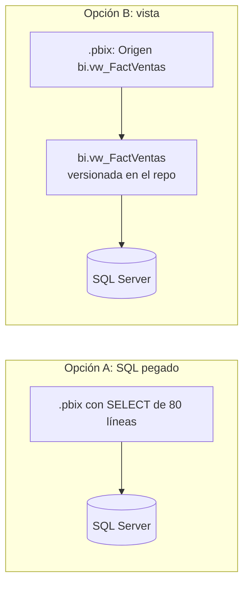

# Consultas nativas de SQL y vistas para Power BI

Parte de: [[17-Power-BI/02 Power Query y el lenguaje M/_Índice Power Query y el lenguaje M|Power Query y el lenguaje M]]

> [!info] Cómo avanzar
> `progreso`: **pendiente** → **viendo** (estudiando) → **visto** (contestaste la autoevaluación sin abrir las respuestas) → **dominado** (hiciste el laboratorio o lo aplicaste de verdad).

## Contenido

### Qué es
Una **consulta nativa** es una sentencia escrita en el lenguaje del origen (SQL en SQL Server) que Power Query envía tal cual, en lugar de construirla a partir de pasos. En el conector SQL Server se escribe en *Opciones avanzadas > Instrucción SQL*, y en M aparece como `Sql.Database(servidor, base, [Query = "SELECT ..."])` o con `Value.NativeQuery`. La alternativa que prefieren muchos equipos es crear una **vista** en la base de datos y que Power BI simplemente la lea como si fuera una tabla.

### Cómo funciona


**Consulta nativa**:
- Ventaja: control total del SQL (CTE, funciones de ventana, hints), útil para prototipos.
- Desventajas: los pasos que agregues después **no se pliegan** (salvo que uses `Value.NativeQuery` con `[EnableFolding = true]`, que funciona con SQL Server y otros conectores compatibles); el SQL queda escondido dentro del `.pbix`; Desktop pide **aprobar** cada consulta nativa nueva por seguridad; y no se puede usar en DirectQuery con pasos adicionales que requieran plegado.

**Vistas en la base**:
- El SQL vive **versionado** junto al resto del esquema (en tu caso, archivos `.sql` en Azure DevOps, como haces con Dapper).
- Es un **contrato estable**: si cambias la tabla subyacente, ajustas la vista y Power BI no se entera.
- Los pasos en Power Query sobre una vista **sí se pliegan** (SQL Server la trata como tabla).
- El DBA puede revisar índices y rendimiento; otros consumidores (Excel, otro informe, un API) reutilizan la misma lógica.
- Permite seguridad: un esquema `bi` con permiso `SELECT` solo sobre vistas para el usuario de la puerta de enlace.

### Ejemplo
Vista para la tabla de hechos `Ventas` del modelo de práctica (`IdVenta, Fecha, FechaEnvio, IdProducto, Cantidad, PrecioUnitario, CostoUnitario`):

```sql
-- archivo: db/bi/vw_FactVentas.sql
CREATE OR ALTER VIEW bi.vw_FactVentas
AS
SELECT
    d.IdVentaDetalle          AS IdVenta,
    CAST(v.FechaVenta AS date) AS Fecha,
    CAST(v.FechaEnvio AS date) AS FechaEnvio,
    d.IdProducto,
    d.Cantidad,
    d.PrecioUnitario,
    d.CostoUnitario
FROM dbo.Venta        AS v
JOIN dbo.VentaDetalle AS d ON d.IdVenta = v.IdVenta
WHERE v.Estatus <> 'CANCELADA';
GO
GRANT SELECT ON bi.vw_FactVentas TO rol_powerbi;
```

En Power Query:

```m
let
    Origen = Sql.Database("srv-sql01", "Dionisio"),
    Ventas = Origen{[Schema = "bi", Item = "vw_FactVentas"]}[Data],
    // este filtro se pliega a WHERE sobre la vista
    Desde2023 = Table.SelectRows(Ventas, each [Fecha] >= #date(2023, 1, 1))
in
    Desde2023
```

Si necesitas una consulta nativa parametrizada y quieres seguir plegando:

```m
let
    Origen = Sql.Database("srv-sql01", "Dionisio"),
    Datos = Value.NativeQuery(Origen,
        "SELECT IdProducto, Producto, Categoria FROM dbo.Producto WHERE Activo = @activo",
        [activo = true], [EnableFolding = true])
in
    Datos
```

### Cuándo usarlo y cuándo no
- **Vistas**: opción por defecto en proyectos serios y en todo lo que se publique. Una vista por tabla del modelo (`vw_DimProducto`, `vw_FactVentas`) con nombres de columna "de negocio".
- **Consulta nativa**: prototipos, orígenes donde no puedes crear objetos o lógica muy puntual. Documenta el SQL.
- **Procedimientos almacenados**: Power BI puede ejecutarlos con consulta nativa (`EXEC`), pero no pliegan, no sirven para DirectQuery y suelen ser frágiles; prefiere vistas o funciones con valores de tabla.
- **Evita** vistas con lógica muy pesada (decenas de `JOIN` y funciones escalares) en DirectQuery: cada visual las ejecuta.

### Errores comunes
- **SQL pegado con `ORDER BY`** o `SELECT *`: el orden no sirve en el modelo y `*` trae columnas nuevas sin aviso.
- **Pasos de Power Query después de una consulta nativa** que no se pliegan y traen toda la tabla.
- **Credenciales con permisos de escritura** para la puerta de enlace; usa un usuario de solo lectura sobre el esquema `bi`.
- **Cambiar nombres de columna en la vista** sin avisar: rompe los pasos y medidas del modelo.
- **Vistas que llaman a vistas** que llaman a vistas: difíciles de optimizar.

### Para profundizar
- [Consultas nativas en Power Query](https://learn.microsoft.com/es-mx/power-query/native-database-query)
- [Plegado de consultas en consultas nativas (Value.NativeQuery)](https://learn.microsoft.com/es-mx/power-query/native-query-folding)
- [CREATE VIEW (Transact-SQL)](https://learn.microsoft.com/es-mx/sql/t-sql/statements/create-view-transact-sql)

Relacionado: [[Query folding]], [[Conectores y orígenes de datos (Excel, CSV, SQL Server, Web y API)]].

## Autoevaluación

Contesta primero en voz alta o en papel; luego despliega la respuesta.

> [!question]- ¿Qué es una consulta nativa en Power BI?
> Escribir SQL en el cuadro *Opciones avanzadas → Instrucción SQL* al conectar. El resultado se trata como una tabla.

> [!question]- ¿Por qué muchos equipos prefieren vistas en la base en vez de SQL pegado en Power BI?
> Las vistas quedan versionadas y reutilizables en la base, el DBA puede optimizarlas, y Power Query puede seguir plegando pasos sobre ellas. Con SQL nativo, los pasos posteriores normalmente no se pliegan (salvo usar `Value.NativeQuery` con `EnableFolding`).

> [!question]- Escribe una vista simple para alimentar la tabla de hechos Ventas.
> ```sql
> CREATE VIEW bi.vVentas AS
> SELECT v.IdVenta, CAST(v.Fecha AS date) AS Fecha, v.IdProducto,
>        v.Cantidad, v.PrecioUnitario
> FROM dbo.Ventas v
> WHERE v.Estatus <> 'Cancelada';
> ```

