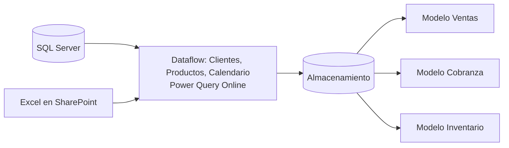

# Dataflows

Parte de: [[17-Power-BI/02 Power Query y el lenguaje M/_Índice Power Query y el lenguaje M|Power Query y el lenguaje M]]

> [!info] Cómo avanzar
> `progreso`: **pendiente** → **viendo** (estudiando) → **visto** (contestaste la autoevaluación sin abrir las respuestas) → **dominado** (hiciste el laboratorio o lo aplicaste de verdad).

## Contenido

### Qué es
Un **dataflow** (flujo de datos) es un conjunto de consultas de **Power Query que se crean y ejecutan en la nube** (Power BI Service o Fabric), en lugar de dentro de un `.pbix`. El resultado se guarda como tablas que otros pueden reutilizar: varios modelos semánticos se conectan al dataflow en lugar de repetir la misma extracción y limpieza. Es la capa de **preparación de datos compartida** del ecosistema.

### Cómo funciona

1. Se crea en un área de trabajo con **Power Query Online**: misma interfaz y mismo M que en Desktop (con indicadores de plegado y plan de consulta).
2. Se **actualiza** con su propio horario (y puerta de enlace si el origen es local).
3. Los modelos lo consumen con el conector **Dataflows** (Gen1) o leyendo el destino donde lo escribió (Gen2).

**Gen1 vs Gen2** (según Microsoft Learn, revisado en noviembre de 2026):

| | Dataflow Gen1 (Power BI) | Dataflow Gen2 (Fabric) |
|---|---|---|
| Dónde guarda | Su almacenamiento interno, leído con el conector de dataflows | Su almacenamiento o **destinos de datos**: Lakehouse, Warehouse, Azure SQL, KQL, ADLS Gen2, SharePoint, Snowflake, PostgreSQL… |
| Capacidad | Funciona en áreas Pro; algunas funciones (motor de cálculo mejorado, entidades calculadas) requieren Premium | Requiere capacidad **Fabric** (o prueba de Fabric o Premium) |
| Integración | Independiente | Se orquesta en **pipelines** de Data Factory con otras actividades |
| Experiencia | Guardado manual | Guardado automático, Monitoring Hub, historial de actualizaciones mejorado |
| CI/CD | Limitado | Los nuevos se crean con integración Git y canalizaciones |
| DirectQuery al dataflow | Sí (con motor mejorado) | No |

Gen2 se puede crear a partir de un Gen1 con *Guardar como*.

### Ejemplo
Tres modelos (Ventas, Cobranza, Inventario) usan las mismas dimensiones de Itzamna.Dionisio: `Clientes` (con limpieza de RFC y razón social), `Productos` (con jerarquía de categorías) y `Calendario` (con festivos de México). Hoy cada `.pbix` repite 40 pasos de Power Query y cada uno pega a la base a las 6:00.

Con un dataflow "Dimensiones Comunes":
- Las consultas viven una vez; un cambio en la regla de limpieza de RFC se hace en un solo lugar.
- La base recibe **una** extracción, no tres.
- Los modelos se conectan con *Obtener datos > Dataflows de Power BI* (Gen1) o leen las tablas del Lakehouse destino (Gen2).
- El dataflow se actualiza a las 5:30 y los modelos a las 6:00 (o se encadenan en un pipeline con Gen2).

### Cuándo usarlo y cuándo no
**Úsalo en vez de repetir la consulta en cada `.pbix`** cuando:
- Varias soluciones necesitan las mismas tablas con la misma lógica (dimensiones conformadas).
- Quieres aislar a los autores de informes del origen (no necesitan credenciales de la base).
- El origen es lento o caro de consultar y conviene extraer una sola vez.
- Necesitas que analistas sin Desktop preparen datos en el navegador.
- En Fabric, cuando quieres que el resultado aterrice en un Lakehouse o Warehouse.

**No lo uses** cuando:
- Solo un modelo usa esas tablas: añades una capa más que mantener y actualizar.
- La transformación es pesada y masiva: en Fabric, un notebook o un pipeline de copia puede ser más eficiente.
- Necesitas datos al minuto: el dataflow es otra actualización programada en la cadena.

### Errores comunes
- **Horarios desfasados**: el modelo se actualiza antes que el dataflow y lee datos de ayer.
- **Dataflows gigantes con todo**: mejor separarlos por dominio (dimensiones, ventas, cobranza).
- **Romper el plegado** en el dataflow igual que en Desktop.
- **Confundir Gen1 y Gen2** al planear licencias: Gen2 necesita capacidad Fabric.
- **Duplicar la lógica de nuevo** en el modelo después de leer el dataflow.

### Para profundizar
- [Introducción a los dataflows y la preparación de datos de autoservicio](https://learn.microsoft.com/es-mx/power-bi/transform-model/dataflows/dataflows-introduction-self-service)
- [Diferencias entre Dataflow Gen1 y Gen2](https://learn.microsoft.com/es-mx/fabric/data-factory/dataflows-gen2-overview)
- [Destinos de datos en Dataflow Gen2](https://learn.microsoft.com/es-mx/fabric/data-factory/dataflow-gen2-data-destinations-and-managed-settings)

Relacionado: [[Fabric - Lakehouse, Warehouse y OneLake]], [[Actualización programada]], [[Linaje de datos]].

## Autoevaluación

Contesta primero en voz alta o en papel; luego despliega la respuesta.

> [!question]- ¿Qué es un dataflow?
> Power Query en el Service (Power Query Online): las consultas se ejecutan y almacenan en la nube para que varios modelos reutilicen los mismos datos limpios.

> [!question]- ¿Cuándo usar un dataflow en vez de repetir la consulta en cada .pbix?
> Cuando varias personas o modelos usan la misma tabla (catálogo de clientes, calendario corporativo): una sola lógica, un solo punto de mantenimiento.

> [!question]- ¿Qué diferencia hay entre Dataflow Gen1 y Gen2?
> Gen2 es la versión de Fabric: puede escribir el resultado en destinos como un Lakehouse o Warehouse. Gen1 guarda en el almacenamiento propio del dataflow. Funciones exactas y requisitos: (verificar en la documentación).

