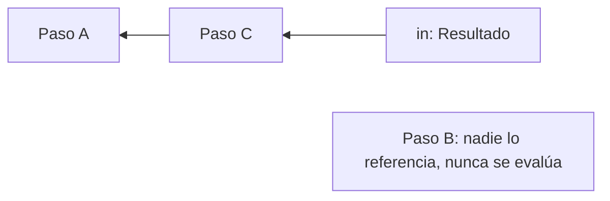

# Lenguaje M - let e in

Parte de: [[17-Power-BI/02 Power Query y el lenguaje M/_Índice Power Query y el lenguaje M|Power Query y el lenguaje M]]

> [!info] Cómo avanzar
> `progreso`: **pendiente** → **viendo** (estudiando) → **visto** (contestaste la autoevaluación sin abrir las respuestas) → **dominado** (hiciste el laboratorio o lo aplicaste de verdad).

## Contenido

### Qué es
**M** (oficialmente *Power Query Formula Language*) es el lenguaje funcional que hay detrás de cada consulta de Power Query. La estructura que verás siempre en el editor avanzado es la expresión **`let ... in`**: dentro de `let` defines variables con nombre (los "pasos aplicados"), separadas por coma; después de `in` va la expresión que la consulta **devuelve**, normalmente el último paso.

### Cómo funciona
```m
let
    Paso1 = expresión,
    Paso2 = algo que usa Paso1,
    #"Paso con espacios" = algo que usa Paso2
in
    #"Paso con espacios"
```

Reglas clave:

- **Cada paso es una variable inmutable.** No hay asignación ni bucles `for`; cada paso produce un valor nuevo a partir de otros.
- **Nombres con espacios o caracteres especiales** se escriben como identificadores entrecomillados: `#"Tipo cambiado"`, `#"Filas filtradas"`. Sin espacios no hace falta: `TipoCambiado`.
- **Comas**: entre pasos sí; después del último paso, antes de `in`, **no**.
- **Distingue mayúsculas**: `Table.AddColumn` existe, `table.addcolumn` no. También en nombres de columnas: `[fecha]` no es `[Fecha]`.
- **Comentarios**: `//` de una línea y `/* ... */` de bloque.
- **Evaluación perezosa** (*lazy*): M no ejecuta los pasos en el orden en que los escribes, sino que parte del resultado del `in` y evalúa **solo los pasos de los que depende**. Un paso que nadie usa nunca se evalúa (ni siquiera si contiene un `error`). El orden textual es para que lo lea un humano; la dependencia real la marcan las referencias.
- **`let` es una expresión** y puede anidarse dentro de otra, por ejemplo dentro de un `each` para calcular variables intermedias por fila.



### Ejemplo
Suma de los pares del 1 al 10:

```m
let
    Numeros = {1..10},
    Pares = List.Select(Numeros, each Number.Mod(_, 2) = 0),
    Suma = List.Sum(Pares)
in
    Suma   // 30
```

Evaluación perezosa:

```m
let
    A = 10,
    B = error "esto falla",   // nunca se evalúa: nadie lo usa
    C = A * 2
in
    C   // 20
```

`let` anidado en una columna personalizada, para calcular la antigüedad de un siniestro en días naturales:

```m
Table.AddColumn(Siniestros, "DiasAbierto", each
    let
        inicio = [FechaReporte],
        fin = [FechaCierre] ?? Date.From(DateTime.LocalNow()),
        dias = Duration.Days(fin - inicio)
    in
        dias, Int64.Type)
```

Calendario completo en una consulta en blanco:

```m
let
    Ini = #date(2024, 1, 1),
    Fin = #date(2025, 12, 31),
    Fechas = List.Dates(Ini, Duration.Days(Fin - Ini) + 1, #duration(1, 0, 0, 0)),
    Tabla = Table.FromList(Fechas, Splitter.SplitByNothing(), {"Fecha"}),
    Tipo = Table.TransformColumnTypes(Tabla, {{"Fecha", type date}}),
    ConAño = Table.AddColumn(Tipo, "Año", each Date.Year([Fecha]), Int64.Type),
    ConMes = Table.AddColumn(ConAño, "NumMes", each Date.Month([Fecha]), Int64.Type),
    ConNombre = Table.AddColumn(ConMes, "Mes", each Date.MonthName([Fecha], "es-MX"), type text)
in
    ConNombre
```

### Cuándo usarlo y cuándo no
- **Edita en el editor avanzado** para reordenar, renombrar, consolidar pasos y escribir lógica que la interfaz no ofrece.
- **Devuelve un paso intermedio** en el `in` para depurar: cambias `in Resultado` por `in PasoSospechoso` y ves qué hay ahí.
- **Usa `let` anidado** dentro de columnas personalizadas cuando una expresión por fila necesita dos o tres valores intermedios; se lee mucho mejor que una sola línea con paréntesis anidados y no cuesta rendimiento.
- **No escribas todo a mano** si la interfaz lo genera: el código generado suele plegar bien.

### Errores comunes
- **Coma después del último paso** o falta de coma entre dos pasos: `Token Comma expected` o `Token Identifier expected`.
- **Mayúsculas incorrectas** en funciones o columnas.
- **Renombrar un paso** en el editor avanzado sin actualizar las referencias.
- **Asumir orden de ejecución**: un paso con `DateTime.LocalNow()` no se evalúa "antes" que otro por estar arriba.
- **Olvidar el `#` en nombres con espacios**.

### Para profundizar
- [Introducción al lenguaje M](https://learn.microsoft.com/es-mx/powerquery-m/m-spec-introduction)
- [Expresión let en la especificación](https://learn.microsoft.com/es-mx/powerquery-m/m-spec-let)
- [Referencia de funciones de M](https://learn.microsoft.com/es-mx/powerquery-m/power-query-m-function-reference)

Relacionado: [[Lenguaje M - tipos (listas, registros y tablas)]], [[Lenguaje M - funciones y recursividad]].

## Ejercicios

Resuélvelos en papel o en la herramienta; la solución está plegada.

> [!question]- Escribe un `let` que cree una lista del 1 al 10, se quede con los pares y devuelva su suma.
> ```m
> let
>     L = {1..10},
>     Pares = List.Select(L, each Number.Mod(_, 2) = 0),
>     Suma = List.Sum(Pares)
> in
>     Suma   // 30
> ```

> [!question]- Escribe una consulta en blanco que genere una tabla Calendario del 2024-01-01 al 2025-12-31 con Fecha, Año, NumMes y Mes (texto en español).
> ```m
> let
>     Ini = #date(2024, 1, 1),
>     Fin = #date(2025, 12, 31),
>     Dias = Duration.Days(Fin - Ini) + 1,
>     Lista = List.Dates(Ini, Dias, #duration(1, 0, 0, 0)),
>     T = Table.FromList(Lista, Splitter.SplitByNothing(), {"Fecha"}),
>     Tipo = Table.TransformColumnTypes(T, {{"Fecha", type date}}),
>     Año = Table.AddColumn(Tipo, "Año", each Date.Year([Fecha]), Int64.Type),
>     NumMes = Table.AddColumn(Año, "NumMes", each Date.Month([Fecha]), Int64.Type),
>     Mes = Table.AddColumn(NumMes, "Mes", each Date.MonthName([Fecha], "es-MX"), type text)
> in
>     Mes
> ```
> 731 filas (2024 es bisiesto).

> [!question]- ¿Qué devuelve esta consulta y qué paso nunca se evalúa?
```m
let
    A = 10,
    C = error "falla",
    D = A * 2
in
    D
```
> Devuelve 20. `C` no se evalúa porque `D` no depende de ellos: M es perezoso, así que el `error` de `C` no se lanza.

## Autoevaluación

Contesta primero en voz alta o en papel; luego despliega la respuesta.

> [!question]- ¿Qué es una expresión `let ... in`?
> Define variables (pasos) separadas por coma dentro de `let` y devuelve la expresión después de `in`, normalmente el último paso.

> [!question]- ¿M se evalúa en el orden en que escribes los pasos?
> No necesariamente: es un lenguaje funcional y perezoso (lazy). Se evalúan los pasos de los que depende el resultado; un paso no usado puede no ejecutarse.

> [!question]- ¿Cómo se nombra un paso con espacios?
> Con `#"Nombre con espacios"`, p. ej. `#"Tipo cambiado"`.

> [!question]- Error común en el editor avanzado.
> Olvidar la coma entre pasos, o dejar coma después del último paso antes de `in`. También: M distingue mayúsculas (`table.addcolumn` no existe).

## Práctica

- [[Lab 3 - Consumir un API en Power Query]]

