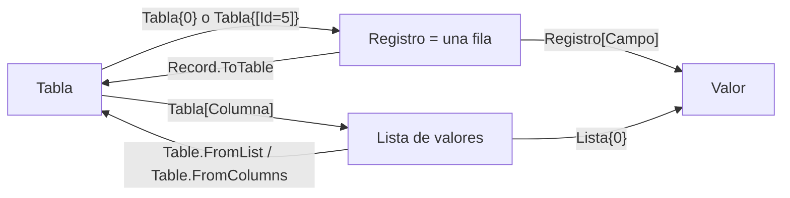

# Lenguaje M - tipos (listas, registros y tablas)

Parte de: [[17-Power-BI/02 Power Query y el lenguaje M/_Índice Power Query y el lenguaje M|Power Query y el lenguaje M]]

> [!info] Cómo avanzar
> `progreso`: **pendiente** → **viendo** (estudiando) → **visto** (contestaste la autoevaluación sin abrir las respuestas) → **dominado** (hiciste el laboratorio o lo aplicaste de verdad).

## Contenido

### Qué es
En M todo es un **valor**. Hay valores **primitivos** (un solo dato) y valores **estructurados** (colecciones). Entender las tres estructuras —**listas**, **registros** y **tablas**— y cómo pasar de una a otra es lo que te permite leer y escribir M con soltura, porque casi todas las funciones reciben o devuelven alguna de ellas.

- **Primitivos**: `number` (`3`, `2.5`), `text` (`"hola"`), `logical` (`true`), `date` (`#date(2025, 3, 1)`), `time`, `datetime`, `datetimezone`, `duration` (`#duration(1, 0, 0, 0)`), `binary` y **`null`**. `null` representa la **ausencia de valor**: no es 0 ni texto vacío; casi cualquier operación con `null` devuelve `null` (`null + 1 = null`), y se compara con `= null`.
- **Estructurados**: lista, registro, tabla y función.

### Cómo funciona
| Estructura | Literal | Se parece a | Detalle |
|---|---|---|---|
| **Lista** | `{1, 2, 3}` | Arreglo / `List<T>` | Valores ordenados, cualquier tipo. [[Listas en M]] |
| **Registro** | `[Id = 1, Nombre = "Café"]` | Objeto / `Dictionary` / fila | Campos con nombre. [[Registros en M]] |
| **Tabla** | `#table({"Id", "Nombre"}, {{1, "Café"}})` | `DataTable` | Columnas con nombre y filas. [[Tablas en M]] |

La relación entre ellas es lo más importante:



- `Ventas[Importe]` → la **columna** `Importe` como **lista**.
- `Ventas{0}` → la **primera fila** como **registro** (índice desde 0).
- `Productos{[Id = 5]}` → la fila cuyo `Id` es 5, como **registro**. Si no hay ninguna o hay más de una, da **error**; con `?` al final (`Productos{[Id = 5]}?`) devuelve `null` si no existe.
- `Productos{[Id = 5]}[Nombre]` → el valor del campo.
- Llaves `{}` = acceso por **posición** o lista; corchetes `[]` = acceso por **nombre** o registro.

### Ejemplo
Total de `Importe` usando la columna como lista:

```m
Total = List.Sum(Ventas[Importe])
```

Tabla literal y búsqueda por clave:

```m
let
    Productos = #table(
        type table [Id = Int64.Type, Nombre = text],
        {{1, "Café"}, {2, "Té"}}),
    Nombre2 = Productos{[Id = 2]}[Nombre]   // "Té"
in
    Nombre2
```

Registro a tabla de dos columnas:

```m
let
    r = [a = 1, b = 2],
    t = Record.ToTable(r),   // columnas Name y Value
    t2 = Table.RenameColumns(t, {{"Name", "Campo"}, {"Value", "Valor"}})
in
    t2
```

Así se ve en la práctica la navegación de un origen SQL Server: `Origen{[Schema = "dbo", Item = "Venta"]}[Data]` es "de la tabla de objetos de la base, la fila cuyo esquema es dbo e item es Venta, y de ese registro el campo Data", que es a su vez una tabla.

### Cuándo usarlo y cuándo no
- **Listas** para conjuntos de valores, parámetros con varios valores y operaciones como sumar, filtrar o generar series.
- **Registros** para filas, configuraciones (`[Delimiter = ",", Encoding = 65001]`), cuerpos JSON y búsquedas.
- **Tablas** para todo lo que se cargará al modelo.
- Cuando una transformación de tabla existe (`Table.Group`), úsala en vez de convertir a listas y reconstruir: es más clara y puede plegar.

### Errores comunes
- **Confundir `{}` y `[]`**: `Ventas{"Importe"}` no existe; es `Ventas[Importe]`.
- **`Tabla{[Id = 5]}` con claves duplicadas** → error "la clave coincidió con más de una fila".
- **Índices desde 1**: en M empiezan en 0.
- **Tratar `null` como 0** en sumas manuales; `List.Sum` ignora nulos, pero `a + b` no.

### Para profundizar
- [Valores en la especificación de M](https://learn.microsoft.com/es-mx/powerquery-m/m-spec-values)
- [Tipos en la especificación de M](https://learn.microsoft.com/es-mx/powerquery-m/m-spec-types)
- [Operadores de acceso a elementos y campos](https://learn.microsoft.com/es-mx/powerquery-m/m-spec-operators)

## Subtemas

- [[Listas en M]]
- [[Registros en M]]
- [[Tablas en M]]

## Ejercicios

Resuélvelos en papel o en la herramienta; la solución está plegada.

> [!question]- Dada `Ventas`, obtén el total de `Importe` usando la columna como lista.
> ```m
> List.Sum(Ventas[Importe])
> ```

> [!question]- Construye una tabla literal con dos productos (Id, Nombre) y obtén el nombre del Id 2.
> ```m
> let
>     P = #table(type table [Id = Int64.Type, Nombre = text], {{1, "Café"}, {2, "Té"}}),
>     N = P{[Id = 2]}[Nombre]
> in
>     N   // "Té"
> ```

> [!question]- Convierte el registro `[a = 1, b = 2]` en una tabla de dos columnas Campo y Valor.
> ```m
> Record.ToTable([a = 1, b = 2])   // columnas Name y Value
> ```

## Autoevaluación

Contesta primero en voz alta o en papel; luego despliega la respuesta.

> [!question]- ¿Cómo se escribe una lista, un registro y una tabla literal en M?
> Lista: `{1, 2, 3}`. Registro: `[Nombre = "Ana", Edad = 30]`. Tabla: `#table({"A", "B"}, {{1, "x"}, {2, "y"}})`.

> [!question]- ¿Cómo obtienes una columna de una tabla como lista y una fila como registro?
> Columna: `Tabla[Columna]`. Fila: `Tabla{0}` (índice base 0). Combinado: `Tabla{0}[Columna]`.

> [!question]- ¿Qué devuelve `Tabla{[Id = 5]}`?
> El registro de la fila cuyo `Id` es 5; si hay cero o más de una coincidencia, da error.

> [!question]- ¿Qué son los valores primitivos y qué es `null`?
> Números, texto, lógicos, fecha/hora, duración, binario; `null` representa ausencia de valor y se propaga en operaciones (`null + 1 = null`).

## Progreso de los subtemas

```base
filters:
  and:
    - file.inFolder("17-Power-BI/02 Power Query y el lenguaje M/Lenguaje M - tipos (listas, registros y tablas)")
    - file.name != "Lenguaje M - tipos (listas, registros y tablas)"
views:
  - type: table
    name: Progreso
    order:
      - file.name
      - progreso
      - nivel
```
