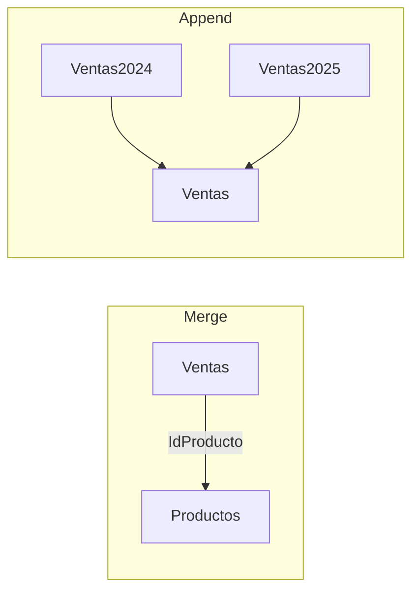

# Power Query - combinar consultas (merge y append)

Parte de: [[17-Power-BI/02 Power Query y el lenguaje M/_Índice Power Query y el lenguaje M|Power Query y el lenguaje M]]

> [!info] Cómo avanzar
> `progreso`: **pendiente** → **viendo** (estudiando) → **visto** (contestaste la autoevaluación sin abrir las respuestas) → **dominado** (hiciste el laboratorio o lo aplicaste de verdad).

## Contenido

### Qué es
Power Query tiene dos operaciones para juntar tablas, que en la interfaz están bajo *Inicio > Combinar*:

- **Combinar consultas (merge)**: une tablas **de lado**, por columnas clave, como un `JOIN` de SQL. Agrega columnas.
- **Anexar consultas (append)**: apila tablas **una debajo de otra**, como un `UNION ALL`. Agrega filas.

### Cómo funciona
**Merge** con `Table.NestedJoin`: produce una columna nueva cuyo valor en cada fila es una **tabla** con las filas coincidentes de la otra consulta; después la **expandes** para traer solo las columnas que necesitas.

| Tipo (`JoinKind`) | Equivalente SQL | Qué filas conserva |
|---|---|---|
| `LeftOuter` | `LEFT JOIN` | Todas las de la izquierda |
| `RightOuter` | `RIGHT JOIN` | Todas las de la derecha |
| `FullOuter` | `FULL JOIN` | Todas |
| `Inner` | `INNER JOIN` | Solo coincidentes |
| `LeftAnti` | `WHERE NOT EXISTS` | Izquierda **sin** coincidencia |
| `RightAnti` | — | Derecha sin coincidencia |

Hay además **combinación aproximada** (*fuzzy*) para unir textos parecidos ("Acme SA" con "ACME, S.A."), con umbral de similitud.

**Append** con `Table.Combine({t1, t2, ...})`: junta columnas **por nombre**. Si una tabla tiene una columna que la otra no, la columna aparece y se llena con `null` donde falte.



### Ejemplo
Merge izquierdo de `Ventas` con `Productos` trayendo solo `Categoria`:

```m
let
    Combinada = Table.NestedJoin(Ventas, {"IdProducto"}, Productos, {"IdProducto"},
        "Prod", JoinKind.LeftOuter),
    Expandida = Table.ExpandTableColumn(Combinada, "Prod", {"Categoria"}, {"Categoria"})
in
    Expandida
```

Anexar dos años:

```m
Ventas = Table.Combine({Ventas2024, Ventas2025})
```

Ventas cuyo producto no existe en el catálogo (control de calidad):

```m
let
    Anti = Table.NestedJoin(Ventas, {"IdProducto"}, Productos, {"IdProducto"},
        "P", JoinKind.LeftAnti),
    Huerfanos = Table.Distinct(Table.SelectColumns(Anti, {"IdProducto"}))
in
    Huerfanos
```

Si `Ventas` y `Productos` vienen de la misma base SQL Server, estas combinaciones se **pliegan** a un `JOIN`/`NOT EXISTS` en el servidor.

### Cuándo usarlo y cuándo no
- **Append** casi siempre conviene: varios archivos o años del mismo esquema se convierten en una sola tabla de hechos.
- **Merge** úsalo para **validar** (anti join), para traer un atributo a una dimensión (aplanar un copo de nieve) o para construir una tabla de hechos a partir de encabezado + detalle.
- **No hagas merge** para traer atributos de una dimensión a la tabla de hechos "por comodidad": el modelo estrella con relaciones hace ese trabajo mejor y sin duplicar texto en millones de filas.
- Si el origen es SQL y la combinación es estable, considera hacerla en una **vista**.

### Errores comunes
- **Tras un merge izquierdo aumentan las filas.** Ocurre cuando la tabla derecha tiene la clave **repetida** (por ejemplo, el mismo `IdProducto` dos veces en el catálogo): cada fila de ventas se multiplica por cada coincidencia. Revisa que la derecha sea única (*Distribución de columnas* o `Table.Distinct` sobre la clave) antes de expandir.
- **Anexar columnas con nombres distintos** (`Fecha` y `fecha`): M distingue mayúsculas, así que quedan **dos columnas** distintas, cada una con `null` en las filas de la otra tabla. Renombra antes de anexar.
- **Claves de tipo distinto** (texto `"0015"` contra número `15`) y merge sin coincidencias.
- **Expandir todas las columnas** de la tabla derecha, con nombres prefijados (`Prod.Nombre`), en lugar de elegir solo las necesarias.
- **Merge entre orígenes distintos** (Excel con SQL): no pliega y puede chocar con niveles de privacidad.

### Para profundizar
- [Información general de combinar consultas](https://learn.microsoft.com/es-mx/power-query/merge-queries-overview)
- [Anexar consultas](https://learn.microsoft.com/es-mx/power-query/append-queries)
- [Combinación aproximada (fuzzy merge)](https://learn.microsoft.com/es-mx/power-query/merge-queries-fuzzy-match)

Practica en [[Lab 2 - Limpieza y combinación de datos en Power Query]].

## Ejercicios

Resuélvelos en papel o en la herramienta; la solución está plegada.

> [!question]- Haz un merge izquierdo de `Ventas` con `Productos` por IdProducto y trae solo `Categoria`.
> ```m
> M = Table.NestedJoin(Ventas, {"IdProducto"}, Productos, {"IdProducto"}, "P", JoinKind.LeftOuter),
> X = Table.ExpandTableColumn(M, "P", {"Categoria"}, {"Categoria"})
> ```

> [!question]- Anexa `Ventas2024` y `Ventas2025`.
> ```m
> Todas = Table.Combine({Ventas2024, Ventas2025})
> ```

> [!question]- Obtén los IdProducto de Ventas que no existen en Productos.
> ```m
> Anti = Table.NestedJoin(Ventas, {"IdProducto"}, Productos, {"IdProducto"}, "P", JoinKind.LeftAnti),
> Huérfanos = Table.Distinct(Table.SelectColumns(Anti, {"IdProducto"}))
> ```

## Autoevaluación

Contesta primero en voz alta o en papel; luego despliega la respuesta.

> [!question]- ¿Diferencia entre combinar (merge) y anexar (append)?
> Merge une columnas de dos tablas por una clave (como un JOIN). Append apila filas de tablas con columnas similares (como UNION ALL).

> [!question]- ¿Qué tipo de combinación usas para encontrar ventas cuyo producto no existe en el catálogo?
> *Anti izquierda* (`JoinKind.LeftAnti`): filas de Ventas sin coincidencia en Productos.

> [!question]- Error común: tras un merge izquierdo el número de filas aumenta. ¿Por qué?
> La tabla derecha tiene claves duplicadas, así que cada fila de la izquierda se repite por cada coincidencia. Quitar duplicados en la clave de la derecha antes del merge.

> [!question]- Al anexar dos tablas con nombres de columna distintos (`Fecha` y `fecha`), ¿qué pasa?
> Power Query distingue mayúsculas: crea dos columnas, cada una con nulls en las filas de la otra tabla. Hay que renombrar para que coincidan.

## Práctica

- [[Lab 2 - Limpieza y combinación de datos en Power Query]]

