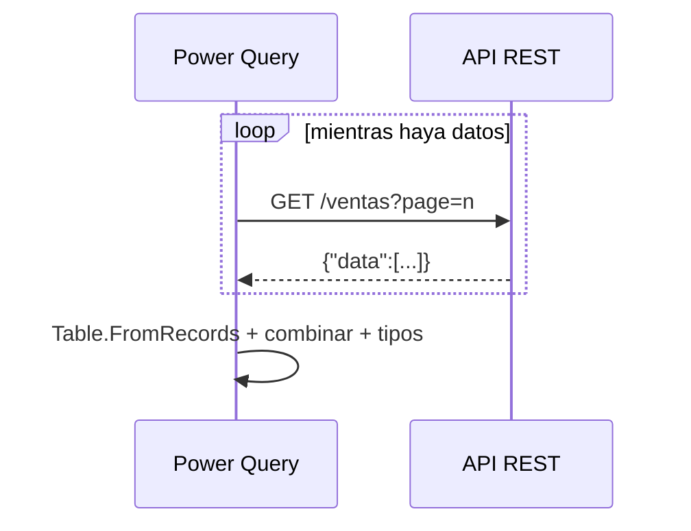

# Power Query - consumir un API

Parte de: [[17-Power-BI/02 Power Query y el lenguaje M/_Índice Power Query y el lenguaje M|Power Query y el lenguaje M]]

> [!info] Cómo avanzar
> `progreso`: **pendiente** → **viendo** (estudiando) → **visto** (contestaste la autoevaluación sin abrir las respuestas) → **dominado** (hiciste el laboratorio o lo aplicaste de verdad).

## Contenido

### Qué es
Power Query puede leer **APIs REST** que devuelven JSON (o XML/CSV) con dos funciones: **`Web.Contents`**, que hace la petición HTTP y devuelve el cuerpo como binario, y **`Json.Document`**, que convierte ese binario en listas y registros de M. Después lo conviertes en tabla, lo expandes y lo tipas. Es la forma de traer datos de un sistema al que no tienes acceso directo a la base, por ejemplo tu propio API de Itzamna.Dionisio.

### Cómo funciona
```m
Web.Contents(urlBase, [
    RelativePath = "v1/ventas",
    Query = [desde = "2025-01-01", page = "1"],   // valores de texto
    Headers = [Accept = "application/json"],
    Timeout = #duration(0, 0, 2, 0)
])
```

1. **URL base estática + `RelativePath` + `Query`**. El Service valida y prepara la actualización analizando la URL **base** de `Web.Contents`; si la construyes concatenando textos con valores variables, el origen se considera **dinámico** y la actualización programada puede no estar permitida. Además, `Query` codifica correctamente los parámetros (espacios, acentos, `&`).
2. **Autenticación**: configúrala en *Configuración de origen de datos* (anónima, básica, clave de API en encabezado para conectores que lo soportan, cuenta organizativa). **Un token o API key nunca va en el código M** ni en un parámetro visible: queda guardado en el `.pbix`, en Git y a la vista de cualquiera que abra el editor avanzado. Si el API exige un token en encabezado, lo correcto es usar una puerta de enlace con credenciales, un conector personalizado, o exponer los datos por otro medio (una vista o un dataflow con credenciales administradas).
3. **`Json.Document`** devuelve una lista (arreglo JSON) o un registro (objeto).
4. **Paginación**: con `List.Generate` pides página tras página hasta que venga vacía o no haya `next`, luego combinas.



### Ejemplo
Usuarios de un API público de prueba, con `id`, `name` y `email`:

```m
let
    Json = Json.Document(Web.Contents("https://jsonplaceholder.typicode.com", [RelativePath = "users"])),
    Tabla = Table.FromRecords(Json, {"id", "name", "email"}, MissingField.UseNull),
    Tipos = Table.TransformColumnTypes(Tabla, {{"id", Int64.Type}, {"name", type text}, {"email", type text}})
in
    Tipos
```

Función con parámetro de consulta:

```m
// fnPosts
(userId as number) as table =>
let
    Json = Json.Document(Web.Contents("https://jsonplaceholder.typicode.com",
        [RelativePath = "posts", Query = [userId = Text.From(userId)]])),
    Tabla = Table.FromRecords(Json)
in
    Tabla
```

Paginación de un API que recibe `?page=n` y devuelve `{"data": []}` vacío al terminar:

```m
let
    Base = "https://api.ejemplo.mx",
    Pagina = (n as number) as list =>
        Json.Document(Web.Contents(Base, [RelativePath = "v1/ventas", Query = [page = Text.From(n)]]))[data],
    Paginas = List.Generate(
        () => [n = 1, datos = Pagina(1)],
        each not List.IsEmpty([datos]),
        each [n = [n] + 1, datos = Pagina([n] + 1)],
        each [datos]),
    Registros = List.Combine(Paginas),
    Tabla = Table.FromRecords(Registros)
in
    Tabla
```

Si el API devuelve un enlace `next`, la condición es `[next] <> null` y la siguiente petición usa ese enlace (cuidando que la base siga siendo estática).

### Cuándo usarlo y cuándo no
- **Úsalo** para APIs de terceros, SaaS sin conector o tu propio API cuando no hay acceso a la base.
- **Prefiere la base de datos** o una exportación si existe: más rápida, plegable y sin límites de peticiones.
- **Para volúmenes grandes** o cargas frecuentes, mejor un proceso (Azure Function, pipeline de Fabric) que deje los datos en una tabla, y Power BI lee de ahí.
- Respeta los límites de peticiones (*rate limits*) del proveedor.

### Errores comunes
- **Concatenar la URL** y que el Service no permita la actualización.
- **Token en el código** o en un parámetro.
- **Una petición por fila** (invocar el API para cada uno de 20 000 registros).
- **Expandir con la lista de campos fija** y perder campos nuevos, o no usar `MissingField.UseNull` cuando hay registros incompletos.
- **No tipar** al final: todo queda como `any`.

### Para profundizar
- [Web.Contents](https://learn.microsoft.com/es-mx/powerquery-m/web-contents)
- [Json.Document](https://learn.microsoft.com/es-mx/powerquery-m/json-document)
- [Manejo de paginación en conectores](https://learn.microsoft.com/es-mx/power-query/handling-paging)
- [Actualización con orígenes dinámicos](https://learn.microsoft.com/es-mx/power-bi/connect-data/refresh-data)

Practica en [[Lab 3 - Consumir un API en Power Query]]. Relacionado: [[Power Query en Excel (consumir un API desde Excel)]].

## Ejercicios

Resuélvelos en papel o en la herramienta; la solución está plegada.

> [!question]- Trae `https://jsonplaceholder.typicode.com/users` y conviértelo en tabla con `id`, `name` y `email`.
> ```m
> let
>     Fuente = Json.Document(Web.Contents("https://jsonplaceholder.typicode.com", [RelativePath = "users"])),
>     Tabla = Table.FromRecords(Fuente),
>     Cols = Table.SelectColumns(Tabla, {"id", "name", "email"})
> in
>     Cols
> ```

> [!question]- Escribe una función `fnPosts(userId as number)` que traiga los posts de ese usuario con `Query`.
> ```m
> (userId as number) as table =>
> let
>     R = Json.Document(Web.Contents("https://jsonplaceholder.typicode.com",
>         [RelativePath = "posts", Query = [userId = Text.From(userId)]])),
>     T = Table.FromRecords(R)
> in
>     T
> ```
> Los valores de `Query` deben ser texto.

> [!question]- Pagina un API que recibe `?page=n` y devuelve `{"data": [...]}` vacío al terminar.
> ```m
> let
>     Pagina = (n as number) => Json.Document(Web.Contents("https://api.ejemplo.com",
>         [RelativePath = "items", Query = [page = Text.From(n)]]))[data],
>     Paginas = List.Generate(
>         () => [n = 1, d = Pagina(1)],
>         each List.Count([d]) > 0,
>         each [n = [n] + 1, d = Pagina([n] + 1)],
>         each [d]),
>     Tabla = Table.FromRecords(List.Combine(Paginas))
> in
>     Tabla
> ```

## Autoevaluación

Contesta primero en voz alta o en papel; luego despliega la respuesta.

> [!question]- ¿Qué funciones M se usan para consumir un API JSON?
> `Web.Contents` para la petición y `Json.Document` para convertir la respuesta; después `Table.FromRecords` o expandir listas/registros.

> [!question]- ¿Por qué usar `RelativePath` y `Query` en `Web.Contents` en vez de concatenar la URL?
> Porque el Service valida el origen con la URL base estática. Con URL armada dinámicamente, la actualización programada puede fallar por "origen dinámico". Con base fija + `RelativePath`/`Query` sí se puede actualizar.

> [!question]- ¿Dónde NO debe ir un token o API key?
> Escrito en el código M o en un parámetro visible del archivo compartido. Usar el tipo de credencial del conector (p. ej. *Web API* con clave) o encabezados con valores protegidos según la documentación del conector.

> [!question]- ¿Cómo se maneja la paginación?
> Con `List.Generate` (seguir mientras haya página siguiente) o generando la lista de números de página y llamando a una función por cada una; luego `Table.Combine`.

## Práctica

- [[Lab 3 - Consumir un API en Power Query]]

