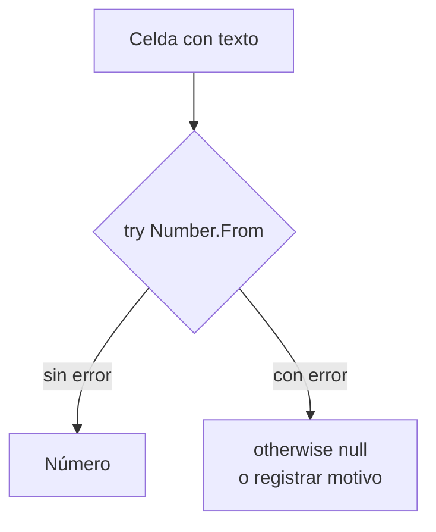

# Power Query - manejo de errores

Parte de: [[17-Power-BI/02 Power Query y el lenguaje M/_Índice Power Query y el lenguaje M|Power Query y el lenguaje M]]

> [!info] Cómo avanzar
> `progreso`: **pendiente** → **viendo** (estudiando) → **visto** (contestaste la autoevaluación sin abrir las respuestas) → **dominado** (hiciste el laboratorio o lo aplicaste de verdad).

## Contenido

### Qué es
En Power Query hay dos niveles de error y se tratan distinto:

- **Error a nivel de paso** (o de consulta): el paso completo falla y la consulta no devuelve nada. Ejemplos: no se encuentra el archivo, credenciales inválidas, una columna referenciada ya no existe (`Expression.Error: No se encontró la columna 'Fecha' de la tabla`). La vista previa muestra un mensaje amarillo y la actualización se detiene.
- **Error a nivel de celda**: la consulta funciona, pero algunas **celdas** contienen un valor de error, típicamente por una conversión fallida (`"N/A"` a número) o una operación inválida en una fila. Las ves como `Error` en la vista previa y en *Calidad de columna*. Al cargar, esas celdas quedan **vacías** en el modelo y Power BI te avisa con "*N filas con errores*".

### Cómo funciona
Un error en M es un **registro** con `Reason`, `Message` y `Detail`. Se maneja con `try`:

- `try expr` devuelve un registro `[HasError = true/false, Value = ...]` o `[HasError = true, Error = [Reason, Message, Detail]]`.
- `try expr otherwise valor` devuelve el resultado o, si falla, el valor alternativo. Es el atajo más usado.
- `error "mensaje"` o `error Error.Record("Razón", "Mensaje", detalle)` lanza un error propio.



Herramientas de la interfaz:
- *Reemplazar errores* (`Table.ReplaceErrorValues`): pone un valor fijo donde haya error.
- *Quitar errores* (`Table.RemoveRowsWithErrors`): borra las filas con error.
- *Conservar errores* (`Table.SelectRowsWithErrors`): deja **solo** las filas con error, ideal para una consulta de auditoría.

### Ejemplo
Convertir `Cantidad` (texto) a número, dejando `null` si no se puede:

```m
Cantidad = Table.TransformColumns(Origen, {{"Cantidad",
    each try Number.From(_, "es-MX") otherwise null, type nullable number}})
```

Columna `MotivoError` con el mensaje de la conversión de `Fecha`:

```m
ConMotivo = Table.AddColumn(Origen, "MotivoError", each
    let r = try Date.From([Fecha], "es-MX")
    in if r[HasError] then r[Error][Message] else null, type nullable text)
```

Reemplazar errores de `Precio` por 0:

```m
PrecioOk = Table.ReplaceErrorValues(ConTipos, {{"Precio", 0}})
```

Consulta de auditoría (carga deshabilitada o cargada a una página de calidad de datos):

```m
ErroresVentas = Table.SelectRowsWithErrors(VentasTipadas, {"Cantidad", "Precio", "Fecha"})
```

Error a nivel de paso controlado: si un archivo opcional no existe, devolver una tabla vacía con el mismo esquema en lugar de romper la actualización:

```m
Ajustes = try Excel.Workbook(File.Contents(pRutaAjustes)){[Item = "Ajustes", Kind = "Table"]}[Data]
          otherwise #table(type table [IdVenta = Int64.Type, Ajuste = Currency.Type], {})
```

### Cuándo usarlo y cuándo no
- **`try … otherwise null`** cuando un valor inválido realmente significa "desconocido" y lo vas a reportar.
- **Reemplazar por 0** solo si el negocio confirma que 0 es correcto (un precio de 0 cambia promedios).
- **Consulta de errores** siempre en procesos productivos: alguien debe ver qué se descartó.
- **Deja que falle** (error de paso) cuando el problema es grave: mejor una actualización fallida con alerta que un informe con datos incompletos que nadie nota.

### Errores comunes
- **"Quitar errores" sin revisar**: borras filas completas (con su importe) y los totales del informe dejan de cuadrar con el sistema origen sin que nadie lo sepa. Primero inspecciona con *Conservar errores*, corrige la causa (cultura, valores "N/A", formatos), y solo entonces decide.
- **`try` demasiado amplio** que oculta errores de credenciales o de esquema.
- **Ignorar el aviso de "filas con errores"** al cargar.
- **Corregir en DAX** (con `IFERROR`) lo que debió resolverse en Power Query.

### Para profundizar
- [Table.ReplaceErrorValues](https://learn.microsoft.com/es-mx/powerquery-m/table-replaceerrorvalues)
- [Tratar errores comunes en Power Query](https://learn.microsoft.com/es-mx/power-query/dealing-with-errors)
- [Manejo de errores en la especificación de M](https://learn.microsoft.com/es-mx/powerquery-m/m-spec-error-handling)

Relacionado: [[Power Query - tipos de datos]], [[Power Query - limpieza de datos]].

## Ejercicios

Resuélvelos en papel o en la herramienta; la solución está plegada.

> [!question]- Convierte `Cantidad` (texto) a número; si no se puede, deja null.
> ```m
> T = Table.TransformColumns(Origen, {{"Cantidad", each try Number.From(_) otherwise null, type nullable number}})
> ```

> [!question]- Agrega una columna `MotivoError` con el mensaje del error al convertir `Fecha` a fecha (o null si no hubo error).
> ```m
> T2 = Table.AddColumn(T, "MotivoError", each
>     let r = try Date.From([Fecha]) in if r[HasError] then r[Error][Message] else null, type nullable text)
> ```

> [!question]- Reemplaza los errores de la columna `Precio` por 0 con la función de tabla adecuada.
> ```m
> T3 = Table.ReplaceErrorValues(T, {{"Precio", 0}})
> ```

## Autoevaluación

Contesta primero en voz alta o en papel; luego despliega la respuesta.

> [!question]- ¿Qué diferencia hay entre un error a nivel de paso y uno a nivel de celda?
> Error de paso: la consulta completa falla (p. ej. columna inexistente, archivo no encontrado). Error de celda: solo algunas celdas contienen `Error` (p. ej. conversión de tipo) y se pueden filtrar o reemplazar.

> [!question]- ¿Qué hace `try ... otherwise`?
> Evalúa la expresión; si falla, devuelve el valor alternativo. `try x` solo devuelve un registro `[HasError, Value]` o `[HasError, Error]`.

> [!question]- Error común: *Quitar errores* sin revisar.
> Se pierden filas en silencio. Mejor primero aislar las filas con error (*Conservar errores*) para entender la causa y luego decidir.

## Práctica

- [[Lab 3 - Consumir un API en Power Query]]

