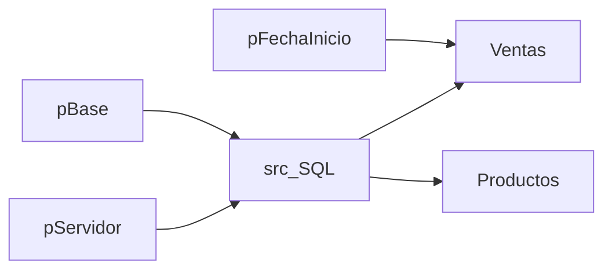

# Power Query - parámetros

Parte de: [[17-Power-BI/02 Power Query y el lenguaje M/_Índice Power Query y el lenguaje M|Power Query y el lenguaje M]]

> [!info] Cómo avanzar
> `progreso`: **pendiente** → **viendo** (estudiando) → **visto** (contestaste la autoevaluación sin abrir las respuestas) → **dominado** (hiciste el laboratorio o lo aplicaste de verdad).

## Contenido

### Qué es
Un **parámetro** en Power Query es una consulta especial que guarda un **valor** (texto, número, fecha, lista…) que otras consultas usan. Sirve para no repetir valores "quemados" en el código: servidor, base de datos, ruta de carpeta, fecha de inicio, ambiente (desarrollo o producción). Se crean con *Inicio > Administrar parámetros > Nuevo parámetro*.

### Cómo funciona
Un parámetro tiene nombre, descripción, si es **obligatorio**, **tipo** y **valores sugeridos** (cualquier valor, lista de valores o consulta). En M es una consulta cuyo valor está marcado con metadatos:

```m
"srv-sql-dev" meta [IsParameterQuery = true, Type = "Text", IsParameterQueryRequired = true]
```

Luego lo usas por nombre en cualquier paso: `Sql.Database(pServidor, pBase)`.



**Usos típicos**:
- **Cambiar de ambiente** (dev/QA/prod) sin tocar cada consulta.
- **Rutas** de archivos o carpetas que cambian según la máquina o el sitio de SharePoint.
- **Filtros de volumen**: en desarrollo traes solo el último mes para trabajar rápido; en producción, todo.
- **Actualización incremental**: los parámetros reservados `RangeStart` y `RangeEnd` (tipo fecha/hora).
- **Plantillas `.pbit`**: al abrir la plantilla, Desktop pide los valores de los parámetros.
- **Parámetros de funciones personalizadas** y de **consultas nativas**.

**¿Se pueden cambiar en el Service?** Sí. En el modelo semántico publicado: *Configuración > Parámetros*, cambias el valor y vuelves a actualizar. También por API REST (`UpdateParameters`) y en **canalizaciones de implementación** con reglas de parámetro por fase (dev apunta a `srv-sql-dev`, prod a `srv-sql-prod`). Hay restricciones: el parámetro debe tener un tipo compatible y algunos casos (como parámetros usados en orígenes dinámicos complejos) no se pueden editar desde allí.

### Ejemplo
Modelo de Itzamna.Dionisio que debe apuntar a la base de desarrollo en tu PC y a la de producción en el Service:

```m
// Parámetro pServidor (Texto, obligatorio)
"localhost" meta [IsParameterQuery = true, Type = "Text", IsParameterQueryRequired = true]

// Parámetro pFilasDev (Número): 0 = sin límite
1000 meta [IsParameterQuery = true, Type = "Number", IsParameterQueryRequired = true]

// Consulta Ventas
let
    Origen = Sql.Database(pServidor, "Dionisio"),
    Ventas = Origen{[Schema = "bi", Item = "vw_Ventas"]}[Data],
    Muestra = if pFilasDev > 0 then Table.FirstN(Ventas, pFilasDev) else Ventas
in
    Muestra
```

`Table.FirstN` se pliega a `SELECT TOP (1000)`. En el Service, en *Parámetros*, pones `pServidor = srv-sql-prod` y `pFilasDev = 0`.

### Cuándo usarlo y cuándo no
- **Úsalos** para cualquier valor que pueda cambiar entre ambientes, máquinas o el tiempo.
- **No los uses** para filtros que debe controlar el lector del informe: eso es una segmentación o un filtro de informe. (Para filtros dinámicos en DirectQuery existe la vinculación de parámetros M a campos, un caso avanzado.)
- Para secretos (tokens, contraseñas) **no**: las credenciales van en la configuración de origen de datos, no en parámetros visibles.

### Errores comunes
- **Parámetro de ruta en una consulta de Excel**: el conector Excel no "sabe" que el parámetro es la ruta y al refrescar en otra máquina o en el Service falla si el valor apunta a `C:\Users\…`. Además, si construyes la ruta concatenando partes, el Service puede marcar el origen como **dinámico** y no permitir la actualización. Usa la ruta completa como un solo parámetro de texto, preferentemente a SharePoint/OneDrive, y verifica en el Service que el origen se detecte.
- **Tipo `Any`**: el Service no permite editarlo bien; declara el tipo.
- **Olvidar regresar `pFilasDev` a 0** antes de publicar y tener un informe con mil filas.
- **Credenciales distintas** por ambiente: cambiar el servidor implica configurar credenciales para el nuevo origen.

### Para profundizar
- [Uso de parámetros en Power Query](https://learn.microsoft.com/es-mx/power-query/power-query-query-parameters)
- [Parámetros dinámicos de M en DirectQuery](https://learn.microsoft.com/es-mx/power-bi/connect-data/desktop-dynamic-m-query-parameters)
- [Reglas de implementación en canalizaciones](https://learn.microsoft.com/es-mx/fabric/cicd/deployment-pipelines/create-rules)

Relacionado: [[Actualización incremental]], [[Canalizaciones de implementación (deployment pipelines)]].

## Autoevaluación

Contesta primero en voz alta o en papel; luego despliega la respuesta.

> [!question]- ¿Para qué sirven los parámetros?
> Para centralizar valores que cambian: ruta de archivos, servidor/base (desarrollo vs producción), fechas de corte, URL base de un API. También son necesarios para actualización incremental (`RangeStart`/`RangeEnd`).

> [!question]- ¿Se pueden cambiar parámetros en el Service?
> Sí, en la configuración del modelo semántico (*Parámetros*), sin volver a publicar, siempre que sean de tipos soportados.

> [!question]- Error común con un parámetro de ruta en una consulta Excel.
> Usar el parámetro de tipo distinto a texto o con comillas extra; la ruta debe ser texto y la función `Excel.Workbook(File.Contents(RutaArchivo))` lo recibe tal cual.

## Práctica

- [[Lab 3 - Consumir un API en Power Query]]

