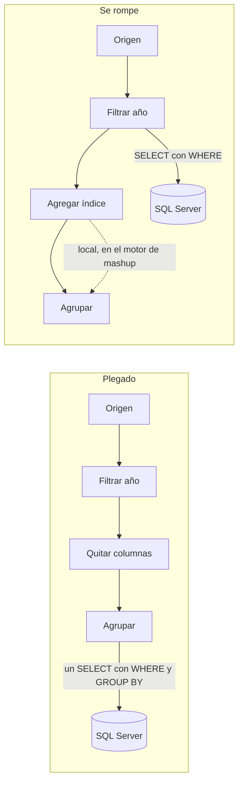

# Query folding

Parte de: [[17-Power-BI/02 Power Query y el lenguaje M/_Índice Power Query y el lenguaje M|Power Query y el lenguaje M]]

> [!info] Cómo avanzar
> `progreso`: **pendiente** → **viendo** (estudiando) → **visto** (contestaste la autoevaluación sin abrir las respuestas) → **dominado** (hiciste el laboratorio o lo aplicaste de verdad).

## Contenido

### Qué es
El **plegado de consultas** (*query folding*) es la capacidad de Power Query de **traducir tus pasos M a una sola consulta en el lenguaje del origen** (SQL en SQL Server) y mandarla al servidor, en lugar de traer todas las filas y transformarlas en la máquina que actualiza. Si filtras 2025, quitas columnas y agrupas por mes, con plegado el servidor recibe un `SELECT ... WHERE ... GROUP BY` y devuelve pocas filas; sin plegado, viajan millones de filas por la red y el motor de mashup hace el trabajo en memoria.

### Cómo funciona


Power Query intenta plegar **desde el primer paso hacia abajo**. En cuanto encuentra un paso que el origen no sabe hacer, **ese paso y todos los siguientes** se ejecutan localmente, aunque después vengan pasos que sí serían plegables. Por eso el orden importa.

**Pasos que suelen plegarse** (en orígenes relacionales): filtrar filas, quitar o elegir columnas, renombrar, ordenar, agrupar, combinar (merge) y anexar consultas **del mismo origen**, cambiar tipos sencillos, columnas condicionales y aritméticas simples, `Table.FirstN` (TOP).

**Pasos que suelen romperlo**: agregar columna de **índice**, funciones de texto sin equivalente SQL (`Text.Proper`, *Limpiar*), *Columna a partir de ejemplos* complejas, pivotar/despivotar en algunos conectores, combinar con otro origen (Excel con SQL), invocar funciones personalizadas por fila, `Table.Buffer`, cambiar tipo con cultura en ciertos casos, y escribir una **consulta nativa** SQL a mano sin habilitar el plegado (`EnableFolding = true`).

**Cómo saber si un paso se pliega**:
- En **Power BI Desktop**: clic derecho en el paso > **Ver consulta nativa**. Si está habilitado, muestra el SQL que se enviará y el paso pliega; si está atenuado, no pliega (o el conector no lo informa). Revisa el último paso.
- **Diagnóstico de consultas** (*Herramientas > Iniciar diagnóstico*) para ver qué se envió.
- En **Power Query Online** (Dataflows, Fabric) hay **indicadores de plegado** junto a cada paso (plegado, no plegado, opaco…) y un **plan de consulta**; en Desktop no existen.
- Del lado del servidor: Extended Events o Profiler de SQL Server muestran el SQL recibido.

### Ejemplo
```m
let
    Origen = Sql.Database("srv-sql01", "Dionisio"),
    Ventas = Origen{[Schema = "dbo", Item = "Venta"]}[Data],
    // pliega: WHERE
    Recientes = Table.SelectRows(Ventas, each [Fecha] >= #date(2024, 1, 1)),
    // pliega: lista de columnas en el SELECT
    Cols = Table.SelectColumns(Recientes, {"Fecha", "IdProducto", "Cantidad", "Importe"}),
    // pliega: GROUP BY
    PorDia = Table.Group(Cols, {"Fecha", "IdProducto"}, {
        {"Cantidad", each List.Sum([Cantidad]), Int64.Type},
        {"Importe", each List.Sum([Importe]), Currency.Type}}),
    // ROMPE el plegado: índice no tiene equivalente directo; ponlo al final o no lo uses
    ConIndice = Table.AddIndexColumn(PorDia, "Fila", 1, 1, Int64.Type)
in
    ConIndice
```

*Ver consulta nativa* en `PorDia` muestra algo como `select [Fecha], [IdProducto], sum([Cantidad]) ... where [Fecha] >= '2024-01-01' group by ...`. En `ConIndice` está atenuado.

### Cuándo usarlo y cuándo no
- **Siempre busca plegar** con orígenes relacionales: actualizaciones más rápidas, menos red y menos memoria en la puerta de enlace.
- **Ordena los pasos**: primero filtros y columnas (plegables), al final lo que no pliegue.
- **Si una transformación no pliega y la tabla es grande**, muévela a una vista SQL.
- **Es crítico para la actualización incremental**: el filtro con `RangeStart`/`RangeEnd` debe plegarse para que cada partición pida al servidor solo su rango de fechas. Si no se pliega, cada partición descarga la tabla completa y filtra localmente: la actualización incremental se vuelve más lenta que una completa. En **DirectQuery**, todo debe plegar o el paso ni se permite.
- Con archivos (Excel, CSV) no hay plegado: no te preocupes por él ahí.

### Errores comunes
- **Un paso no plegable al inicio** (por ejemplo, *Usar primera fila como encabezado* sobre una tabla SQL que ya tiene encabezados, o un índice) que arruina todo lo que sigue.
- **Combinar SQL con un Excel** antes de filtrar la tabla grande.
- **Consulta nativa** pegada en el conector, que bloquea el plegado de los pasos siguientes.
- **Niveles de privacidad** que impiden plegar al combinar orígenes.
- **Creer que "Ver consulta nativa" atenuado siempre significa no plegado**: algunos conectores no lo muestran aunque plieguen; confirma con diagnóstico o con el servidor.

### Para profundizar
- [Información general sobre el plegado de consultas](https://learn.microsoft.com/es-mx/power-query/query-folding-basics)
- [Guía de plegado de consultas en Power BI Desktop](https://learn.microsoft.com/es-mx/power-bi/guidance/power-query-folding)
- [Indicadores de plegado de pasos (Power Query Online)](https://learn.microsoft.com/es-mx/power-query/step-folding-indicators)

Relacionado: [[Actualización incremental]], [[Consultas nativas de SQL y vistas para Power BI]], [[Modo de almacenamiento DirectQuery]].

## Autoevaluación

Contesta primero en voz alta o en papel; luego despliega la respuesta.

> [!question]- ¿Qué es el plegado de consultas (query folding)?
> Que Power Query traduzca los pasos a una consulta nativa del origen (p. ej. SQL) para que el origen haga el trabajo y solo regrese el resultado.

> [!question]- ¿Cómo sabes si un paso se pliega?
> Clic derecho en el paso → *Ver consulta nativa* (si está habilitado, se pliega) o los indicadores de plegado de pasos en Power Query Online/Desktop.

> [!question]- ¿Qué pasos suelen romper el plegado?
> Agregar columna de índice, algunas funciones de texto, combinar con orígenes distintos (p. ej. SQL con Excel), `Table.Buffer`, ciertos cambios de tipo. Una vez roto, los pasos siguientes ya no se pliegan.

> [!question]- ¿Por qué es crítico para la actualización incremental?
> El filtro por `RangeStart`/`RangeEnd` debe plegarse al origen; si no, se descargan todos los datos en cada partición y se pierde la ventaja.

