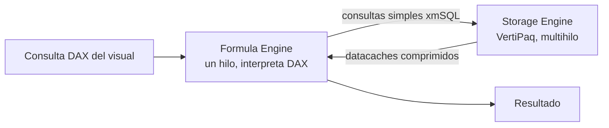

# Cómo funciona el motor VertiPaq

Parte de: [[17-Power-BI/03 Modelado de datos/_Índice Modelado de datos|Modelado de datos]]

> [!info] Cómo avanzar
> `progreso`: **pendiente** → **viendo** (estudiando) → **visto** (contestaste la autoevaluación sin abrir las respuestas) → **dominado** (hiciste el laboratorio o lo aplicaste de verdad).

## Contenido

### Qué es
**VertiPaq** (también llamado *xVelocity in-memory analytics engine*) es el motor de almacenamiento **en memoria y por columnas** que usan Power BI en modo Import, Analysis Services Tabular, Power Pivot en Excel y Direct Lake. Entender cómo guarda los datos explica por qué ciertos modelos pesan 200 MB y otros 4 GB con las mismas filas, y por qué algunas medidas responden en milisegundos y otras en segundos.

### Cómo funciona
**Almacenamiento columnar comprimido.** VertiPaq no guarda filas; guarda **cada columna por separado**, dividida en segmentos, y la comprime con varias técnicas:

1. **Codificación por diccionario** (*hash*): para cada columna construye un diccionario de valores distintos (`"Bebidas" = 0`, `"Alimentos" = 1`…) y guarda solo los índices enteros. Por eso texto repetido ocupa poco y texto único ocupa mucho.
2. **Codificación por valor**: para enteros, guarda el valor menos una base o dividido entre un factor, usando menos bits.
3. **RLE** (*run-length encoding*): secuencias de valores iguales consecutivos se guardan como "valor × cantidad". Funciona mejor si los datos están ordenados por columnas de baja cardinalidad.
4. **Empaquetado de bits**: cada índice usa solo los bits necesarios para el número de valores distintos.

Conclusión práctica: el tamaño depende sobre todo de la **cardinalidad** (valores distintos) de cada columna, no del número de filas.

**Dos motores al consultar**:



- **Storage Engine (SE)**: VertiPaq propiamente. Hace escaneos, filtros simples, agregaciones (`SUM`, `COUNT`) y *joins* por relaciones sobre las columnas comprimidas. Es **multihilo** y rapidísimo, y cachea resultados.
- **Formula Engine (FE)**: interpreta el DAX completo, resuelve la lógica compleja (iteraciones con condiciones, `IF` por fila, cálculos que el SE no sabe hacer) y pide datos al SE. Es **de un solo hilo**.

Una medida es rápida cuando la mayor parte del trabajo lo hace el SE y el FE solo combina resultados pequeños. Es lenta cuando el FE tiene que iterar millones de filas o recibir *datacaches* enormes (por ejemplo, por un `SUMX` con lógica que el SE no puede resolver, o *callbacks* `CallbackDataID`). En DAX Studio, *Server Timings* muestra cuánto tiempo pasa en cada motor.

### Ejemplo
Tabla `Ventas` de 50 millones de filas con tamaño inicial de 3.1 GB. Con **VertiPaq Analyzer** (en DAX Studio) descubres:

| Columna | Cardinalidad | Tamaño | Acción |
|---|---|---|---|
| `IdVenta` (GUID texto) | 50 M | 1.4 GB | Quitarla: nadie la usa en visuales |
| `FechaHora` (datetime) | 31 M | 0.9 GB | Separar en `Fecha` (date) y, si se necesita, `Hora` redondeada |
| `Comentario` | 12 M | 0.4 GB | Quitarla |
| `Importe` (decimal) | 2 M | 0.2 GB | Decimal fijo, redondear a 2 decimales |
| `IdProducto` | 2 000 | 30 MB | OK |

Tras los cambios en la vista SQL o en Power Query el modelo baja a unos cientos de MB (las cifras son ilustrativas).

Medida que obliga al FE a trabajar de más y su alternativa:

```dax
// Lenta: IF fila por fila dentro del iterador
Importe con IVA lento =
SUMX ( Ventas, IF ( Ventas[AplicaIVA], Ventas[Importe] * 1.16, Ventas[Importe] ) )

// Más amigable con el SE: dos agregados filtrados
Importe con IVA =
CALCULATE ( SUM ( Ventas[Importe] ), Ventas[AplicaIVA] = TRUE () ) * 1.16
    + CALCULATE ( SUM ( Ventas[Importe] ), Ventas[AplicaIVA] = FALSE () )
```

### Cuándo usarlo y cuándo no
**Formas de reducir el tamaño de un modelo**:
- **Quitar columnas** que no se usan (claves técnicas, GUIDs, comentarios, auditoría).
- **Reducir cardinalidad**: separar fecha y hora, redondear decimales, usar decimal fijo, agrupar categorías raras.
- **Filtrar filas** que no se analizan (años viejos) o resumir a un grano mayor cuando el detalle no se usa.
- **Desactivar Fecha/hora automática**.
- **Preferir columnas en Power Query/SQL** sobre columnas calculadas DAX (que además no siempre comprimen igual de bien).
- **Usar enteros** para claves de relación en lugar de texto.

Este conocimiento aplica a Import y Direct Lake. En DirectQuery el SE es el origen (SQL Server) y las reglas cambian.

### Errores comunes
- **Pensar en filas** en lugar de cardinalidad.
- **Importar `SELECT *`** con columnas técnicas.
- **Columnas calculadas** pesadas en tablas de hechos.
- **Medidas con iteradores complejos** que mandan todo al FE.
- **Optimizar a ciegas** sin medir con VertiPaq Analyzer y Server Timings.

### Para profundizar
- [Técnicas de reducción de datos para el modelado de importación](https://learn.microsoft.com/es-mx/power-bi/guidance/import-modeling-data-reduction)
- [Optimización de modelos con Performance Analyzer](https://learn.microsoft.com/es-mx/power-bi/create-reports/desktop-performance-analyzer)
- [DAX Studio (sitio oficial)](https://daxstudio.org/)
- [SQLBI: VertiPaq Analyzer](https://www.sqlbi.com/tools/vertipaq-analyzer/)

Relacionado: [[Rendimiento - Performance Analyzer y VertiPaq Analyzer]], [[DAX Studio]], [[Modo de almacenamiento Import]], [[DAX - optimización]].

## Autoevaluación

Contesta primero en voz alta o en papel; luego despliega la respuesta.

> [!question]- ¿Cómo almacena VertiPaq los datos?
> En columnas, comprimidas en memoria. Usa codificación por diccionario, por valor y RLE (repeticiones). Por eso pocas columnas y baja cardinalidad = modelo pequeño y rápido.

> [!question]- ¿Qué son el *Storage Engine* y el *Formula Engine*?
> SE: escanea y agrega columnas comprimidas, muy rápido y en paralelo. FE: resuelve la lógica DAX compleja, un solo hilo. Una medida eficiente empuja trabajo al SE.

> [!question]- Menciona tres formas de reducir el tamaño de un modelo.
> Quitar columnas no usadas, separar fecha y hora, redondear decimales, evitar columnas calculadas con alta cardinalidad, desactivar fecha/hora automática.

