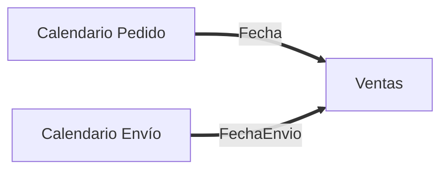

# Dimensiones de rol múltiple

Parte de: [[17-Power-BI/03 Modelado de datos/_Índice Modelado de datos|Modelado de datos]]

> [!info] Cómo avanzar
> `progreso`: **pendiente** → **viendo** (estudiando) → **visto** (contestaste la autoevaluación sin abrir las respuestas) → **dominado** (hiciste el laboratorio o lo aplicaste de verdad).

## Contenido

### Qué es
Una **dimensión de rol múltiple** (*role-playing dimension*) es una dimensión que se relaciona con la misma tabla de hechos **más de una vez**, cada vez con un significado distinto. El caso clásico es la fecha: una venta tiene fecha de pedido, fecha de envío y fecha de entrega; las tres apuntan a la misma dimensión `Calendario`, pero cada una juega un "rol". Otros ejemplos: `Sucursales` como sucursal de origen y de destino en un traspaso; `Empleados` como vendedor y como autorizador; en seguros, `Calendario` para fecha de ocurrencia, reporte y pago.

### Cómo funciona
Hay **dos formas** de modelarla en Power BI:

**1. Una sola dimensión con relaciones inactivas**


- Una tabla `Calendario`; una relación activa (la fecha principal) y las demás inactivas.
- Medidas específicas activan cada rol con `USERELATIONSHIP` ([[Relaciones activas e inactivas]]).
- Ventajas: un solo calendario, una sola segmentación de fecha, modelo pequeño.
- Desventaja: el usuario **no puede filtrar por dos roles a la vez** ni arrastrar "Mes de envío" a un eje; todo pasa por medidas.

**2. Una tabla por rol**



- Duplicas la dimensión (en Power Query, *Referencia* a la consulta base, o tabla calculada DAX) y renombras **todas** las columnas con el rol: `Año Pedido`, `Mes Pedido`, `Año Envío`, `Mes Envío`.
- Cada copia tiene su relación **activa**.
- Ventajas: filtros independientes y simultáneos, cualquier columna del rol se usa en ejes y segmentaciones sin medidas especiales.
- Desventajas: más tablas, más memoria (poca, para calendarios), y la inteligencia de tiempo debe referirse al calendario correcto.

### Ejemplo
**Caso**: el usuario quiere filtrar con **dos segmentaciones a la vez**: fecha de pedido = enero 2026 y fecha de envío = febrero 2026 ("¿qué se pidió en enero y se envió hasta febrero?"). Conviene la **opción 2**, tablas separadas, porque con una sola tabla y relación inactiva no puedes tener dos filtros de fecha independientes activos sobre el mismo hecho.

En Power Query, a partir de la consulta `Calendario`:

```m
// Consulta "Calendario Envío" (Referencia de Calendario)
let
    Origen = Calendario,
    Renombrada = Table.TransformColumnNames(Origen, each _ & " Envío")
    // Fecha Envío, Año Envío, NumMes Envío, Mes Envío...
in
    Renombrada
```

O como tabla calculada en DAX:

```dax
Calendario Envío =
SELECTCOLUMNS (
    Calendario,
    "Fecha Envío", Calendario[Fecha],
    "Año Envío", Calendario[Año],
    "Mes Envío", Calendario[Mes],
    "NumMes Envío", Calendario[NumMes]
)
```

Relaciones: `Calendario[Fecha]` → `Ventas[Fecha]` y `Calendario Envío[Fecha Envío]` → `Ventas[FechaEnvio]`, ambas activas. Marca solo la principal como tabla de fechas (o ambas si usas inteligencia de tiempo en las dos) y ordena `Mes Envío` por `NumMes Envío`.

Medida de tiempo de entrega promedio, que funciona con ambos filtros:

```dax
Días a Envío Promedio =
AVERAGEX ( Ventas, DATEDIFF ( Ventas[Fecha], Ventas[FechaEnvio], DAY ) )
```

### Cuándo usarlo y cuándo no
- **Relaciones inactivas** cuando hay un rol principal y los demás solo aparecen en algunas medidas.
- **Tablas por rol** cuando los usuarios filtran por varios roles a la vez o exploran libremente por cada rol (traspasos origen/destino casi siempre lo necesitan).
- Para dimensiones grandes (millones de clientes) piénsalo dos veces antes de duplicar; para calendarios el costo es mínimo.

### Errores comunes
- **No renombrar columnas** en la copia: el usuario ve dos `Año` y no sabe cuál es cuál.
- **Mezclar opciones**: copias por rol y además relaciones inactivas a la tabla original.
- **Inteligencia de tiempo** con el calendario equivocado (`TOTALYTD` sobre `Calendario` cuando el visual filtra `Calendario Envío`).
- **Ordenar por** no configurado en la copia (meses en orden alfabético).

### Para profundizar
- [Guía de relaciones activas e inactivas (dimensiones de rol)](https://learn.microsoft.com/es-mx/power-bi/guidance/relationships-active-inactive)
- [Esquema de estrella: dimensiones de rol múltiple](https://learn.microsoft.com/es-mx/power-bi/guidance/star-schema)
- [Kimball Group: técnicas de modelado dimensional](https://www.kimballgroup.com/data-warehouse-business-intelligence-resources/kimball-techniques/dimensional-modeling-techniques/)

Relacionado: [[Tabla de calendario]], [[DAX - USERELATIONSHIP, TREATAS y CROSSFILTER]].

## Autoevaluación

Contesta primero en voz alta o en papel; luego despliega la respuesta.

> [!question]- ¿Qué es una dimensión de rol múltiple?
> Una dimensión que se relaciona con los hechos con distintos significados: Calendario como fecha de pedido, de envío o de entrega.

> [!question]- ¿Qué dos formas hay de modelarla?
> 1) Una sola tabla con relaciones inactivas y medidas con USERELATIONSHIP. 2) Copias de la tabla (Calendario Envío) con relación activa cada una.

> [!question]- Caso: el usuario quiere filtrar con dos segmentaciones, una de fecha de pedido y otra de fecha de envío, a la vez. ¿Qué opción conviene?
> Copias de la dimensión: con una sola tabla no puedes tener dos filtros de fecha simultáneos e independientes.

