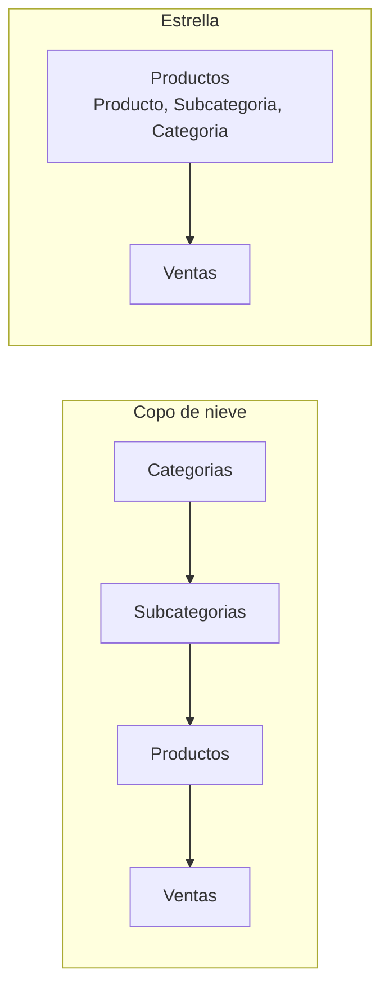

# Esquema copo de nieve vs estrella

Parte de: [[17-Power-BI/03 Modelado de datos/_Índice Modelado de datos|Modelado de datos]]

> [!info] Cómo avanzar
> `progreso`: **pendiente** → **viendo** (estudiando) → **visto** (contestaste la autoevaluación sin abrir las respuestas) → **dominado** (hiciste el laboratorio o lo aplicaste de verdad).

## Contenido

### Qué es
Un **copo de nieve** (*snowflake*) es una variante del modelo dimensional en la que las dimensiones están **normalizadas** en varias tablas encadenadas: `Ventas` → `Productos` → `Subcategorias` → `Categorias`. En el **esquema estrella**, en cambio, cada dimensión es **una sola tabla desnormalizada** (`Productos` ya trae `Subcategoria` y `Categoria` como columnas). El copo de nieve suele aparecer cuando se importan las tablas de un OLTP tal como están, porque el sistema transaccional está normalizado.

### Cómo funciona


En el copo de nieve, cuando filtras `Categoria = "Bebidas"`, el filtro tiene que recorrer **tres relaciones** para llegar a `Ventas`. En la estrella recorre **una**.

**¿Por qué en Power BI se suele preferir estrella?**
- **Rendimiento**: cada salto de relación agrega trabajo al motor en cada consulta; las dimensiones desnormalizadas se comprimen muy bien en VertiPaq (la columna `Categoria` repetida en 2 000 productos ocupa casi nada).
- **Usabilidad**: el autor encuentra todos los atributos del producto en una sola tabla del panel de datos, en lugar de buscar en tres.
- **Jerarquías**: una jerarquía Categoría > Subcategoría > Producto solo se puede crear con columnas de **la misma tabla**.
- **Menos relaciones** que mantener y menos riesgo de caminos ambiguos.
- **DAX más simple**: no necesitas `RELATED` encadenados.

La desnormalización se hace en una **vista SQL** o en **Power Query** con merges que traen el atributo de la tabla padre y luego se deshabilita la carga de las tablas padre.

### Ejemplo
De copo de nieve a estrella en SQL:

```sql
CREATE OR ALTER VIEW bi.vw_DimProducto AS
SELECT p.IdProducto,
       p.Nombre        AS Producto,
       p.Color,
       s.Nombre        AS Subcategoria,
       c.Nombre        AS Categoria
FROM dbo.Producto     AS p
JOIN dbo.Subcategoria AS s ON s.IdSubcategoria = p.IdSubcategoria
JOIN dbo.Categoria    AS c ON c.IdCategoria   = s.IdCategoria;
```

O en Power Query, si no tienes acceso para crear vistas:

```m
let
    ConSub = Table.NestedJoin(Productos, {"IdSubcategoria"}, Subcategorias, {"IdSubcategoria"}, "S", JoinKind.LeftOuter),
    ExpSub = Table.ExpandTableColumn(ConSub, "S", {"Subcategoria", "IdCategoria"}),
    ConCat = Table.NestedJoin(ExpSub, {"IdCategoria"}, Categorias, {"IdCategoria"}, "C", JoinKind.LeftOuter),
    ExpCat = Table.ExpandTableColumn(ConCat, "C", {"Categoria"}),
    Final = Table.RemoveColumns(ExpCat, {"IdSubcategoria", "IdCategoria"})
in
    Final
```

Con las tres tablas en el mismo origen SQL Server, estos merges se pliegan a `JOIN`.

### Cuándo usarlo y cuándo no
**¿Cuándo es aceptable dejar un copo de nieve?**
- Cuando **otra tabla de hechos se relaciona a un nivel superior**: `Presupuesto` es por **categoría**. Tener `Categorias` como tabla propia, relacionada tanto con `Productos` como con `Presupuesto`, es un copo de nieve **intencional** que permite comparar ventas vs presupuesto por categoría sin muchos a muchos.
- Cuando la dimensión es **muy grande** y la tabla padre tiene muchos atributos (por ejemplo, millones de clientes y una tabla de segmentos con 40 columnas): normalizar puede ahorrar memoria.
- Cuando el origen ya es un modelo que no controlas (Live Connection a un modelo corporativo así diseñado).
- En modelos DirectQuery donde no puedes transformar y el origen ya es copo de nieve, aunque ahí conviene pedir vistas.

En los demás casos, aplana.

### Errores comunes
- **Importar las tablas del OLTP tal cual** y terminar con 25 tablas encadenadas.
- **Dejar visibles** las tablas padre después de desnormalizar (confunden y duplican atributos); deshabilita su carga.
- **Aplanar una dimensión que otra tabla de hechos necesita a nivel superior**, y luego forzar una relación muchos a muchos.
- **Jerarquías imposibles** por tener niveles en tablas distintas.
- **Relaciones bidireccionales** en la cadena para que "suba" el filtro.

### Para profundizar
- [Esquema de estrella: dimensiones copo de nieve](https://learn.microsoft.com/es-mx/power-bi/guidance/star-schema)
- [Combinar consultas en Power Query](https://learn.microsoft.com/es-mx/power-query/merge-queries-overview)
- [Kimball: técnicas de modelado dimensional](https://www.kimballgroup.com/data-warehouse-business-intelligence-resources/kimball-techniques/dimensional-modeling-techniques/)

Relacionado: [[Modelo estrella (hechos y dimensiones)]], [[Jerarquías]], [[Granularidad de una tabla de hechos]].

## Autoevaluación

Contesta primero en voz alta o en papel; luego despliega la respuesta.

> [!question]- ¿Qué es un copo de nieve?
> Dimensiones normalizadas en varias tablas encadenadas: Ventas → Productos → Subcategorías → Categorías.

> [!question]- ¿Por qué en Power BI se suele preferir estrella?
> Menos relaciones, filtros más simples, jerarquías posibles en una sola tabla y menos confusión en la lista de campos. Se desnormaliza con merges en Power Query.

> [!question]- ¿Cuándo es aceptable dejar un copo de nieve?
> Cuando otra tabla de hechos se relaciona a nivel intermedio (p. ej. Presupuesto por Subcategoría) y la tabla intermedia sirve de dimensión compartida.

