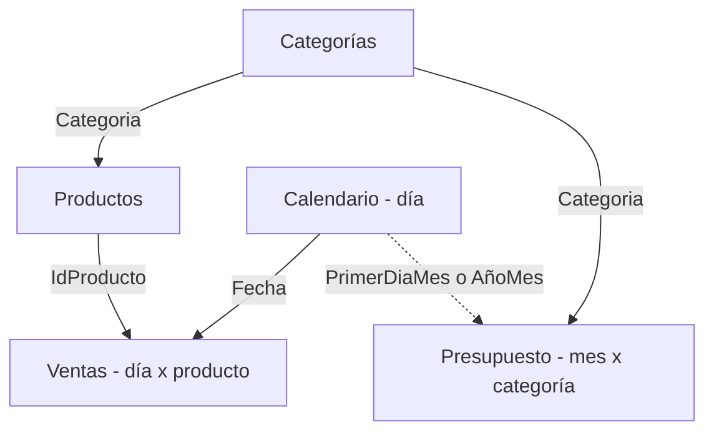

# Granularidad de una tabla de hechos

Parte de: [[17-Power-BI/03 Modelado de datos/_Índice Modelado de datos|Modelado de datos]]

> [!info] Cómo avanzar
> `progreso`: **pendiente** → **viendo** (estudiando) → **visto** (contestaste la autoevaluación sin abrir las respuestas) → **dominado** (hiciste el laboratorio o lo aplicaste de verdad).

## Contenido

### Qué es
La **granularidad** (o **grano**) de una tabla de hechos es la definición exacta de **qué representa una fila**. Ejemplos: "una línea de producto dentro de un ticket de venta", "un pago de un siniestro", "el saldo de inventario de un producto en un almacén al cierre del día", "el presupuesto de una categoría en un mes". Declarar el grano es el primer paso del diseño dimensional: de él dependen qué dimensiones se pueden relacionar, qué medidas son correctas y cómo se combinan varios hechos.

### Cómo funciona
Al declarar el grano te preguntas: ¿qué combinación de dimensiones identifica una fila?

| Tabla de hechos | Grano | Dimensiones que encajan |
|---|---|---|
| `Ventas` | Línea vendida por día, producto, cliente y sucursal | Calendario (día), Productos, Clientes, Sucursales |
| `Presupuesto` | Mes × categoría | Calendario a nivel **mes**, Categorías |
| `InventarioDiario` | Producto × almacén × día (foto) | Calendario, Productos, Almacenes |
| `PagosSiniestro` | Un pago | Calendario, Ramo, Estado, Ajustador, Siniestro |

Una dimensión solo puede filtrar un hecho si el hecho tiene la clave **al nivel de detalle de esa dimensión** (o uno más fino). `Presupuesto` no tiene producto ni día; no puede relacionarse con `Productos[IdProducto]` ni con `Calendario[Fecha]` de manera directa y correcta.



### Ejemplo
**Caso**: `Ventas` es diaria por producto; `Presupuesto` es mensual por categoría. ¿Cómo relacionas `Presupuesto` con `Calendario`?

Opción recomendada:
1. En `Presupuesto`, representa el mes con una **fecha**: el primer día del mes (`2026-03-01`). En Power Query: `#date([Año], [NumMes], 1)`.
2. Relaciona `Presupuesto[FechaMes]` → `Calendario[Fecha]` (1:*). Así, filtrar por año, trimestre o mes funciona; filtrar por un **día** distinto del 1 dejaría el presupuesto en blanco, lo cual es correcto: no hay presupuesto diario.
3. Para la categoría: crea una dimensión `Categorias` (lista única) y relaciónala con `Productos[Categoria]` y con `Presupuesto[Categoria]`. Alternativamente, usa `TREATAS` en la medida.
4. Protege las medidas para que no muestren el presupuesto a niveles más finos:

```dax
Presupuesto =
IF (
    ISINSCOPE ( Calendario[Fecha] ) || ISINSCOPE ( Productos[Producto] ),
    BLANK (),
    SUM ( Presupuesto[Monto] )
)
```

Otra opción es una columna `AñoMes` (por ejemplo `202603`) en ambas tablas y una relación muchos a muchos con Calendario, pero es más frágil; la fecha del primer día es más limpia.

### Cuándo usarlo y cuándo no
**¿Por qué conviene la granularidad más fina disponible?**
- Puedes **agregar** siempre hacia arriba (de día a mes, de producto a categoría), pero **nunca desagregar** lo que ya resumiste.
- Las preguntas futuras ("¿cómo vendió el SKU X los martes?") solo se contestan con detalle.
- Más dimensiones pueden relacionarse.
- VertiPaq comprime bien; el costo de memoria del detalle suele ser aceptable.

**Cuándo resumir**: cuando el detalle es enorme y nadie lo necesita (logs por segundo), cuando el origen solo tiene datos resumidos (presupuestos, metas) o para **tablas de agregación** adicionales que aceleran DirectQuery, manteniendo el detalle disponible.

### Errores comunes
- **Mezclar granos en una tabla**: filas de detalle junto con filas de subtotales (el típico "Total" de un Excel) que duplican sumas.
- **No declarar el grano** y descubrir tarde que el hecho tenía una fila por línea **y** otra por encabezado.
- **Relacionar el presupuesto mensual con Calendario por una fecha arbitraria** (fin de mes en una tabla, inicio en otra).
- **Medidas que asignan presupuesto a días** sin regla de prorrateo explícita.
- **Combinar hechos de distinto grano** en una sola tabla con muchas columnas vacías en lugar de dos tablas de hechos.

### Para profundizar
- [Guía del esquema de estrella: tablas de hechos y granularidad](https://learn.microsoft.com/es-mx/power-bi/guidance/star-schema)
- [Relaciones de modelo: granularidad distinta (guía de muchos a muchos)](https://learn.microsoft.com/es-mx/power-bi/guidance/relationships-many-to-many)
- [Kimball Group: técnicas de modelado dimensional](https://www.kimballgroup.com/data-warehouse-business-intelligence-resources/kimball-techniques/dimensional-modeling-techniques/)

Relacionado: [[Modelo estrella (hechos y dimensiones)]], [[DAX - SELECTEDVALUE, ISINSCOPE y HASONEVALUE]], [[DAX - medidas semiaditivas]].

## Autoevaluación

Contesta primero en voz alta o en papel; luego despliega la respuesta.

> [!question]- ¿Qué es la granularidad?
> Lo que representa una fila de la tabla de hechos: "una línea de ticket", "un producto por día por tienda", "un presupuesto por mes por categoría".

> [!question]- Caso: Ventas es diaria por producto y Presupuesto es mensual por categoría. ¿Cómo relacionas Presupuesto con Calendario?
> Con una clave a nivel mes (p. ej. primer día del mes o columna AñoMes) o relacionando con una dimensión de mes; y con Categoría en vez de Producto. Las medidas deben evitar mostrar presupuesto a nivel día o producto (ISINSCOPE / reparto explícito).

> [!question]- ¿Por qué conviene la granularidad más fina disponible?
> Permite responder más preguntas (agregar siempre se puede, desagregar no). El costo es tamaño; se equilibra con agregaciones.

## Práctica

- [[Lab 4 - Modelo estrella con tabla de calendario en Power BI]]

