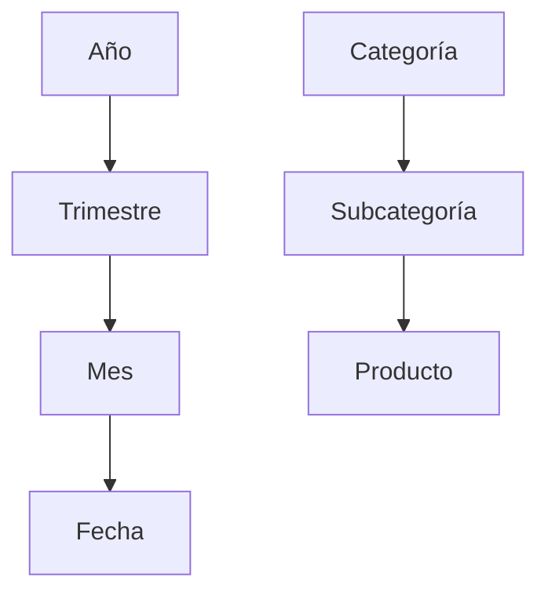

# Jerarquías

Parte de: [[17-Power-BI/03 Modelado de datos/_Índice Modelado de datos|Modelado de datos]]

> [!info] Cómo avanzar
> `progreso`: **pendiente** → **viendo** (estudiando) → **visto** (contestaste la autoevaluación sin abrir las respuestas) → **dominado** (hiciste el laboratorio o lo aplicaste de verdad).

## Contenido

### Qué es
Una **jerarquía** en el modelo es un objeto que agrupa columnas de una dimensión en **niveles ordenados de lo general a lo particular**, para que el usuario pueda **navegar** (drill down) en los visuales: Año > Trimestre > Mes > Día, o Categoría > Subcategoría > Producto, o País > Estado > Municipio. Al arrastrar la jerarquía a un eje, el visual muestra el nivel superior y habilita las flechas para bajar y subir.

### Cómo funciona
**Crear una jerarquía**: en el panel *Datos* (o en la vista Modelo), clic derecho sobre la columna de nivel superior > **Crear jerarquía**; luego, en cada columna inferior, *Agregar a jerarquía*. En la vista Modelo puedes renombrarla y reordenar niveles en el panel *Propiedades*.

**¿Puede una jerarquía incluir columnas de tablas distintas?** **No**. Todos los niveles deben ser columnas de **la misma tabla**. Por eso conviene desnormalizar las dimensiones (estrella): si `Categoria` está en otra tabla, primero tráela a `Productos`. En los visuales sí puedes arrastrar columnas de tablas distintas al eje y hacer drill down "ad hoc", pero no como un objeto jerarquía del modelo.

**Jerarquía de fechas automática.** Con la opción *Fecha/hora automática* activada, Power BI crea una jerarquía oculta Año/Trimestre/Mes/Día para cada columna de fecha. Es mejor desactivarla y construir tu propia jerarquía en la [[Tabla de calendario]].



**Jerarquías padre-hijo.** Hay estructuras en que la jerarquía no está en columnas sino **en las filas**: cada fila tiene un `Id` y un `IdPadre` que apunta a otra fila de la misma tabla. Ejemplos: organigrama (empleado → jefe), catálogo de cuentas contables, centros de costo, estructura de agentes de seguros. La profundidad puede variar por rama. Power BI no las navega directamente: hay que **aplanarlas** en columnas `Nivel1`, `Nivel2`, `Nivel3`… con las funciones **PATH** de DAX:

- `PATH(Id, IdPadre)` devuelve una cadena con la ruta desde la raíz: `"1|4|12"`.
- `PATHLENGTH(ruta)` da la profundidad.
- `PATHITEM(ruta, n, INTEGER)` devuelve el id del nivel `n`.
- `LOOKUPVALUE` trae el nombre de ese id.

### Ejemplo
Organigrama en la tabla `Empleados`(IdEmpleado, Nombre, IdJefe):

```dax
// columnas calculadas en Empleados
Ruta = PATH ( Empleados[IdEmpleado], Empleados[IdJefe] )

Profundidad = PATHLENGTH ( Empleados[Ruta] )

Nivel 1 =
LOOKUPVALUE (
    Empleados[Nombre],
    Empleados[IdEmpleado], PATHITEM ( Empleados[Ruta], 1, INTEGER )
)

Nivel 2 =
VAR id = PATHITEM ( Empleados[Ruta], 2, INTEGER )
RETURN
    IF ( ISBLANK ( id ),
         Empleados[Nivel 1],          // rellena con el nivel anterior para evitar huecos
         LOOKUPVALUE ( Empleados[Nombre], Empleados[IdEmpleado], id ) )
```

Repites para `Nivel 3`, `Nivel 4`… hasta la profundidad máxima, y creas la jerarquía `Organigrama` = Nivel 1 > Nivel 2 > Nivel 3. Para no mostrar niveles repetidos en ramas cortas, se usa una medida que devuelve `BLANK()` cuando el nivel visible es mayor que la profundidad de la fila (patrón documentado por SQLBI).

Jerarquía de producto en un modelo estrella: `Productos` con `Categoria`, `Subcategoria`, `Producto` → jerarquía *Producto Jerarquía*. En una matriz, el usuario expande Bebidas → Refrescos → Cola 600 ml.

### Cuándo usarlo y cuándo no
- **Crea jerarquías** para rutas de navegación naturales que los usuarios repiten (fecha, geografía, producto, organización). Ahorran arrastrar tres columnas cada vez.
- **No metas** atributos que no son jerárquicos (Color dentro de Categoría > Producto).
- **Padre-hijo con PATH** en dimensiones de tamaño razonable; en organigramas de cientos de miles de filas, aplana en SQL o Power Query.

### Errores comunes
- **Intentar crear la jerarquía con columnas de dos tablas**.
- **Niveles sin "Ordenar por columna"**: meses en orden alfabético dentro de la jerarquía.
- **Nombres no únicos en niveles bajos** ("Varios" en tres subcategorías distintas) que confunden la navegación; usa claves o nombres compuestos cuando haga falta.
- **Ramas desbalanceadas** en padre-hijo que muestran huecos o el mismo nombre repetido.
- **Depender de la jerarquía automática de fechas**.

### Para profundizar
- [Crear y usar jerarquías (vista Modelo)](https://learn.microsoft.com/es-mx/power-bi/transform-model/desktop-modeling-view)
- [Funciones padre-hijo en DAX](https://learn.microsoft.com/es-mx/dax/understanding-functions-for-parent-child-hierarchies-in-dax)
- [SQLBI: jerarquías padre-hijo](https://www.daxpatterns.com/parent-child-hierarchies/)

Relacionado: [[Drill down y drill through]], [[Esquema copo de nieve vs estrella]].

## Autoevaluación

Contesta primero en voz alta o en papel; luego despliega la respuesta.

> [!question]- ¿Qué es una jerarquía en el modelo?
> Un conjunto ordenado de columnas de una tabla (Año → Trimestre → Mes → Fecha; Categoría → Producto) que permite drill down en los visuales.

> [!question]- ¿Puede una jerarquía incluir columnas de tablas distintas?
> No; deben estar en la misma tabla. Si Categoría está en otra tabla (copo de nieve), se trae con RELATED o se desnormaliza en Power Query.

> [!question]- ¿Qué es una jerarquía padre-hijo y cómo se maneja en DAX?
> Una tabla que se referencia a sí misma (Empleado → Jefe). Se aplana con las funciones `PATH`, `PATHITEM` y `PATHLENGTH` en columnas calculadas.

## Práctica

- [[Lab 4 - Modelo estrella con tabla de calendario en Power BI]]

