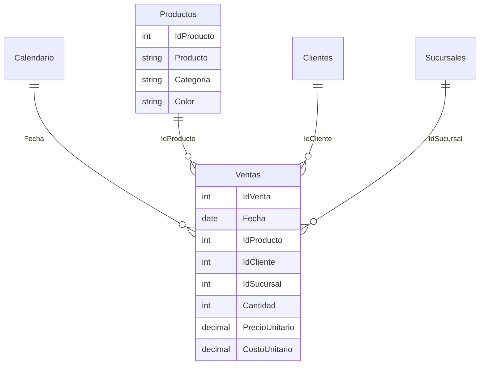

# Modelo estrella (hechos y dimensiones)

Parte de: [[17-Power-BI/03 Modelado de datos/_Índice Modelado de datos|Modelado de datos]]

> [!info] Cómo avanzar
> `progreso`: **pendiente** → **viendo** (estudiando) → **visto** (contestaste la autoevaluación sin abrir las respuestas) → **dominado** (hiciste el laboratorio o lo aplicaste de verdad).

## Contenido

### Qué es
El **modelo estrella** (*star schema*) organiza los datos en dos tipos de tablas:

- **Tablas de hechos**: registran **eventos medibles** del negocio —una venta, un pago, un siniestro, un movimiento de inventario—. Tienen muchas filas, columnas numéricas que se agregan (cantidad, importe, costo) y **claves** hacia las dimensiones. Crecen con el tiempo.
- **Tablas de dimensión**: describen el **contexto** de esos eventos —quién, qué, dónde, cuándo—: productos, clientes, sucursales, fechas. Tienen pocas filas comparadas con los hechos, una clave única y atributos descriptivos (nombre, categoría, color, región) que se usan para **filtrar y agrupar**.

Se llama estrella porque, dibujado, el hecho queda en el centro y las dimensiones alrededor, cada una con una relación uno a muchos hacia él.

### Cómo funciona


El flujo de filtros es el corazón: cuando el usuario elige `Categoria = "Bebidas"` en una segmentación, el filtro viaja por la relación **desde la dimensión (lado uno) hacia el hecho (lado muchos)**, y las medidas sobre `Ventas` solo suman las filas de bebidas. Cada dimensión filtra el hecho de forma independiente y las combinaciones (Bebidas + Jalisco + marzo) se resuelven solas.

**¿Por qué Power BI funciona mejor con estrella que con una tabla plana?**
- **Compresión**: en la tabla plana, `"Bebidas"` se repite en 50 millones de filas; en estrella vive una vez en `Productos` y el hecho solo guarda un entero.
- **DAX más simple y correcto**: medidas como `SUM(Ventas[Importe])` funcionan con cualquier combinación de filtros; contar productos o clientes distintos sale directo de la dimensión.
- **Varias tablas de hechos** (Ventas y Presupuesto) pueden compartir dimensiones y compararse en un mismo visual; con tablas planas no hay forma limpia.
- **Inteligencia de tiempo** requiere una dimensión de calendario.
- **Usabilidad**: los autores ven "Productos", "Clientes", "Ventas", no 80 columnas mezcladas.

### Ejemplo
En el modelo de práctica `Ventas`/`Productos`/`Calendario`, la **tabla de hechos es `Ventas`**: cada fila es una línea vendida, con `Cantidad`, `PrecioUnitario`, `CostoUnitario` y las claves `Fecha` e `IdProducto`. `Productos` y `Calendario` son dimensiones.

Para un modelo de siniestros: hecho `FactPagoSiniestro` (una fila por pago) con dimensiones `DimFecha`, `DimRamo`, `DimEstado`, `DimAjustador`, `DimPoliza`.

Medidas típicas sobre el hecho:

```dax
Importe = SUMX ( Ventas, Ventas[Cantidad] * Ventas[PrecioUnitario] )
Costo = SUMX ( Ventas, Ventas[Cantidad] * Ventas[CostoUnitario] )
Margen % = DIVIDE ( [Importe] - [Costo], [Importe] )
Productos Vendidos = DISTINCTCOUNT ( Ventas[IdProducto] )
```

Buenas prácticas de presentación: oculta las columnas clave en el hecho (los usuarios filtran con la dimensión), oculta las columnas numéricas crudas si ya hay medidas, y pon las medidas en una tabla de medidas o en el hecho.

### Cuándo usarlo y cuándo no
- **Úsalo siempre** como forma objetivo de un modelo de Power BI. Microsoft lo recomienda explícitamente.
- Para construirlo desde un OLTP normalizado: **desnormaliza** dimensiones (une Producto + Subcategoría + Categoría en una sola `Productos`) y arma el hecho desde encabezado + detalle. Hazlo en vistas SQL o en Power Query.
- Una tabla plana pequeña de un Excel puede bastar para un análisis rápido, pero en cuanto haya segunda fuente o fechas, pásala a estrella.

### Errores comunes
- **Relacionar dos tablas de hechos directamente** (por ejemplo, `Ventas` con `Presupuesto` por `IdProducto`): la relación sería muchos a muchos, los filtros fluyen de forma ambigua y los totales salen mal. Los hechos se relacionan **solo a través de dimensiones compartidas** (Productos, Calendario); si sus granos son distintos, la dimensión se relaciona a nivel compatible ([[Granularidad de una tabla de hechos]]).
- **Atributos descriptivos en el hecho** (nombre de producto en `Ventas`): crece el modelo y se duplican filtros.
- **Dimensiones con clave duplicada**: rompen la relación uno a muchos.
- **Filtros bidireccionales** por defecto para "que funcione": ambigüedad y lentitud.
- **No tener calendario**.

### Para profundizar
- [Comprender el esquema de estrella y su importancia para Power BI](https://learn.microsoft.com/es-mx/power-bi/guidance/star-schema)
- [Relaciones de modelo en Power BI Desktop](https://learn.microsoft.com/es-mx/power-bi/transform-model/desktop-relationships-understand)
- [Kimball Group: técnicas de modelado dimensional](https://www.kimballgroup.com/data-warehouse-business-intelligence-resources/kimball-techniques/dimensional-modeling-techniques/)

Practica en [[Lab 4 - Modelo estrella con tabla de calendario en Power BI]]. Relacionado: [[Esquema copo de nieve vs estrella]], [[Relaciones (cardinalidad y dirección del filtro)]].

## Autoevaluación

Contesta primero en voz alta o en papel; luego despliega la respuesta.

> [!question]- ¿Qué es una tabla de hechos y una de dimensión?
> Hechos: eventos medibles (ventas, movimientos) con claves y valores numéricos; muchas filas. Dimensión: contexto descriptivo (producto, cliente, fecha) por el que se filtra y agrupa; pocas filas, una por clave.

> [!question]- ¿Por qué Power BI funciona mejor con estrella que con una tabla plana?
> Las dimensiones filtran a los hechos por relaciones 1:* de forma simple y predecible, el modelo comprime mejor (menos repetición de textos) y las medidas DAX son más fáciles y rápidas.

> [!question]- En el modelo Ventas/Productos/Calendario, ¿cuál es la tabla de hechos?
> `Ventas`. `Productos` y `Calendario` son dimensiones.

> [!question]- Error común: relacionar dos tablas de hechos directamente.
> Por ejemplo Ventas ↔ Presupuesto. Se crean relaciones *:* ambiguas. Lo correcto es que ambas se relacionen con dimensiones compartidas (Calendario, Productos) a la granularidad común.

## Práctica

- [[Lab 4 - Modelo estrella con tabla de calendario en Power BI]]

