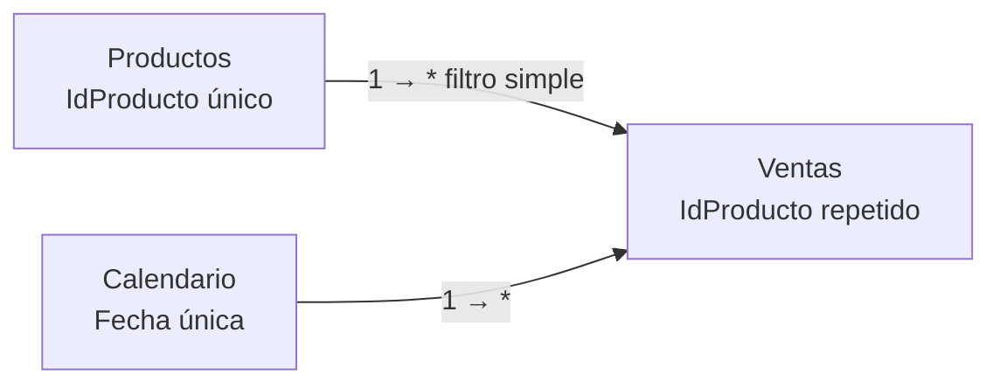

# Relaciones (cardinalidad y dirección del filtro)

Parte de: [[17-Power-BI/03 Modelado de datos/_Índice Modelado de datos|Modelado de datos]]

> [!info] Cómo avanzar
> `progreso`: **pendiente** → **viendo** (estudiando) → **visto** (contestaste la autoevaluación sin abrir las respuestas) → **dominado** (hiciste el laboratorio o lo aplicaste de verdad).

## Contenido

### Qué es
Una **relación** en el modelo une una columna de una tabla con una columna de otra para que los **filtros se propaguen** entre ellas. Tiene dos propiedades que debes entender bien: la **cardinalidad** (cuántas filas de un lado corresponden a cuántas del otro) y la **dirección del filtro cruzado** (hacia dónde viaja el filtro). En el modelo estrella casi todas son *uno a muchos* con dirección *simple*.

### Cómo funciona
**Cardinalidad**:

| Tipo | Significado | Uso |
|---|---|---|
| **Uno a muchos (1:\*)** | La columna del lado uno tiene valores **únicos**; del otro lado se repiten | Dimensión → hecho. La normal |
| **Muchos a uno (\*:1)** | Lo mismo, visto desde el otro lado | Igual que la anterior |
| **Uno a uno (1:1)** | Valores únicos en ambos lados | Raro; suele indicar que las tablas deberían unirse |
| **Muchos a muchos (\*:\*)** | Valores repetidos en ambos lados | Granos distintos; es una relación limitada. Ver [[Relaciones muchos a muchos y bidireccionales]] |

**Dirección del filtro cruzado**:
- **Simple**: el filtro viaja del lado **uno** al lado **muchos** (de `Productos` a `Ventas`). Filtrar por categoría reduce las ventas; filtrar ventas **no** reduce la lista de productos.
- **Ambas** (bidireccional): el filtro también viaja de muchos a uno. Útil en casos específicos, con riesgos.



**Integridad referencial y fila en blanco.** Si una venta tiene un `IdProducto` que **no existe** en `Productos`, la relación sigue funcionando: el motor agrega a `Productos` una **fila virtual en blanco** a la que se asignan todas esas ventas huérfanas. En un visual por categoría aparece una fila "(En blanco)" con su importe, y el total general sí incluye esas ventas. Es una señal de problema de calidad de datos en el origen: corrige en el origen o mapea a un producto "Desconocido" (`-1`) en Power Query.

**Propiedades adicionales**: *Activa/inactiva* (ver [[Relaciones activas e inactivas]]), *Suponer integridad referencial* (en DirectQuery, permite `INNER JOIN` en vez de `OUTER JOIN`, más rápido si los datos son íntegros) y *Aplicar filtro de seguridad en ambas direcciones* (para RLS con bidireccionales).

### Ejemplo
Modelo de práctica: `Ventas[Fecha]` → `Calendario[Fecha]` y `Ventas[IdProducto]` → `Productos[IdProducto]`, ambas 1:\*, filtro simple.

Detectar huérfanos antes de que lleguen al informe:

```dax
// Medida de control: importe de ventas sin producto en el catálogo
Ventas sin producto =
CALCULATE ( [Importe], ISBLANK ( Productos[IdProducto] ) )
```

O en SQL, en la vista de control de calidad:

```sql
SELECT v.IdProducto, COUNT(*) AS Filas
FROM bi.vw_FactVentas AS v
LEFT JOIN bi.vw_DimProducto AS p ON p.IdProducto = v.IdProducto
WHERE p.IdProducto IS NULL
GROUP BY v.IdProducto;
```

Para crear o editar: vista **Modelo** > arrastra la columna de una tabla a la otra, o *Administrar relaciones*. Power BI detecta la cardinalidad mirando los datos; verifícala.

### Cuándo usarlo y cuándo no
- **1:\* simple** para todo dimensión → hecho. Es lo que optimiza el motor.
- **1:1** solo si de verdad son dos tablas que no conviene unir (por seguridad, por ejemplo); si no, combínalas en Power Query.
- **Ambas direcciones** solo con una razón concreta y probada.
- Evita relaciones entre columnas calculadas DAX o de texto largo; prefiere claves enteras.

### Errores comunes
- **Claves con tipos distintos** (texto `"0015"` en una tabla, entero `15` en otra). Power BI no deja crear la relación o, si conviertes a la ligera, los valores no coinciden (`"15"` vs `"0015"`) y todo cae en la fila en blanco. Unifica tipo y formato en Power Query **antes** de relacionar.
- **Duplicados en el lado uno** (por mayúsculas o espacios): Power BI propone muchos a muchos y el modelo se vuelve ambiguo.
- **Relaciones bidireccionales por defecto** porque "así jala".
- **Dejar que Power BI cree relaciones automáticas** por nombres de columna similares (`Id`): desactívalo en *Opciones > Carga de datos* y créalas tú.

### Para profundizar
- [Relaciones de modelo en Power BI Desktop](https://learn.microsoft.com/es-mx/power-bi/transform-model/desktop-relationships-understand)
- [Crear y administrar relaciones](https://learn.microsoft.com/es-mx/power-bi/transform-model/desktop-create-and-manage-relationships)
- [Guía de relaciones uno a uno](https://learn.microsoft.com/es-mx/power-bi/guidance/relationships-one-to-one)

Relacionado: [[Modelo estrella (hechos y dimensiones)]], [[DAX - RELATED y RELATEDTABLE]].

## Autoevaluación

Contesta primero en voz alta o en papel; luego despliega la respuesta.

> [!question]- ¿Qué tipos de cardinalidad existen?
> Uno a varios (1:*), varios a uno (*:1, la misma vista desde el otro lado), uno a uno (1:1) y varios a varios (*:*).

> [!question]- ¿Qué significa dirección de filtro *simple*?
> El filtro fluye del lado "uno" (dimensión) al lado "varios" (hechos). Filtrar Productos filtra Ventas, pero no al revés.

> [!question]- ¿Qué pasa si una venta tiene IdProducto que no existe en Productos?
> La relación sigue funcionando; el motor agrega una fila en blanco a Productos y esas ventas aparecen bajo "(En blanco)". Es señal de problema de calidad de datos.

> [!question]- Error común: la columna clave tiene tipos distintos (texto en una tabla, número en otra).
> Power BI no deja crear la relación o no coinciden valores. Ambas columnas deben ser del mismo tipo; corregir en Power Query.

## Práctica

- [[Lab 4 - Modelo estrella con tabla de calendario en Power BI]]

