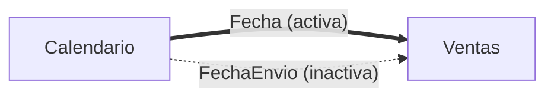

# Relaciones activas e inactivas

Parte de: [[17-Power-BI/03 Modelado de datos/_Índice Modelado de datos|Modelado de datos]]

> [!info] Cómo avanzar
> `progreso`: **pendiente** → **viendo** (estudiando) → **visto** (contestaste la autoevaluación sin abrir las respuestas) → **dominado** (hiciste el laboratorio o lo aplicaste de verdad).

## Contenido

### Qué es
Entre dos tablas puede haber **varias relaciones**, pero solo **una puede estar activa** a la vez en un mismo camino de filtrado. Las demás quedan **inactivas** (se dibujan con línea punteada en la vista Modelo) y no propagan filtros por sí solas; una medida las **activa temporalmente** con `USERELATIONSHIP`. Existen porque un hecho muchas veces tiene **varias fechas o varios roles** hacia la misma dimensión.

### Cómo funciona
**¿Por qué existen?** Si `Ventas` tuviera dos relaciones activas con `Calendario` (por `Fecha` y por `FechaEnvio`), al filtrar marzo el motor no sabría si te refieres a lo vendido o a lo enviado en marzo: habría **ambigüedad**. Power BI exige que exista un único camino activo entre dos tablas para que el resultado sea determinista. La segunda relación se crea, pero inactiva.



**Cómo se usa**: dentro de `CALCULATE`, el modificador `USERELATIONSHIP(columna1, columna2)` activa la relación inactiva **solo durante esa medida** y desactiva la activa entre las mismas tablas:

```dax
Ventas por Envío =
CALCULATE (
    [Importe],
    USERELATIONSHIP ( Ventas[FechaEnvio], Calendario[Fecha] )
)
```

Con esa medida y `[Importe]` en el mismo visual por mes, ves en una columna lo vendido y en otra lo enviado, usando un solo calendario.

Requisitos: la relación debe **existir** en el modelo (inactiva); `USERELATIONSHIP` no crea relaciones. Si no hay relación física, la alternativa en la medida es `TREATAS`.

### Ejemplo
Modelo de práctica: `Ventas`(IdVenta, Fecha, FechaEnvio, IdProducto, Cantidad, PrecioUnitario, CostoUnitario).

1. Relación activa `Ventas[Fecha]` → `Calendario[Fecha]`.
2. Arrastra `Ventas[FechaEnvio]` a `Calendario[Fecha]`: Power BI la crea **inactiva**.
3. Medidas:

```dax
Importe = SUMX ( Ventas, Ventas[Cantidad] * Ventas[PrecioUnitario] )

Importe Enviado =
CALCULATE ( [Importe], USERELATIONSHIP ( Ventas[FechaEnvio], Calendario[Fecha] ) )

Pendiente de Envío =
CALCULATE ( [Importe], ISBLANK ( Ventas[FechaEnvio] ) )
```

En siniestros: `FactSiniestro` con `FechaOcurrencia` (activa), `FechaReporte` y `FechaCierre` (inactivas). Medidas `[Siniestros Reportados]` y `[Siniestros Cerrados]` con `USERELATIONSHIP` permiten ver en un mismo mes cuántos ocurrieron, se reportaron y se cerraron.

### Cuándo usarlo y cuándo no
**Usa relaciones inactivas** cuando:
- Los usuarios analizan casi siempre por una fecha principal y, en algunas medidas, por otra.
- Quieres un solo calendario (una sola segmentación de fecha) y varias medidas que interpreten esa fecha distinto.

**La alternativa** es una **dimensión de rol múltiple** con tablas separadas: duplicar `Calendario` como `Calendario Pedido` y `Calendario Envío`, cada una con su relación **activa**. Conviene cuando el usuario necesita **filtrar por las dos fechas a la vez** (pedidos de enero enviados en febrero) o arrastrar la fecha de envío directamente a un visual sin medidas especiales. Ver [[Dimensiones de rol múltiple]].

### Errores comunes
- **Esperar que la relación inactiva filtre sola** en un visual: no lo hace sin `USERELATIONSHIP`.
- **Activar la segunda y que Power BI desactive la primera** sin que lo notes: revisa cuál quedó activa.
- **Caminos ambiguos** por relaciones bidireccionales que obligan a Power BI a desactivar relaciones que esperabas activas.
- **`USERELATIONSHIP` en una columna calculada o en RLS**: no se permite en filtros de RLS y en columnas calculadas no tiene el efecto esperado; úsalo en medidas.
- **Muchas medidas duplicadas** (`Importe`, `Importe Envío`, `Margen`, `Margen Envío`…): considera grupos de cálculo.

### Para profundizar
- [Guía de relaciones activas e inactivas](https://learn.microsoft.com/es-mx/power-bi/guidance/relationships-active-inactive)
- [USERELATIONSHIP (DAX)](https://learn.microsoft.com/es-mx/dax/userelationship-function-dax)
- [Relaciones de modelo: ambigüedad](https://learn.microsoft.com/es-mx/power-bi/transform-model/desktop-relationships-understand)

Relacionado: [[DAX - USERELATIONSHIP, TREATAS y CROSSFILTER]], [[Grupos de cálculo]].

## Autoevaluación

Contesta primero en voz alta o en papel; luego despliega la respuesta.

> [!question]- ¿Por qué existen relaciones inactivas?
> Entre dos tablas solo puede haber una ruta activa. Si Ventas tiene Fecha y FechaEnvio, ambas a Calendario, una queda activa y la otra inactiva (línea punteada).

> [!question]- ¿Cómo usas una relación inactiva?
> En una medida con `USERELATIONSHIP` dentro de `CALCULATE`: `CALCULATE([Ventas $], USERELATIONSHIP(Ventas[FechaEnvio], Calendario[Fecha]))`.

> [!question]- ¿Cuál es la alternativa a usar relaciones inactivas?
> Dimensiones de rol múltiple: duplicar la dimensión (Calendario de envío) con su relación activa. Más fácil para el usuario, más tamaño.

## Práctica

- [[Lab 4 - Modelo estrella con tabla de calendario en Power BI]]

