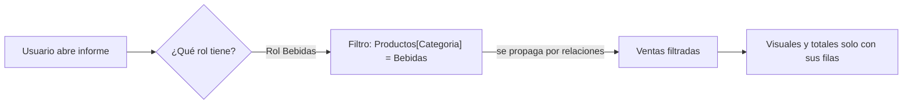

# Seguridad a nivel de fila (RLS)

Parte de: [[17-Power-BI/03 Modelado de datos/_Índice Modelado de datos|Modelado de datos]]

> [!info] Cómo avanzar
> `progreso`: **pendiente** → **viendo** (estudiando) → **visto** (contestaste la autoevaluación sin abrir las respuestas) → **dominado** (hiciste el laboratorio o lo aplicaste de verdad).

## Contenido

### Qué es
La **seguridad a nivel de fila** (RLS, *row-level security*) restringe **qué filas** de datos puede ver cada usuario de un mismo informe y modelo semántico. Se define con **roles** en el modelo; cada rol tiene **filtros DAX** sobre tablas, y en el Service se asignan usuarios o grupos de Entra ID a cada rol. Un gerente de la región Norte y uno de la Sur abren el mismo informe y cada uno ve solo su región.

### Cómo funciona


1. **Crear roles** en Desktop: *Modelado > Administrar roles > Nuevo*. Eliges la tabla y escribes una expresión DAX que debe devolver **verdadero/falso por fila** (o usas el editor de reglas sin código).
2. El filtro se aplica a esa tabla y **se propaga por las relaciones** como cualquier filtro: si filtras `Productos`, `Ventas` queda filtrada por la relación 1:\*. Lo ideal es filtrar **dimensiones**, no hechos.
3. **Probar** en Desktop con *Modelado > Ver como* (eliges rol y, opcionalmente, *Otro usuario* para probar seguridad dinámica).
4. **Publicar** y en el Service, en el modelo semántico > *Seguridad*, agregar miembros a cada rol. Ahí también *Probar como rol*.

**RLS estática vs dinámica**:
- **Estática**: el valor está escrito en el rol (`[Categoria] = "Bebidas"`). Un rol por cada combinación; fácil, pero no escala si tienes 200 sucursales.
- **Dinámica**: un solo rol cuyo filtro usa `USERPRINCIPALNAME()` (el correo/UPN del usuario) contra una tabla de permisos (`Usuario`, `Region`). Agregar a alguien es insertar una fila en la tabla, no crear un rol. Ver [[DAX - seguridad dinámica con USERPRINCIPALNAME]].

**¿RLS aplica a dueños y miembros del área de trabajo?** **No**. RLS solo restringe a quienes tienen rol **Lector** (Viewer) en el área de trabajo o reciben el contenido por aplicación o uso compartido. Los roles **Administrador, Miembro y Colaborador** tienen permiso de edición sobre el modelo y ven **todos** los datos. Por eso, para probar, no basta con abrir el informe tú mismo: usa *Probar como rol* o una cuenta con permiso de lector.

### Ejemplo
Modelo de práctica: `Ventas`(IdVenta, Fecha, FechaEnvio, IdProducto, Cantidad, PrecioUnitario, CostoUnitario), `Productos`(IdProducto, Producto, Categoria, Color), `Calendario`(Fecha, Año, NumMes, Mes, Trimestre); relaciones activas Ventas[Fecha] → Calendario[Fecha] y Ventas[IdProducto] → Productos[IdProducto], 1:\*, filtro simple.

Rol **Solo Bebidas**, filtro en `Productos`:

```dax
[Categoria] = "Bebidas"
```

Rol **Bebidas y Alimentos**, filtro en `Productos`:

```dax
[Categoria] IN { "Bebidas", "Alimentos" }
```

Rol **Desde 2025**, filtro en `Calendario`:

```dax
[Año] >= 2025
```

Si un usuario pertenece a **dos roles**, ve la **unión** de las filas de ambos (los roles se suman, no se intersectan).

Rol dinámico con tabla `Permisos`(Correo, Categoria) relacionada con `Productos[Categoria]` a través de una dimensión de categorías, o con filtro directo:

```dax
// filtro en Productos
[Categoria] IN
    CALCULATETABLE (
        VALUES ( Permisos[Categoria] ),
        Permisos[Correo] = USERPRINCIPALNAME ()
    )
```

### Cuándo usarlo y cuándo no
- **Úsala** cuando el mismo informe sirve a audiencias que no deben ver los datos de otras (regiones, sucursales, clientes en Embedded, agentes de seguros).
- **Prefiere dinámica** cuando el número de combinaciones crece o cambia seguido.
- **No la uses** para ocultar **columnas o tablas** completas: eso es [[Seguridad a nivel de objeto (OLS)]].
- **No es seguridad del informe** sino del modelo: protege también Analizar en Excel y conexiones al modelo. Pero quien tiene permiso de edición la salta.
- En DirectQuery con SSO, a veces conviene que la seguridad la aplique la base de datos.

### Errores comunes
- **Probar con tu cuenta de administrador** y concluir que "RLS no funciona".
- **Filtrar la tabla de hechos** en lugar de la dimensión (más lento y no limita las segmentaciones).
- **Relaciones bidireccionales** sin habilitar *Aplicar filtro de seguridad en ambas direcciones*: el filtro no llega a donde esperas.
- **Olvidar asignar miembros** en el Service: un usuario sin rol en un modelo con RLS **no ve nada** (o recibe error).
- **Comparar `USERPRINCIPALNAME()` con mayúsculas distintas** o con correos alternos (alias vs UPN).

### Para profundizar
- [Seguridad de nivel de fila (RLS) con Power BI](https://learn.microsoft.com/es-mx/power-bi/enterprise/service-admin-rls)
- [Guía de RLS en Power BI Desktop](https://learn.microsoft.com/es-mx/power-bi/guidance/rls-guidance)
- [USERPRINCIPALNAME (DAX)](https://learn.microsoft.com/es-mx/dax/userprincipalname-function-dax)

Practica en [[Lab 5 - Seguridad a nivel de fila (RLS) en Power BI]]. Relacionado: [[Seguridad y permisos en el Service]].

## Ejercicios

Resuélvelos en papel o en la herramienta; la solución está plegada.

> [!question]- Modelo de práctica: `Ventas`(IdVenta, Fecha, FechaEnvio, IdProducto, Cantidad, PrecioUnitario, CostoUnitario), `Productos`(IdProducto, Producto, Categoria, Color) y `Calendario`(Fecha, Año, NumMes, Mes, Trimestre). Relaciones activas Ventas[Fecha] → Calendario[Fecha] y Ventas[IdProducto] → Productos[IdProducto] (1:*, filtro simple). Agrega `Productos[Categoria]`. Escribe el filtro de un rol que solo vea la categoría Bebidas.
> En el rol, tabla `Productos`:
> ```dax
> [Categoria] = "Bebidas"
> ```

> [!question]- Rol para que el usuario vea Bebidas y Alimentos.
> ```dax
> [Categoria] IN { "Bebidas", "Alimentos" }
> ```

> [!question]- Rol que solo vea ventas de 2025 en adelante.
> En la tabla Calendario:
> ```dax
> [Año] >= 2025
> ```
> Con los datos de ejemplo verá 700.

## Autoevaluación

Contesta primero en voz alta o en papel; luego despliega la respuesta.

> [!question]- ¿Qué es RLS?
> Restringir qué filas ve cada usuario mediante roles con filtros DAX sobre tablas (normalmente dimensiones). El filtro se propaga por las relaciones.

> [!question]- Diferencia entre RLS estática y dinámica.
> Estática: el filtro está fijo en el rol (`[Region] = "Norte"`), un rol por región. Dinámica: un solo rol que filtra con `USERPRINCIPALNAME()` contra una tabla de permisos.

> [!question]- ¿RLS aplica a los dueños/miembros del workspace?
> No: Administradores, Miembros y Colaboradores del workspace ven todo. RLS aplica a usuarios con permiso de Lector o a quienes reciben el contenido por app/compartir.

> [!question]- ¿Cómo pruebas RLS antes de publicar?
> *Modelado → Ver como* (View as) eligiendo el rol y, para dinámica, otro usuario. En el Service: *Seguridad → Probar como rol*.

## Práctica

- [[Lab 5 - Seguridad a nivel de fila (RLS) en Power BI]]

