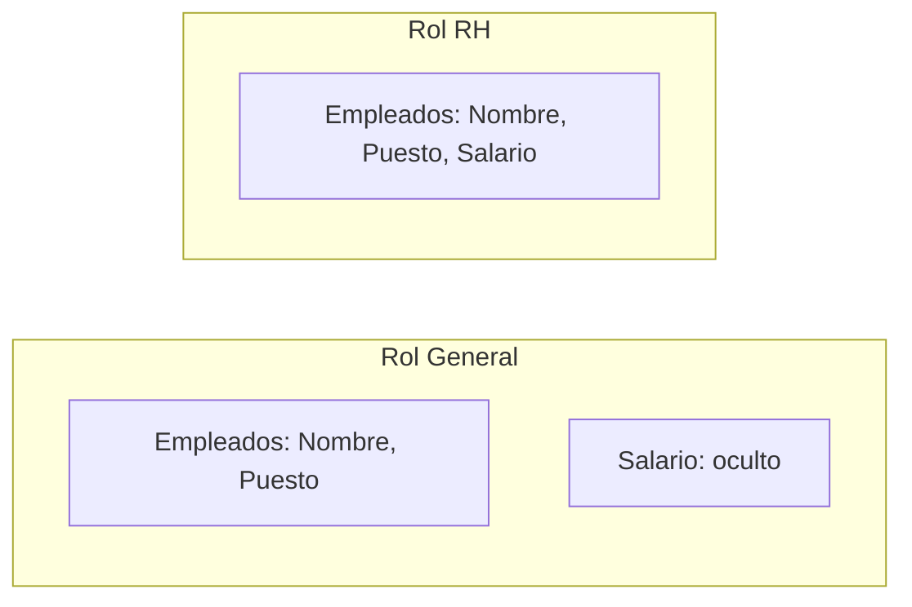

# Seguridad a nivel de objeto (OLS)

Parte de: [[17-Power-BI/03 Modelado de datos/_Índice Modelado de datos|Modelado de datos]]

> [!info] Cómo avanzar
> `progreso`: **pendiente** → **viendo** (estudiando) → **visto** (contestaste la autoevaluación sin abrir las respuestas) → **dominado** (hiciste el laboratorio o lo aplicaste de verdad).

## Contenido

### Qué es
La **seguridad a nivel de objeto** (OLS, *object-level security*) oculta **tablas o columnas completas** del modelo semántico a ciertos roles. Mientras RLS decide **qué filas** ve un usuario, OLS decide **qué objetos existen** para él: para un usuario sin permiso, la columna `Salario` o la tabla `Nomina` simplemente no existen, ni en los visuales, ni en la lista de campos, ni al consultar el modelo desde Excel o DAX Studio.

### Cómo funciona
OLS se define dentro de los mismos **roles** que usa RLS. Cada rol tiene, por tabla y por columna, un permiso de metadatos:
- **None**: el objeto queda oculto y protegido para ese rol.
- **Read**: visible (valor por defecto).

**¿Con qué herramienta se configura?** Los roles se crean en Power BI Desktop (*Administrar roles*), pero la interfaz de roles de Desktop **no** tiene la opción de OLS. Según Microsoft Learn (revisado en noviembre de 2026) hay dos formas:
1. **Vista TMDL** en Power BI Desktop: escribes un script `createOrReplace` con `tablePermission` y `columnPermission`, lo previsualizas y lo aplicas.
2. **Tabular Editor** como herramienta externa: en el rol, sección *Table Permissions*, eliges `None` o `Read` para cada tabla o columna, y guardas al modelo.

Después de publicar, asignas miembros al rol en el Service (*Seguridad* del modelo), igual que con RLS.



**A quién aplica**: igual que RLS, solo a usuarios con rol **Lector** del área o que consumen por aplicación o uso compartido. Administradores, miembros y colaboradores del área tienen permiso de edición y ven todo.

**Qué ve el usuario restringido**: si un visual usa una columna o tabla protegida, el visual muestra un **error** indicando que el campo no se encuentra o no puede usarse. Por eso, con OLS, se diseñan páginas o informes distintos por audiencia (o se usan medidas que no dependan del objeto oculto).

### Ejemplo
**Caso**: ocultar la columna `Salario` de la tabla `Empleados` a todos menos RH. Es **OLS**, no RLS: no quieres esconder **filas** de empleados (todos deben ver la plantilla), sino una **columna**.

Script en la vista TMDL de Desktop:

```tmdl
createOrReplace

    role General
        modelPermission: read

        tablePermission Empleados
            columnPermission Salario
                metadataPermission: none

    role RH
        modelPermission: read
```

Asignas a todos los lectores al rol `General` y al equipo de RH al rol `RH`. Una medida `[Costo Nómina] = SUM(Empleados[Salario])` también debe protegerse: las medidas que dependen de objetos ocultos fallan para el rol restringido, así que colócalas en páginas exclusivas de RH.

Combinado con RLS: el mismo rol `General` puede tener además un filtro de fila (`Empleados[Region] = "Norte"`). Lo que **no** conviene es repartir RLS y OLS en **roles distintos** asignados al mismo usuario: la documentación de Analysis Services indica que esa combinación no se permite porque podría abrir acceso no previsto, y el usuario recibe un error al consultar. Define ambas reglas en el mismo rol.

### Cuándo usarlo y cuándo no
- **Úsalo** para datos sensibles a nivel de atributo: salarios, márgenes, datos personales (CURP, teléfono), costos de proveedor.
- **Usa RLS** cuando el problema es qué registros ve cada quien.
- **Alternativa más simple**: dos modelos (uno con datos sensibles y otro sin ellos) si los públicos son muy distintos; o no cargar la columna si nadie la necesita.
- **Ocultar** una columna en la vista Modelo **no es seguridad**: solo la quita del panel; se puede consultar igual.

### Errores comunes
- **Confundir "ocultar en vista de informe" con OLS**.
- **Probar con cuenta de editor** y ver todo.
- **Informes compartidos** con visuales que usan el objeto oculto: los lectores ven errores.
- **Olvidar medidas** que exponen el dato indirectamente (un promedio de salario por puesto con un solo empleado revela el salario).
- **Funciones no compatibles**: Microsoft documenta que modelos con OLS no admiten algunas funciones (Quick insights, narrativa inteligente, galería de tipos de datos de Excel).

### Para profundizar
- [Seguridad de nivel de objeto (OLS)](https://learn.microsoft.com/es-mx/fabric/security/service-admin-object-level-security)
- [Vista TMDL en Power BI Desktop](https://learn.microsoft.com/es-mx/power-bi/transform-model/desktop-tmdl-view)
- [Tabular Editor: roles y permisos](https://docs.tabulareditor.com/)

Relacionado: [[Seguridad a nivel de fila (RLS)]], [[Tabular Editor]], [[TMDL y proyectos PBIP]].

## Autoevaluación

Contesta primero en voz alta o en papel; luego despliega la respuesta.

> [!question]- ¿Qué es OLS?
> Ocultar tablas o columnas completas a ciertos roles; para ellos el objeto "no existe" (los visuales que lo usan dan error).

> [!question]- ¿Con qué herramienta se configura?
> No hay interfaz en Desktop para OLS: se define con Tabular Editor (o TMDL/XMLA) en los roles, permiso `None` a la tabla o columna.

> [!question]- Caso: ocultar la columna Salario a todos menos RH. ¿RLS u OLS?
> OLS: el problema no es qué filas sino qué columna. RLS filtra filas.

