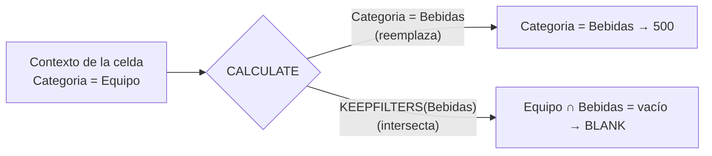

# DAX - CALCULATE

Parte de: [[17-Power-BI/04 DAX/_Índice DAX|DAX]]

> [!info] Cómo avanzar
> `progreso`: **pendiente** → **viendo** (estudiando) → **visto** (contestaste la autoevaluación sin abrir las respuestas) → **dominado** (hiciste el laboratorio o lo aplicaste de verdad).

## Contenido

### Qué es
`CALCULATE(expresión, filtro1, filtro2, ...)` evalúa una expresión en un **contexto de filtro modificado**. Es la función más importante de DAX: permite agregar, reemplazar o quitar filtros y, además, convierte cualquier contexto de fila en filtro (transición de contexto). `CALCULATETABLE` hace lo mismo pero devuelve una tabla.

### Cómo funciona
Orden de evaluación (simplificado):
1. Se toma el contexto de filtro actual (el de la celda).
2. Si hay contexto de fila, se aplica la **transición de contexto**: la fila se vuelve filtro ([[DAX - transición de contexto]]).
3. Se evalúan los argumentos de filtro **en el contexto original**.
4. Cada filtro **reemplaza** los filtros existentes sobre las mismas columnas (a menos que uses `KEEPFILTERS`, que intersecta).
5. Se aplican modificadores como `REMOVEFILTERS`, `ALL`, `USERELATIONSHIP`, `CROSSFILTER`.
6. Se evalúa la expresión en el contexto resultante.

**Filtros booleanos**: `Productos[Categoria] = "Bebidas"` es azúcar sintáctica de `FILTER(ALL(Productos[Categoria]), Productos[Categoria] = "Bebidas")`. Por eso *reemplaza*: el `ALL` borra el filtro previo de esa columna. Un predicado puede usar varias columnas **de la misma tabla** (`Ventas[Cantidad] * Ventas[PrecioUnitario] > 300`), pero no medidas ni columnas de tablas distintas; para eso usas `FILTER` explícito.



### Ejemplo
> [!example] Modelo de ejemplo de esta sección
> - `Productos`: P1 Café (Bebidas, Negro), P2 Molino (Equipo, Rojo), P3 Galletas (Alimentos, Café).
> - `Ventas` (Cantidad × PrecioUnitario, CostoUnitario): 1) 2024-01-15 P1 2×100 (60); 2) 2024-02-10 P2 1×250 (150); 3) 2024-02-20 P1 3×100 (60); 4) 2025-01-05 P3 5×40 (25); 5) 2025-02-14 P2 2×250 (150).
> - `Calendario` (Fecha, Año, NumMes, Mes, AñoMes, Trimestre) relacionado 1:* con `Ventas[Fecha]`; `Productos` 1:* con `Ventas[IdProducto]`.
> - Medida base: `Ventas $ = SUMX(Ventas, Ventas[Cantidad] * Ventas[PrecioUnitario])` → total **1 450**; Bebidas 500, Equipo 750, Alimentos 200; 2024 = 750, 2025 = 700.

```dax
-- 1) Filtro fijo: siempre Bebidas
Ventas Bebidas = CALCULATE([Ventas $], Productos[Categoria] = "Bebidas")
-- Total: 500. En la fila Equipo de una matriz también da 500 (reemplaza).

-- 2) Porcentaje del total: quitar el filtro de productos
% del total =
DIVIDE([Ventas $], CALCULATE([Ventas $], REMOVEFILTERS(Productos)))
-- Equipo: 750 / 1 450 = 51.72 %

-- 3) Año fijo
Ventas 2025 = CALCULATE([Ventas $], Calendario[Año] = 2025)   -- 700

-- 4) Respetar la selección del usuario: intersectar
Ventas Bebidas KF =
CALCULATE([Ventas $], KEEPFILTERS(Productos[Categoria] = "Bebidas"))
-- Fila Bebidas 500; fila Equipo BLANK

-- 5) Varios filtros = AND
Ventas Bebidas 2024 =
CALCULATE([Ventas $], Productos[Categoria] = "Bebidas", Calendario[Año] = 2024)  -- 500

-- 6) Predicado con varias columnas de la misma tabla
Ventas lineas > 300 =
CALCULATE([Ventas $], Ventas[Cantidad] * Ventas[PrecioUnitario] > 300)  -- 500 (línea 5)
```

El caso 6 es válido: el motor filtra las combinaciones existentes de (Cantidad, PrecioUnitario) que cumplen la condición y reemplaza los filtros previos sobre esas dos columnas. Si además quisieras usar una medida en la condición, tendrías que escribir `FILTER(Ventas, [Medida] > x)`, que itera la tabla de hechos.

### Cuándo usarlo y cuándo no
- Úsalo para cualquier "ventas de X", porcentajes del total, comparativos de tiempo (todas las funciones de inteligencia de tiempo son filtros de CALCULATE) y para activar relaciones inactivas.
- Prefiere filtros sobre **columnas de dimensiones** a `FILTER(Ventas, ...)` sobre toda la tabla de hechos.
- Usa `KEEPFILTERS` cuando el filtro deba *respetar* lo que eligió el usuario.
- No envuelvas en CALCULATE algo que no lo necesita: `CALCULATE([Ventas $])` en una medida sin contexto de fila no cambia nada.

### Errores comunes
- **Esperar que el filtro se sume al del visual**: reemplaza; usa KEEPFILTERS para intersectar.
- **Poner una medida en un filtro booleano** (`CALCULATE(..., [Ventas $] > 100)`): no es válido; usa FILTER sobre una tabla adecuada.
- **Usar una variable como expresión**: `CALCULATE(VarYaCalculada, ...)` no recalcula nada ([[DAX - variables (VAR y RETURN)]]).
- **Filtrar la tabla completa** (`FILTER(ALL(Ventas), ...)`) cuando bastaba una columna: más lento y quita filtros de más.

### Para profundizar
- [Función CALCULATE](https://learn.microsoft.com/en-us/dax/calculate-function-dax)
- [Función KEEPFILTERS](https://learn.microsoft.com/en-us/dax/keepfilters-function-dax)
- [Evitar FILTER como argumento de filtro (guía de buenas prácticas)](https://learn.microsoft.com/en-us/dax/best-practices/dax-avoid-avoid-filter-as-filter-argument)

## Ejercicios

Resuélvelos en papel o en la herramienta; la solución está plegada.

> [!question]- Datos de ejemplo (para los ejercicios con resultado numérico): Productos P1 Café (Bebidas), P2 Molino (Equipo), P3 Galletas (Alimentos). Ventas: 1) 2024-01-15 P1 2×100; 2) 2024-02-10 P2 1×250; 3) 2024-02-20 P1 3×100; 4) 2025-01-05 P3 5×40; 5) 2025-02-14 P2 2×250. Medida base: `Ventas $ = SUMX(Ventas, Ventas[Cantidad] * Ventas[PrecioUnitario])` → total 1 450. Medida `Ventas Bebidas`. ¿Cuánto da en total?
> ```dax
> Ventas Bebidas = CALCULATE([Ventas $], Productos[Categoria] = "Bebidas")
> ```
> Resultado: 500.

> [!question]- Medida `% del total` (ventas de la fila entre ventas de todos los productos). ¿Cuánto da para Equipo?
> ```dax
> % del total = DIVIDE([Ventas $], CALCULATE([Ventas $], REMOVEFILTERS(Productos)))
> ```
> Equipo: 750 / 1 450 ≈ 51.72 %.

> [!question]- Medida `Ventas 2025` sin importar el año seleccionado.
> ```dax
> Ventas 2025 = CALCULATE([Ventas $], Calendario[Año] = 2025)
> ```
> Resultado: 700.

> [!question]- Medida que respete la selección del usuario pero se limite a Bebidas (si el usuario eligió Equipo, debe dar blank).
> ```dax
> Ventas Bebidas KF = CALCULATE([Ventas $], KEEPFILTERS(Productos[Categoria] = "Bebidas"))
> ```

## Autoevaluación

Contesta primero en voz alta o en papel; luego despliega la respuesta.

> [!question]- ¿Qué hace CALCULATE?
> Evalúa una expresión en un contexto de filtro modificado: agrega, reemplaza o quita filtros según sus argumentos, y aplica transición de contexto.

> [!question]- ¿Un filtro de CALCULATE sobre una columna se suma al filtro del visual o lo reemplaza?
> Lo **reemplaza** para esa columna. `CALCULATE([Ventas $], Productos[Categoria] = "Bebidas")` da Bebidas aunque la fila sea Equipo. Para intersectar usa `KEEPFILTERS`.

> [!question]- ¿Qué es un filtro booleano en CALCULATE y qué equivale internamente?
> `Productos[Color] = "Rojo"` equivale a `FILTER(ALL(Productos[Color]), Productos[Color] = "Rojo")`.

> [!question]- Caso: `CALCULATE([Ventas $], Ventas[Cantidad] * Ventas[PrecioUnitario] > 300)`. ¿Es válido y qué hace?
> Sí (se permiten predicados con varias columnas de la **misma** tabla). Internamente filtra las combinaciones existentes de (Cantidad, PrecioUnitario) y reemplaza filtros previos sobre esas columnas. `FILTER(Ventas, ...)` es más explícito pero itera toda la tabla de hechos; con medidas o columnas de otras tablas en el predicado sí necesitas FILTER.

## Práctica

- [[Lab 6 - Medidas con CALCULATE y comparativos de tiempo en Power BI]]

