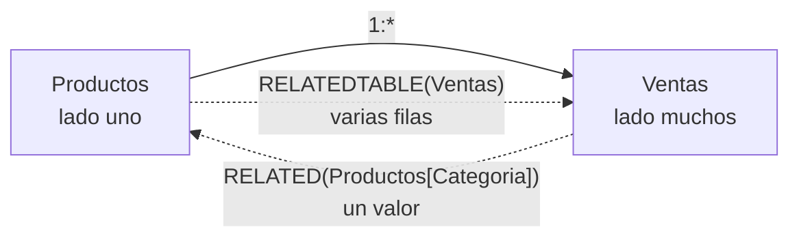

# DAX - RELATED y RELATEDTABLE

Parte de: [[17-Power-BI/04 DAX/_Índice DAX|DAX]]

> [!info] Cómo avanzar
> `progreso`: **pendiente** → **viendo** (estudiando) → **visto** (contestaste la autoevaluación sin abrir las respuestas) → **dominado** (hiciste el laboratorio o lo aplicaste de verdad).

## Contenido

### Qué es
`RELATED` y `RELATEDTABLE` permiten, **desde un contexto de fila**, leer datos de otra tabla siguiendo una relación del modelo:
- `RELATED(Tabla[Columna])` va del lado **muchos al lado uno** y devuelve **un valor**: desde una línea de Ventas, la categoría de su producto.
- `RELATEDTABLE(Tabla)` va del lado **uno al lado muchos** y devuelve **una tabla**: desde un producto, todas sus líneas de venta.

Son el equivalente DAX de un `JOIN` puntual, pero sin escribir la condición: usan la relación ya definida.

### Cómo funciona


- **RELATED necesita contexto de fila** sobre la tabla del lado muchos (columna calculada en Ventas o un iterador como `SUMX(Ventas, ...)`/`FILTER(Ventas, ...)`). En una medida "suelta" no hay fila y da error.
- **RELATEDTABLE** es, en la práctica, un `CALCULATETABLE(Tabla)`: hace transición de contexto con la fila actual, así que el filtro se propaga por la relación. Por eso funciona en una columna calculada de Productos sin escribir CALCULATE.
- Ambas usan la relación **activa**. Para relaciones inactivas se recurre a `USERELATIONSHIP` dentro de CALCULATE ([[DAX - USERELATIONSHIP, TREATAS y CROSSFILTER]]).
- Con relaciones muchos a muchos o de cardinalidad *:* `RELATED` no está disponible: no hay "un solo" valor del otro lado.

### Ejemplo
> [!example] Modelo de ejemplo de esta sección
> - `Productos`: P1 Café (Bebidas, Negro), P2 Molino (Equipo, Rojo), P3 Galletas (Alimentos, Café).
> - `Ventas` (Cantidad × PrecioUnitario, CostoUnitario): 1) 2024-01-15 P1 2×100 (60); 2) 2024-02-10 P2 1×250 (150); 3) 2024-02-20 P1 3×100 (60); 4) 2025-01-05 P3 5×40 (25); 5) 2025-02-14 P2 2×250 (150).
> - `Calendario` (Fecha, Año, NumMes, Mes, AñoMes, Trimestre) relacionado 1:* con `Ventas[Fecha]`; `Productos` 1:* con `Ventas[IdProducto]`.
> - Medida base: `Ventas $ = SUMX(Ventas, Ventas[Cantidad] * Ventas[PrecioUnitario])` → total **1 450**; Bebidas 500, Equipo 750, Alimentos 200; 2024 = 750, 2025 = 700.

```dax
-- Columna calculada en Ventas (lado muchos → uno)
Categoria = RELATED(Productos[Categoria])

-- Columna calculada en Productos (lado uno → muchos)
Num ventas = COUNTROWS(RELATEDTABLE(Ventas))
-- Café 2, Molino 2, Galletas 1

-- Medida: ventas de productos rojos con iterador + RELATED
Ventas rojo =
SUMX(
    FILTER(Ventas, RELATED(Productos[Color]) = "Rojo"),
    Ventas[Cantidad] * Ventas[PrecioUnitario]
)
-- Solo Molino (líneas 2 y 5): 250 + 500 = 750

-- Medida: categorías que empiezan con "B"
Ventas categoria B =
SUMX(
    FILTER(Ventas, LEFT(RELATED(Productos[Categoria]), 1) = "B"),
    Ventas[Cantidad] * Ventas[PrecioUnitario]
)
-- Bebidas (Café): 200 + 300 = 500
```

Las dos medidas son correctas, pero filtran la tabla de hechos fila por fila. La versión más eficiente pone el filtro en la dimensión y deja que la relación lo propague:

```dax
Ventas rojo rapido = CALCULATE([Ventas $], Productos[Color] = "Rojo")                -- 750
Ventas categoria B rapido = CALCULATE([Ventas $], LEFT(Productos[Categoria], 1) = "B") -- 500
```

### Cuándo usarlo y cuándo no
- **RELATED** en columnas calculadas de la tabla de hechos cuando realmente necesitas el atributo ahí (por ejemplo, para una clave compuesta). Si es solo para mostrar o filtrar, no hace falta: el visual ya puede usar `Productos[Categoria]` gracias a la relación.
- **RELATED dentro de iteradores** cuando el cálculo por línea combina datos de hechos y de dimensión: `SUMX(Ventas, Ventas[Cantidad] * RELATED(Productos[PrecioLista]))`.
- **RELATEDTABLE** para conteos o sumas por fila de dimensión en columnas calculadas (número de ventas por producto, fecha de primera compra por cliente).
- Para filtrar por un atributo de la dimensión, **prefiere CALCULATE** con un filtro sobre la dimensión.

### Errores comunes
- **Usar RELATED en una medida sin iterador**: `Ventas rojo = IF(RELATED(Productos[Color]) = "Rojo", ...)` no tiene fila; error de contexto.
- **Usar RELATED en la dirección equivocada** (desde Productos hacia Ventas): no hay un solo valor; usa RELATEDTABLE y agrega.
- **Duplicar atributos de la dimensión en la tabla de hechos** con columnas RELATED "por si acaso": más memoria y modelo más confuso.
- **Esperar que RELATED use una relación inactiva**: siempre toma la activa.

### Para profundizar
- [Función RELATED](https://learn.microsoft.com/en-us/dax/related-function-dax)
- [Función RELATEDTABLE](https://learn.microsoft.com/en-us/dax/relatedtable-function-dax)
- [Modelo estrella en Power BI (guía)](https://learn.microsoft.com/en-us/power-bi/guidance/star-schema)

## Ejercicios

Resuélvelos en papel o en la herramienta; la solución está plegada.

> [!question]- Modelo de práctica: `Ventas`(IdVenta, Fecha, FechaEnvio, IdProducto, Cantidad, PrecioUnitario, CostoUnitario), `Productos`(IdProducto, Producto, Categoria, Color) y `Calendario`(Fecha, Año, NumMes, Mes, Trimestre). Relaciones activas Ventas[Fecha] → Calendario[Fecha] y Ventas[IdProducto] → Productos[IdProducto] (1:*, filtro simple). Columna en Productos con el número de ventas (filas) del producto.
> ```dax
> Num ventas = COUNTROWS(RELATEDTABLE(Ventas))
> ```

> [!question]- Medida: ventas solo de productos de color Rojo usando RELATED dentro de un iterador.
> ```dax
> Ventas rojo = SUMX(FILTER(Ventas, RELATED(Productos[Color]) = "Rojo"),
>     Ventas[Cantidad] * Ventas[PrecioUnitario])
> ```
> (Más eficiente: `CALCULATE([Ventas $], Productos[Color] = "Rojo")`.)

> [!question]- Datos de ejemplo (para los ejercicios con resultado numérico): Productos P1 Café (Bebidas), P2 Molino (Equipo), P3 Galletas (Alimentos). Ventas: 1) 2024-01-15 P1 2×100; 2) 2024-02-10 P2 1×250; 3) 2024-02-20 P1 3×100; 4) 2025-01-05 P3 5×40; 5) 2025-02-14 P2 2×250. Medida base: `Ventas $ = SUMX(Ventas, Ventas[Cantidad] * Ventas[PrecioUnitario])` → total 1 450. Medida de ventas de productos cuya categoría empieza con "B", con iterador y RELATED. ¿Resultado?
> ```dax
> Ventas cat B = SUMX(FILTER(Ventas, LEFT(RELATED(Productos[Categoria]), 1) = "B"),
>     Ventas[Cantidad] * Ventas[PrecioUnitario])
> ```
> Solo Bebidas → 500.

## Autoevaluación

Contesta primero en voz alta o en papel; luego despliega la respuesta.

> [!question]- ¿Qué hace RELATED?
> Desde el lado "varios" (Ventas), trae un valor del lado "uno" (Productos) siguiendo la relación. Requiere contexto de fila.

> [!question]- ¿Qué hace RELATEDTABLE?
> Desde el lado "uno" devuelve la tabla de filas relacionadas del lado "varios". Equivale a `CALCULATETABLE(Ventas)` con transición de contexto.

> [!question]- Error común: usar RELATED en una medida sin iterador.
> Da error porque no hay contexto de fila. Debe ir dentro de SUMX/FILTER, etc.

