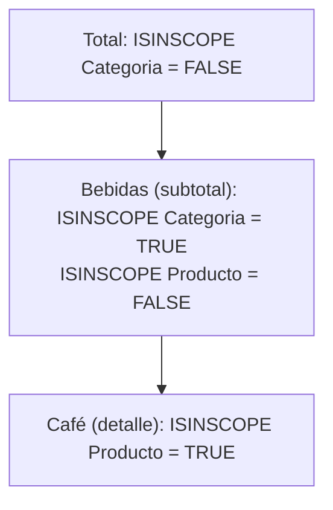

# DAX - SELECTEDVALUE, ISINSCOPE y HASONEVALUE

Parte de: [[17-Power-BI/04 DAX/_Índice DAX|DAX]]

> [!info] Cómo avanzar
> `progreso`: **pendiente** → **viendo** (estudiando) → **visto** (contestaste la autoevaluación sin abrir las respuestas) → **dominado** (hiciste el laboratorio o lo aplicaste de verdad).

## Contenido

### Qué es
Funciones para **saber qué hay en el contexto de filtro** y reaccionar:
- `HASONEVALUE(col)`: TRUE si la columna tiene exactamente un valor visible.
- `SELECTEDVALUE(col [, alterno])`: devuelve ese valor único; si hay cero o varios, devuelve el alterno (BLANK por omisión). Es el atajo de `IF(HASONEVALUE(col), VALUES(col), alterno)`.
- `ISINSCOPE(col)`: TRUE si la columna está **agrupando** en el nivel actual de un visual (es decir, estás en una fila de detalle de esa columna, no en un subtotal o total).
- Relacionadas: `ISFILTERED(col)` (hay filtro directo sobre la columna) e `ISCROSSFILTERED`.

### Cómo funciona
La diferencia entre HASONEVALUE e ISINSCOPE aparece en las matrices:
- En la fila de subtotal "Bebidas" (agrupada por Categoría y luego Producto), Categoría tiene un solo valor, y si la categoría solo tiene un producto, **Producto también tiene un solo valor**. `HASONEVALUE(Productos[Producto])` sería TRUE en el subtotal, aunque no estés en el nivel de producto.
- `ISINSCOPE(Productos[Producto])` solo es TRUE en las filas donde Producto es el nivel de agrupación. Por eso es la función correcta para "mostrar solo en el detalle".
- `HASONEVALUE` también se cumple cuando el usuario selecciona un solo valor en una segmentación, aunque la columna no esté en el visual; ahí es útil para títulos y textos.



### Ejemplo
> [!example] Modelo de ejemplo de esta sección
> - `Productos`: P1 Café (Bebidas, Negro), P2 Molino (Equipo, Rojo), P3 Galletas (Alimentos, Café).
> - `Ventas` (Cantidad × PrecioUnitario, CostoUnitario): 1) 2024-01-15 P1 2×100 (60); 2) 2024-02-10 P2 1×250 (150); 3) 2024-02-20 P1 3×100 (60); 4) 2025-01-05 P3 5×40 (25); 5) 2025-02-14 P2 2×250 (150).
> - `Calendario` (Fecha, Año, NumMes, Mes, AñoMes, Trimestre) relacionado 1:* con `Ventas[Fecha]`; `Productos` 1:* con `Ventas[IdProducto]`.
> - Medida base: `Ventas $ = SUMX(Ventas, Ventas[Cantidad] * Ventas[PrecioUnitario])` → total **1 450**; Bebidas 500, Equipo 750, Alimentos 200; 2024 = 750, 2025 = 700.

Matriz con Categoría → Producto en filas:

```dax
Ventas solo detalle =
IF(ISINSCOPE(Productos[Producto]), [Ventas $])
-- Café 500, Molino 750, Galletas 200; blank en subtotales de categoría y total

Año elegido =
SELECTEDVALUE(Calendario[Año], MAX(Calendario[Año]))
-- Segmentación en 2024 → 2024; sin selección (2024 y 2025) → 2025

Titulo =
"Ventas de " & SELECTEDVALUE(Productos[Categoria], "todas las categorías")
-- Bebidas elegida → "Ventas de Bebidas"; ninguna o varias → "Ventas de todas las categorías"
```

Para usar `Titulo` en un visual: *Formato → General → Título → fx* y eliges la medida. El mismo patrón sirve para subtítulos con el año (`"Año " & [Año elegido]`) o para notas al pie que expliquen el filtro activo.

Lista de valores cuando hay varios seleccionados:

```dax
Titulo detallado =
VAR N = COUNTROWS(VALUES(Productos[Categoria]))
RETURN
    SWITCH(TRUE(),
        N = 1, "Ventas de " & SELECTEDVALUE(Productos[Categoria]),
        N <= 3 && ISFILTERED(Productos[Categoria]),
            "Ventas de " & CONCATENATEX(VALUES(Productos[Categoria]), Productos[Categoria], ", "),
        "Ventas de todas las categorías")
```

### Cuándo usarlo y cuándo no
- **SELECTEDVALUE** para títulos dinámicos, parámetros what-if, tablas desconectadas de opciones (elegir moneda o medida) y medidas que dependen del valor elegido.
- **ISINSCOPE** para cálculos que solo tienen sentido en cierto nivel de una jerarquía (rankings por producto, porcentajes del padre) y para ocultar totales.
- **HASONEVALUE** cuando la pregunta es "¿el usuario redujo esta columna a un valor?", tenga o no la columna en el visual.

### Errores comunes
- **Usar HASONEVALUE para detectar el nivel de detalle**: falla cuando un padre tiene un solo hijo. Usa ISINSCOPE.
- **`VALUES(col)` como escalar sin protección**: error en el total cuando hay varios valores.
- **Olvidar el valor alterno** en SELECTEDVALUE para títulos: aparece "Ventas de " con nada.
- **Esperar que SELECTEDVALUE vea selecciones de otra tabla**: solo mira la columna indicada; si el filtro llega por otra dimensión que no filtra esa columna, devolverá el alterno.

### Para profundizar
- [Función SELECTEDVALUE](https://learn.microsoft.com/en-us/dax/selectedvalue-function)
- [Función ISINSCOPE](https://learn.microsoft.com/en-us/dax/isinscope-function-dax)
- [Función HASONEVALUE](https://learn.microsoft.com/en-us/dax/hasonevalue-function-dax)

## Ejercicios

Resuélvelos en papel o en la herramienta; la solución está plegada.

> [!question]- Medida que muestre Ventas $ en filas de producto pero blank en los subtotales de categoría y total.
> ```dax
> Ventas solo detalle = IF(ISINSCOPE(Productos[Producto]), [Ventas $])
> ```

> [!question]- Medida que devuelva el año seleccionado o el máximo año si hay varios.
> ```dax
> Año elegido = SELECTEDVALUE(Calendario[Año], MAX(Calendario[Año]))
> ```

> [!question]- Título dinámico: "Ventas de <Categoria>" o "Ventas de todas las categorías".
> ```dax
> Título = "Ventas de " & SELECTEDVALUE(Productos[Categoria], "todas las categorías")
> ```

## Autoevaluación

Contesta primero en voz alta o en papel; luego despliega la respuesta.

> [!question]- ¿Qué devuelve SELECTEDVALUE(col, alterno)?
> El valor si en el contexto hay exactamente uno; si no, el alterno (o blank).

> [!question]- ¿Diferencia entre HASONEVALUE e ISINSCOPE?
> HASONEVALUE es verdadero si hay un solo valor filtrado (puede ser por segmentación). ISINSCOPE es verdadero si la columna está agrupando en ese nivel del visual (detecta niveles de jerarquía y totales con más precisión).

> [!question]- Uso típico de SELECTEDVALUE en títulos dinámicos.
> `Título = "Ventas de " & SELECTEDVALUE(Productos[Categoria], "todas las categorías")` y asignarla al título del visual con formato condicional (fx).

