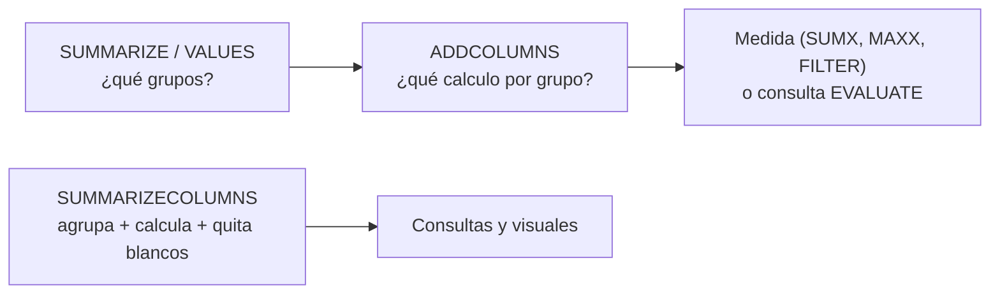

# DAX - SUMMARIZE, SUMMARIZECOLUMNS y ADDCOLUMNS

Parte de: [[17-Power-BI/04 DAX/_Índice DAX|DAX]]

> [!info] Cómo avanzar
> `progreso`: **pendiente** → **viendo** (estudiando) → **visto** (contestaste la autoevaluación sin abrir las respuestas) → **dominado** (hiciste el laboratorio o lo aplicaste de verdad).

## Contenido

### Qué es
Tres funciones para **construir tablas agrupadas**, el equivalente DAX de un `GROUP BY`:
- `SUMMARIZE(tabla, col1, col2, ...)`: devuelve las combinaciones existentes de columnas de una tabla y de sus tablas relacionadas del lado uno (desde Ventas puedes agrupar por `Productos[Categoria]`).
- `ADDCOLUMNS(tabla, "Nombre", expresión, ...)`: agrega columnas calculadas a una tabla; cada expresión se evalúa en contexto de fila (con transición de contexto si es una medida).
- `SUMMARIZECOLUMNS(col1, col2, [filtros], "Nombre", expresión, ...)`: agrupa y calcula en un solo paso, y **omite las filas donde todas las expresiones son BLANK**. Es lo que generan los visuales de Power BI en sus consultas.

### Cómo funciona
**Patrón recomendado en medidas y tablas calculadas**: agrupar con SUMMARIZE (o VALUES) y calcular con ADDCOLUMNS.

```dax
ADDCOLUMNS(
    SUMMARIZE(Ventas, Productos[Categoria]),   -- solo las categorías con ventas
    "@Total", [Ventas $]                         -- medida → transición de contexto
)
```

¿Por qué no calcular dentro de SUMMARIZE (`SUMMARIZE(Ventas, Productos[Categoria], "Total", [Ventas $])`)? Funciona, pero SUMMARIZE evalúa esas expresiones en un contexto mezclado (fila + filtro) que puede dar resultados inesperados con ciertos filtros y suele ser menos eficiente. La documentación y SQLBI recomiendan usar SUMMARIZE solo para agrupar.

**SUMMARIZECOLUMNS** es la opción más eficiente para **consultas** (`EVALUATE`) y la que verás al copiar la consulta de un visual con Performance Analyzer. Históricamente no admitía transición de contexto y no podía usarse en muchas medidas; según DAX Guide, los motores publicados desde junio de 2024 ya la soportan dentro de medidas, con algunas limitaciones que documenta Microsoft. Si mantienes modelos en Analysis Services antiguos, revisa tu versión.



### Ejemplo
> [!example] Modelo de ejemplo de esta sección
> - `Productos`: P1 Café (Bebidas, Negro), P2 Molino (Equipo, Rojo), P3 Galletas (Alimentos, Café).
> - `Ventas` (Cantidad × PrecioUnitario, CostoUnitario): 1) 2024-01-15 P1 2×100 (60); 2) 2024-02-10 P2 1×250 (150); 3) 2024-02-20 P1 3×100 (60); 4) 2025-01-05 P3 5×40 (25); 5) 2025-02-14 P2 2×250 (150).
> - `Calendario` (Fecha, Año, NumMes, Mes, AñoMes, Trimestre) relacionado 1:* con `Ventas[Fecha]`; `Productos` 1:* con `Ventas[IdProducto]`.
> - Medida base: `Ventas $ = SUMX(Ventas, Ventas[Cantidad] * Ventas[PrecioUnitario])` → total **1 450**; Bebidas 500, Equipo 750, Alimentos 200; 2024 = 750, 2025 = 700.

```dax
-- Ventas por categoría y año (consulta)
EVALUATE
SUMMARIZECOLUMNS(Productos[Categoria], Calendario[Año], "Ventas", [Ventas $])
-- Bebidas-2024 500; Equipo-2024 250; Equipo-2025 500; Alimentos-2025 200
-- No aparecen Bebidas-2025 ni Alimentos-2024: su medida es BLANK

-- Productos vendidos con total y número de líneas
EVALUATE
ADDCOLUMNS(
    SUMMARIZE(Ventas, Productos[Producto]),
    "Ventas", [Ventas $],
    "Lineas", CALCULATE(COUNTROWS(Ventas))
)
-- Café 500 / 2; Molino 750 / 2; Galletas 200 / 1

-- Categorías con ventas mayores a 300
EVALUATE
FILTER(
    SUMMARIZECOLUMNS(Productos[Categoria], "Ventas", [Ventas $]),
    [Ventas] > 300
)
-- Equipo 750, Bebidas 500
```

Observa `CALCULATE(COUNTROWS(Ventas))`: dentro de ADDCOLUMNS hay contexto de fila; sin CALCULATE, COUNTROWS vería las 5 líneas en cada producto.

Dentro de una medida, el mismo patrón alimenta un agregador:

```dax
Categoria lider =
VAR T = ADDCOLUMNS(SUMMARIZE(Ventas, Productos[Categoria]), "@V", [Ventas $])
RETURN MAXX(TOPN(1, T, [@V]), Productos[Categoria])   -- "Equipo"
```

### Cuándo usarlo y cuándo no
- **SUMMARIZECOLUMNS** para consultas EVALUATE, tablas calculadas de resumen y depuración.
- **ADDCOLUMNS + SUMMARIZE/VALUES** para tablas virtuales dentro de medidas, sobre todo si necesitas compatibilidad con motores antiguos.
- **SUMMARIZE solo para agrupar**, por ejemplo para obtener las combinaciones existentes de cliente y producto.
- Si solo necesitas una columna de valores únicos, `VALUES(col)` es más simple que SUMMARIZE.

### Errores comunes
- **Agregar columnas calculadas dentro de SUMMARIZE**: resultados difíciles de predecir; usa ADDCOLUMNS.
- **Olvidar CALCULATE dentro de ADDCOLUMNS** cuando usas funciones de agregación directas (no medidas): falta la transición de contexto.
- **Esperar filas con BLANK en SUMMARIZECOLUMNS**: las quita; si necesitas todas las combinaciones, agrega `IGNORE()` o usa ADDCOLUMNS sobre un CROSSJOIN.
- **Crear tablas calculadas resumen gigantes** "para acelerar": duplican datos; prueba antes medidas o agregaciones del modelo.

### Para profundizar
- [Función SUMMARIZECOLUMNS](https://learn.microsoft.com/en-us/dax/summarizecolumns-function-dax)
- [Función SUMMARIZE](https://learn.microsoft.com/en-us/dax/summarize-function-dax)
- [SUMMARIZECOLUMNS en DAX Guide](https://dax.guide/summarizecolumns/)
- [Introducing SUMMARIZECOLUMNS (SQLBI)](https://www.sqlbi.com/articles/introducing-summarizecolumns/)

## Ejercicios

Resuélvelos en papel o en la herramienta; la solución está plegada.

> [!question]- Datos de ejemplo (para los ejercicios con resultado numérico): Productos P1 Café (Bebidas), P2 Molino (Equipo), P3 Galletas (Alimentos). Ventas: 1) 2024-01-15 P1 2×100; 2) 2024-02-10 P2 1×250; 3) 2024-02-20 P1 3×100; 4) 2025-01-05 P3 5×40; 5) 2025-02-14 P2 2×250. Medida base: `Ventas $ = SUMX(Ventas, Ventas[Cantidad] * Ventas[PrecioUnitario])` → total 1 450. Escribe una consulta que devuelva ventas por categoría y año.
> ```dax
> EVALUATE
> SUMMARIZECOLUMNS(Productos[Categoria], Calendario[Año], "Ventas", [Ventas $])
> ```
> Bebidas 2024 500; Equipo 2024 250, 2025 500; Alimentos 2025 200.

> [!question]- Con ADDCOLUMNS + SUMMARIZE, tabla de productos vendidos con su total y número de líneas.
> ```dax
> EVALUATE
> ADDCOLUMNS(
>     SUMMARIZE(Ventas, Productos[Producto]),
>     "Ventas", [Ventas $],
>     "Lineas", CALCULATE(COUNTROWS(Ventas)))
> ```

> [!question]- Consulta que devuelva las categorías con ventas mayores a 300.
> ```dax
> EVALUATE
> FILTER(
>     SUMMARIZECOLUMNS(Productos[Categoria], "Ventas", [Ventas $]),
>     [Ventas] > 300)
> ```
> → Equipo 750, Bebidas 500.

## Autoevaluación

Contesta primero en voz alta o en papel; luego despliega la respuesta.

> [!question]- ¿Para qué sirve SUMMARIZE y qué no se recomienda hacer con él?
> Agrupar una tabla por columnas (incluidas de tablas relacionadas). No se recomienda agregar columnas calculadas dentro de SUMMARIZE; se combina con ADDCOLUMNS.

> [!question]- ¿Dónde se usa SUMMARIZECOLUMNS?
> Es la función que generan los visuales en sus consultas y la más eficiente para consultas EVALUATE. Dentro de medidas tiene restricciones (verificar en la documentación para tu versión).

> [!question]- Patrón recomendado para agrupar y calcular.
> `ADDCOLUMNS(SUMMARIZE(Ventas, Productos[Categoria]), "Total", [Ventas $])`.

