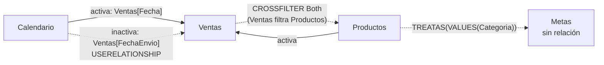

# DAX - USERELATIONSHIP, TREATAS y CROSSFILTER

Parte de: [[17-Power-BI/04 DAX/_Índice DAX|DAX]]

> [!info] Cómo avanzar
> `progreso`: **pendiente** → **viendo** (estudiando) → **visto** (contestaste la autoevaluación sin abrir las respuestas) → **dominado** (hiciste el laboratorio o lo aplicaste de verdad).

## Contenido

### Qué es
Tres modificadores de CALCULATE para controlar **cómo viajan los filtros** entre tablas:
- `USERELATIONSHIP(col1, col2)`: activa, solo durante el cálculo, una relación **inactiva** que ya existe en el modelo.
- `TREATAS(tabla, col1 [, col2...])`: aplica los valores de una tabla como filtro sobre columnas de otra tabla **aunque no haya relación** (una "relación virtual").
- `CROSSFILTER(col1, col2, dirección)`: cambia la dirección de filtrado de una relación existente (`Both`, `OneWay`, `None`) durante el cálculo.

### Cómo funciona


- Entre dos tablas solo puede haber **una relación activa**. Una tabla de hechos con dos fechas (pedido y envío) tiene una relación activa y otra inactiva; USERELATIONSHIP la usa sin duplicar el calendario.
- `TREATAS(VALUES(Productos[Categoria]), Metas[Categoria])` toma las categorías visibles y filtra Metas con ellas. Es la forma eficiente de conectar tablas con distinta granularidad (metas por categoría y mes, ventas por día y producto) sin relaciones muchos a muchos.
- La relación por defecto filtra de la dimensión a los hechos. Para contar productos *con ventas* en un periodo, necesitas que Ventas filtre a Productos: `CROSSFILTER(..., Both)` lo hace solo dentro de esa medida, sin volver bidireccional la relación del modelo.

### Ejemplo
> [!example] Modelo de ejemplo de esta sección
> - `Productos`: P1 Café (Bebidas, Negro), P2 Molino (Equipo, Rojo), P3 Galletas (Alimentos, Café).
> - `Ventas` (Cantidad × PrecioUnitario, CostoUnitario): 1) 2024-01-15 P1 2×100 (60); 2) 2024-02-10 P2 1×250 (150); 3) 2024-02-20 P1 3×100 (60); 4) 2025-01-05 P3 5×40 (25); 5) 2025-02-14 P2 2×250 (150).
> - `Calendario` (Fecha, Año, NumMes, Mes, AñoMes, Trimestre) relacionado 1:* con `Ventas[Fecha]`; `Productos` 1:* con `Ventas[IdProducto]`.
> - Medida base: `Ventas $ = SUMX(Ventas, Ventas[Cantidad] * Ventas[PrecioUnitario])` → total **1 450**; Bebidas 500, Equipo 750, Alimentos 200; 2024 = 750, 2025 = 700.

Fechas de envío de las cinco líneas: 18-ene-24, 12-feb-24, 25-feb-24, 07-ene-25 y 20-feb-25 (relación inactiva Ventas[FechaEnvio] → Calendario[Fecha]).

```dax
Ventas por envio =
CALCULATE([Ventas $], USERELATIONSHIP(Ventas[FechaEnvio], Calendario[Fecha]))
-- Por mes de envío: ene-24 200, feb-24 550, ene-25 200, feb-25 500

-- Tabla Metas(Categoria, Monto) SIN relación: Bebidas 600, Equipo 700, Alimentos 300
Meta =
CALCULATE(SUM(Metas[Monto]), TREATAS(VALUES(Productos[Categoria]), Metas[Categoria]))
-- Con la segmentación de Productos[Categoria] = Bebidas → 600

Cumplimiento % = DIVIDE([Ventas $], [Meta])
-- Bebidas 500/600 = 83.3 %; Equipo 750/700 = 107.1 %; Alimentos 200/300 = 66.7 %

Productos con venta =
CALCULATE(
    COUNTROWS(Productos),
    CROSSFILTER(Ventas[IdProducto], Productos[IdProducto], Both)
)
-- 2025: Galletas y Molino → 2; 2024: Café y Molino → 2
```

En `Productos con venta`, sin CROSSFILTER el resultado sería 3 en cualquier año, porque el filtro de Calendario llega a Ventas pero no sube a Productos. (Una alternativa sin cambiar la dirección es `DISTINCTCOUNT(Ventas[IdProducto])`.)

### Cuándo usarlo y cuándo no
- **USERELATIONSHIP**: varias fechas en la tabla de hechos (pedido, envío, entrega), dimensiones de rol múltiple ([[Dimensiones de rol múltiple]]).
- **TREATAS**: metas, presupuestos o tablas desconectadas con otra granularidad; también para aplicar filtros calculados a columnas de otra tabla.
- **CROSSFILTER**: casos puntuales donde necesitas filtrar "hacia arriba" o desactivar una relación (`None`) en una medida concreta. Es mejor que volver bidireccional la relación del modelo, que provoca ambigüedad y lentitud.
- Si el uso es constante en todo el modelo, quizá la solución sea de **modelado** (otra relación, tabla puente), no DAX.

### Errores comunes
- **Esperar que USERELATIONSHIP funcione sin la relación creada**: la relación inactiva debe existir en el modelo.
- **USERELATIONSHIP con seguridad de filas**: la documentación indica que no se puede usar cuando hay RLS definida en la tabla donde vive la medida; planéalo al diseñar roles.
- **TREATAS con columnas de tipos distintos** (texto vs número): no coincide nada.
- **Volver bidireccional la relación del modelo** en lugar de usar CROSSFILTER en la medida.
- **Abusar de relaciones virtuales** cuando una relación física simple sería más rápida y clara.

### Para profundizar
- [Función USERELATIONSHIP](https://learn.microsoft.com/en-us/dax/userelationship-function-dax)
- [Función TREATAS](https://learn.microsoft.com/en-us/dax/treatas-function)
- [Función CROSSFILTER](https://learn.microsoft.com/en-us/dax/crossfilter-function-dax)

## Ejercicios

Resuélvelos en papel o en la herramienta; la solución está plegada.

> [!question]- Modelo de práctica: `Ventas`(IdVenta, Fecha, FechaEnvio, IdProducto, Cantidad, PrecioUnitario, CostoUnitario), `Productos`(IdProducto, Producto, Categoria, Color) y `Calendario`(Fecha, Año, NumMes, Mes, Trimestre). Relaciones activas Ventas[Fecha] → Calendario[Fecha] y Ventas[IdProducto] → Productos[IdProducto] (1:*, filtro simple). La relación Ventas[FechaEnvio] → Calendario[Fecha] está inactiva. Escribe `Ventas por envío`.
> ```dax
> Ventas por envío =
> CALCULATE([Ventas $], USERELATIONSHIP(Ventas[FechaEnvio], Calendario[Fecha]))
> ```

> [!question]- Tienes una tabla `Metas`(Categoria, Monto) sin relación. Haz que la segmentación de Productos[Categoria] la filtre.
> ```dax
> Meta $ = CALCULATE(SUM(Metas[Monto]), TREATAS(VALUES(Productos[Categoria]), Metas[Categoria]))
> ```

> [!question]- Cuenta productos que tienen ventas en el periodo filtrado haciendo que Ventas filtre a Productos.
> ```dax
> Productos con venta =
> CALCULATE(COUNTROWS(Productos), CROSSFILTER(Ventas[IdProducto], Productos[IdProducto], BOTH))
> ```

## Autoevaluación

Contesta primero en voz alta o en papel; luego despliega la respuesta.

> [!question]- ¿Qué hace USERELATIONSHIP?
> Activa una relación inactiva existente solo durante el CALCULATE. Las columnas deben tener ya la relación definida en el modelo.

> [!question]- ¿Qué hace TREATAS?
> Aplica los valores de una tabla/columna como filtro sobre otra columna **sin relación física** (relación virtual).

> [!question]- ¿Qué hace CROSSFILTER?
> Cambia la dirección del filtro (Both, OneWay, None) de una relación existente dentro de un CALCULATE.

