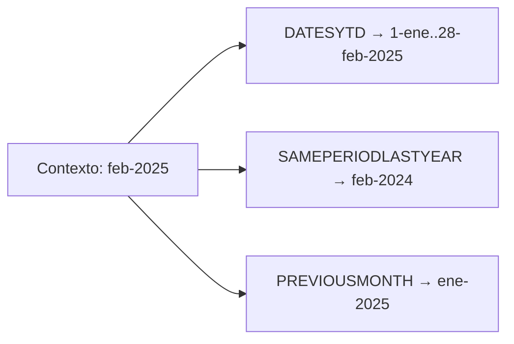

# DAX - YTD, mismo periodo del año anterior y comparativos

Parte de: [[17-Power-BI/04 DAX/_Índice DAX|DAX]]

> [!info] Cómo avanzar
> `progreso`: **pendiente** → **viendo** (estudiando) → **visto** (contestaste la autoevaluación sin abrir las respuestas) → **dominado** (hiciste el laboratorio o lo aplicaste de verdad).

## Contenido

### Qué es
Son los cálculos de tiempo más pedidos en cualquier informe ejecutivo: **acumulado del año (YTD)**, **mismo periodo del año anterior (AA)**, **variación** absoluta y porcentual, y **periodo anterior** (mes anterior, trimestre anterior). Todos se construyen como `CALCULATE([Medida], <función de fechas>)` sobre la tabla de calendario. La base conceptual está en [[DAX - inteligencia de tiempo]].

### Cómo funciona
1. El visual filtra el calendario (por ejemplo, Año = 2025 y Mes = febrero).
2. La función de fechas toma las fechas visibles y devuelve otro conjunto: `DATESYTD` → del 1 de enero al 28 de febrero de 2025; `SAMEPERIODLASTYEAR` → febrero de 2024; `PREVIOUSMONTH` → enero de 2025.
3. CALCULATE reemplaza el filtro de fechas por ese conjunto y evalúa la medida.



**Año fiscal**: `DATESYTD` y `TOTALYTD` aceptan la fecha de cierre como texto. Si el año fiscal termina el 30 de junio: `TOTALYTD([Ventas $], Calendario[Fecha], "6/30")`. Así, en agosto de 2025 el acumulado empieza el 1 de julio de 2025. (El texto de la fecha de cierre se interpreta según la configuración regional del modelo; "6/30", mes primero, es el ejemplo de la documentación.)

### Ejemplo
> [!example] Modelo de ejemplo de esta sección
> - `Productos`: P1 Café (Bebidas, Negro), P2 Molino (Equipo, Rojo), P3 Galletas (Alimentos, Café).
> - `Ventas` (Cantidad × PrecioUnitario, CostoUnitario): 1) 2024-01-15 P1 2×100 (60); 2) 2024-02-10 P2 1×250 (150); 3) 2024-02-20 P1 3×100 (60); 4) 2025-01-05 P3 5×40 (25); 5) 2025-02-14 P2 2×250 (150).
> - `Calendario` (Fecha, Año, NumMes, Mes, AñoMes, Trimestre) relacionado 1:* con `Ventas[Fecha]`; `Productos` 1:* con `Ventas[IdProducto]`.
> - Medida base: `Ventas $ = SUMX(Ventas, Ventas[Cantidad] * Ventas[PrecioUnitario])` → total **1 450**; Bebidas 500, Equipo 750, Alimentos 200; 2024 = 750, 2025 = 700.

```dax
Ventas YTD = TOTALYTD([Ventas $], Calendario[Fecha])
-- Febrero 2025: 200 + 500 = 700

Ventas AA = CALCULATE([Ventas $], SAMEPERIODLASTYEAR(Calendario[Fecha]))
-- Febrero 2025 → febrero 2024 = 550

Var vs AA = [Ventas $] - [Ventas AA]
-- Febrero 2025: 500 − 550 = −50

Var vs AA % =
VAR AA = [Ventas AA]
RETURN DIVIDE([Ventas $] - AA, AA)
-- Febrero 2025: −50 / 550 = −9.09 %

Ventas mes anterior = CALCULATE([Ventas $], PREVIOUSMONTH(Calendario[Fecha]))
-- Enero 2025 → diciembre 2024 = BLANK (no hubo ventas)

Ventas YTD AA = CALCULATE([Ventas YTD], SAMEPERIODLASTYEAR(Calendario[Fecha]))
-- Febrero 2025 → YTD a febrero 2024 = 750
```

**El problema del mes incompleto**: si hoy es 14 de febrero y comparas "febrero 2025" (14 días con datos) contra "febrero 2024" (mes completo), la variación sale artificialmente negativa. Soluciones:
- Limitar el año anterior hasta el mismo día: filtrar el calendario a fechas ≤ la última fecha con ventas.
- Agregar al calendario una columna `EsFechaConDatos` o `FechaHastaHoy` y filtrar con ella.

```dax
Ventas AA comparable =
VAR UltimaVenta = CALCULATE(MAX(Ventas[Fecha]), REMOVEFILTERS())
RETURN
CALCULATE(
    [Ventas AA],
    KEEPFILTERS(Calendario[Fecha] <= UltimaVenta)
)
```

### Cuándo usarlo y cuándo no
- **YTD/QTD/MTD** para tableros de seguimiento contra metas.
- **AA** para estacionalidad (comparar febrero con febrero), **mes anterior** para tendencia de corto plazo.
- **Grupos de cálculo** cuando necesitas YTD, AA y variaciones para muchas medidas: evitas la explosión de medidas ([[Grupos de cálculo]]).
- Si la empresa usa semanas o calendarios 4-4-5, evalúa los calendarios personalizados.

### Errores comunes
- **`SAMEPERIODLASTYEAR(Ventas[Fecha])`**: usa la columna de la tabla de hechos, que tiene huecos y no quita el filtro del calendario; el resultado es BLANK o incorrecto. Usa siempre `Calendario[Fecha]`.
- **Comparar periodos incompletos** sin ajustar.
- **Calendario sin años completos**: SAMEPERIODLASTYEAR no encuentra fechas del año anterior.
- **Dividir con `/`** en la variación porcentual: el primer año da infinito; usa DIVIDE.
- **Mostrar AA en niveles sin año** (por ejemplo, solo por categoría sin fecha): el "año anterior" del total de todos los años no tiene sentido; oculta con `ISINSCOPE` o `HASONEVALUE(Calendario[Año])`.

### Para profundizar
- [Función TOTALYTD](https://learn.microsoft.com/en-us/dax/totalytd-function-dax)
- [Función SAMEPERIODLASTYEAR](https://learn.microsoft.com/en-us/dax/sameperiodlastyear-function-dax)
- [Función DATESYTD](https://learn.microsoft.com/en-us/dax/datesytd-function-dax)

## Ejercicios

Resuélvelos en papel o en la herramienta; la solución está plegada.

> [!question]- Datos de ejemplo (para los ejercicios con resultado numérico): Productos P1 Café (Bebidas), P2 Molino (Equipo), P3 Galletas (Alimentos). Ventas: 1) 2024-01-15 P1 2×100; 2) 2024-02-10 P2 1×250; 3) 2024-02-20 P1 3×100; 4) 2025-01-05 P3 5×40; 5) 2025-02-14 P2 2×250. Medida base: `Ventas $ = SUMX(Ventas, Ventas[Cantidad] * Ventas[PrecioUnitario])` → total 1 450. Medida `Ventas YTD`. ¿Qué da en febrero 2025?
> ```dax
> Ventas YTD = TOTALYTD([Ventas $], Calendario[Fecha])
> ```
> Feb-2025: 200 + 500 = 700.

> [!question]- Medida `Ventas AA` (mismo periodo año anterior). ¿Qué da en febrero 2025?
> ```dax
> Ventas AA = CALCULATE([Ventas $], SAMEPERIODLASTYEAR(Calendario[Fecha]))
> ```
> Feb-2024: 250 + 300 = 550.

> [!question]- Medida `Var vs AA %`. ¿Febrero 2025?
> ```dax
> Var vs AA % = DIVIDE([Ventas $] - [Ventas AA], [Ventas AA])
> ```
> (500 − 550) / 550 ≈ −9.09 %.

> [!question]- Medida `Ventas mes anterior`. ¿Qué da en enero 2025?
> ```dax
> Ventas MA = CALCULATE([Ventas $], DATEADD(Calendario[Fecha], -1, MONTH))
> ```
> Enero 2025 → diciembre 2024 → blank (no hubo ventas).

## Autoevaluación

Contesta primero en voz alta o en papel; luego despliega la respuesta.

> [!question]- ¿Cómo se calcula YTD con año fiscal que termina en junio?
> `TOTALYTD([Ventas $], Calendario[Fecha], "30/6")` o `CALCULATE([Ventas $], DATESYTD(Calendario[Fecha], "30/6"))`. El formato de fecha de fin depende de la configuración regional; usar formato no ambiguo según la documentación.

> [!question]- Al comparar el mes actual (incompleto) con el año anterior, ¿qué problema hay?
> Comparas medio mes contra el mes completo del año anterior. Solución: limitar el año anterior hasta la misma fecha (columna "fecha con datos" o filtrar hasta MAX(Ventas[Fecha]) desplazado).

> [!question]- Error común: SAMEPERIODLASTYEAR con columna de fecha de la tabla de hechos.
> Si la columna tiene huecos (días sin venta), los resultados son incorrectos. Siempre usa la columna de la tabla Calendario.

## Práctica

- [[Lab 6 - Medidas con CALCULATE y comparativos de tiempo en Power BI]]

