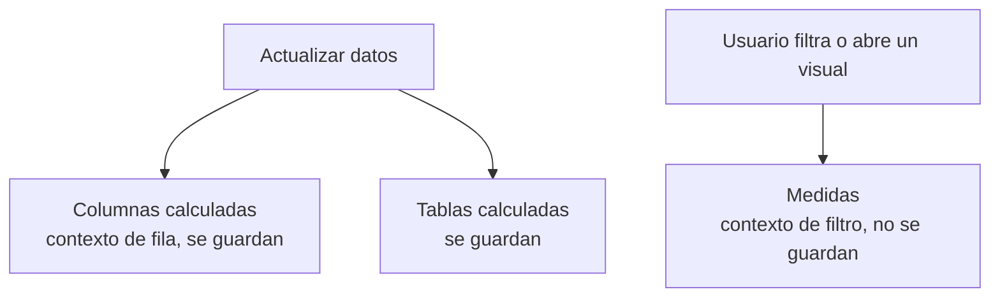

# DAX - columnas calculadas, medidas y tablas calculadas

Parte de: [[17-Power-BI/04 DAX/_Índice DAX|DAX]]

> [!info] Cómo avanzar
> `progreso`: **pendiente** → **viendo** (estudiando) → **visto** (contestaste la autoevaluación sin abrir las respuestas) → **dominado** (hiciste el laboratorio o lo aplicaste de verdad).

## Contenido

### Qué es
DAX produce tres tipos de objetos y elegir bien entre ellos es la primera decisión de diseño:
- **Columna calculada**: una columna nueva en una tabla, calculada fila por fila **al actualizar** el modelo y guardada en memoria.
- **Medida**: una fórmula que **no guarda nada**; se evalúa al consultar, en cada celda del visual, según los filtros activos.
- **Tabla calculada**: una tabla completa generada con una expresión DAX al actualizar (por ejemplo, un calendario o una tabla de parámetros).

### Cómo funciona


| | Columna calculada | Medida | Tabla calculada |
|---|---|---|---|
| Cuándo se calcula | Al actualizar | Al consultar | Al actualizar |
| Contexto natural | Fila de su tabla | Filtros de la celda | Ninguno (todo el modelo) |
| Ocupa memoria | Sí | No | Sí |
| Responde a segmentaciones | No (valor fijo) | Sí | No |
| Se puede usar en ejes, segmentaciones, relaciones | Sí | No | Sí |

Una columna calculada sabe "en qué fila está" ([[DAX - contexto de fila]]), así que puede leer `Ventas[Cantidad]` directamente. Una medida no tiene fila: vive en el [[DAX - contexto de filtro]] y por eso necesita agregar (`SUM`, `SUMX`, `COUNTROWS`...).

### Ejemplo
> [!example] Modelo de ejemplo de esta sección
> - `Productos`: P1 Café (Bebidas, Negro), P2 Molino (Equipo, Rojo), P3 Galletas (Alimentos, Café).
> - `Ventas` (Cantidad × PrecioUnitario, CostoUnitario): 1) 2024-01-15 P1 2×100 (60); 2) 2024-02-10 P2 1×250 (150); 3) 2024-02-20 P1 3×100 (60); 4) 2025-01-05 P3 5×40 (25); 5) 2025-02-14 P2 2×250 (150).
> - `Calendario` (Fecha, Año, NumMes, Mes, AñoMes, Trimestre) relacionado 1:* con `Ventas[Fecha]`; `Productos` 1:* con `Ventas[IdProducto]`.
> - Medida base: `Ventas $ = SUMX(Ventas, Ventas[Cantidad] * Ventas[PrecioUnitario])` → total **1 450**; Bebidas 500, Equipo 750, Alimentos 200; 2024 = 750, 2025 = 700.

```dax
-- MEDIDAS (en la tabla Ventas o en una tabla de medidas)
Ventas $ = SUMX(Ventas, Ventas[Cantidad] * Ventas[PrecioUnitario])
Costo $  = SUMX(Ventas, Ventas[Cantidad] * Ventas[CostoUnitario])
Margen $ = [Ventas $] - [Costo $]

-- COLUMNA CALCULADA en Ventas: trae la categoría por la relación
Categoria = RELATED(Productos[Categoria])

-- COLUMNA CALCULADA en Productos: rango de precio para usar en un eje
Rango de precio =
VAR P = CALCULATE(MAX(Ventas[PrecioUnitario]))
RETURN SWITCH(TRUE(), P >= 200, "Alto", P >= 80, "Medio", "Bajo")

-- TABLA CALCULADA: calendario de 2024 y 2025
Calendario =
ADDCOLUMNS(
    CALENDAR(DATE(2024, 1, 1), DATE(2025, 12, 31)),
    "Año", YEAR([Date]),
    "NumMes", MONTH([Date])
)
```

Resultados: `Ventas $` 1 450, `Costo $` 875, `Margen $` 575. `Rango de precio` queda Molino "Alto", Café "Medio", Galletas "Bajo"; como es columna, puedes ponerla en el eje de un gráfico o en una segmentación, cosa imposible con una medida.

### Cuándo usarlo y cuándo no
- **Medida** (la opción por defecto): cualquier número que se agregue o dependa de filtros: ventas, márgenes, porcentajes, comparativos.
- **Columna calculada**: cuando necesitas el valor para **agrupar, filtrar, ordenar o relacionar** (eje, segmentación, leyenda, clave de relación) y no puedes traerlo desde Power Query o SQL. Si puedes calcularlo en el origen (una vista en SQL Server) o en Power Query, mejor allí: se comprime mejor y queda documentado en un solo lugar.
- **Tabla calculada**: calendarios rápidos, tablas de parámetros, tablas puente pequeñas o resúmenes para depurar. Para dimensiones reales, prefiere Power Query o la base.

### Errores comunes
- **Crear `Importe` como columna y sumarla** en lugar de una medida con SUMX: el resultado es igual, pero ocupa memoria por cada fila de la tabla de hechos (millones de valores) sin ganar nada. Peor aún es crear un *ratio* como columna y sumarlo: la suma de porcentajes no es el porcentaje del total.
- **Esperar que una columna calculada responda a una segmentación**: se calculó al actualizar y su valor es fijo.
- **Columnas calculadas que usan CALCULATE en tablas de hechos grandes**: cada fila hace [[DAX - transición de contexto]] y la actualización se vuelve lenta.
- **Dependencias circulares** al crear columnas que se refieren entre sí con CALCULATE (ver [[DAX - errores comunes]]).

### Para profundizar
- [Columnas calculadas en Power BI Desktop](https://learn.microsoft.com/en-us/power-bi/transform-model/desktop-calculated-columns)
- [Medidas en Power BI Desktop](https://learn.microsoft.com/en-us/power-bi/transform-model/desktop-measures)
- [Tablas calculadas en Power BI Desktop](https://learn.microsoft.com/en-us/power-bi/transform-model/desktop-calculated-tables)

## Ejercicios

Resuélvelos en papel o en la herramienta; la solución está plegada.

> [!question]- Modelo de práctica: `Ventas`(IdVenta, Fecha, FechaEnvio, IdProducto, Cantidad, PrecioUnitario, CostoUnitario), `Productos`(IdProducto, Producto, Categoria, Color) y `Calendario`(Fecha, Año, NumMes, Mes, Trimestre). Relaciones activas Ventas[Fecha] → Calendario[Fecha] y Ventas[IdProducto] → Productos[IdProducto] (1:*, filtro simple). Escribe la medida base `Ventas $`.
> ```dax
> Ventas $ = SUMX(Ventas, Ventas[Cantidad] * Ventas[PrecioUnitario])
> ```

> [!question]- Escribe la medida `Costo $` y `Margen $`.
> ```dax
> Costo $ = SUMX(Ventas, Ventas[Cantidad] * Ventas[CostoUnitario])
> Margen $ = [Ventas $] - [Costo $]
> ```

> [!question]- Columna calculada en Ventas con la categoría del producto.
> ```dax
> Categoria = RELATED(Productos[Categoria])
> ```
> (Mejor aún: traerla con merge en Power Query o simplemente usar Productos[Categoria] en los visuales.)

## Autoevaluación

Contesta primero en voz alta o en papel; luego despliega la respuesta.

> [!question]- ¿Cuándo se calcula una columna calculada y cuándo una medida?
> Columna: al actualizar el modelo, fila por fila, y se guarda (ocupa memoria). Medida: en el momento de la consulta, según el contexto de filtro del visual; no ocupa almacenamiento.

> [!question]- Caso: quieres usar "Rango de precio" en el eje de un gráfico. ¿Columna o medida?
> Columna (o mejor, columna en Power Query): para usar algo en ejes, segmentaciones o filas debe ser una columna.

> [!question]- Error común: crear `Ventas $` como columna calculada y sumarla.
> Funciona, pero duplica memoria y no reacciona al contexto como una medida. Lo correcto es una medida `SUMX(...)`.

> [!question]- ¿Para qué sirve una tabla calculada?
> Para crear tablas auxiliares a partir del modelo: calendario, tabla de parámetros, tablas puente. Se recalculan al actualizar.

