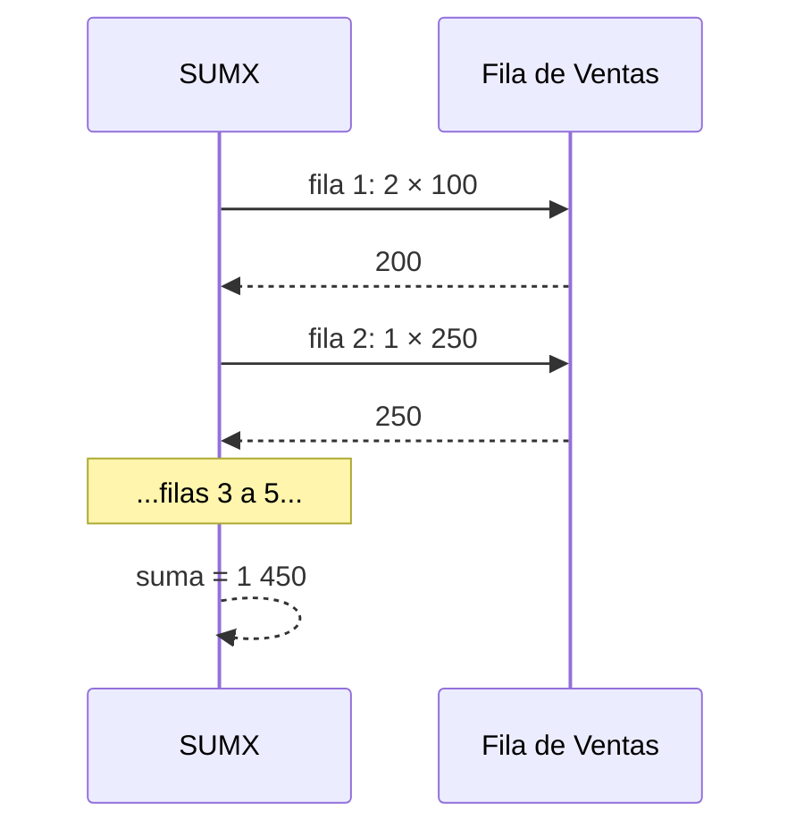

# DAX - contexto de fila

Parte de: [[17-Power-BI/04 DAX/_Índice DAX|DAX]]

> [!info] Cómo avanzar
> `progreso`: **pendiente** → **viendo** (estudiando) → **visto** (contestaste la autoevaluación sin abrir las respuestas) → **dominado** (hiciste el laboratorio o lo aplicaste de verdad).

## Contenido

### Qué es
El **contexto de fila** es la noción de "fila actual" mientras DAX recorre una tabla. Dentro de él, una referencia a columna como `Ventas[Cantidad]` devuelve **el valor de esa fila**. Sin contexto de fila, la misma referencia no tiene sentido (¿la cantidad de cuál fila?) y DAX marca error.

### Cómo funciona
Hay dos lugares donde se crea un contexto de fila:
1. **Columnas calculadas**: el motor evalúa la fórmula una vez por fila de la tabla donde vive la columna.
2. **Iteradores** (`SUMX`, `AVERAGEX`, `FILTER`, `COUNTX`, `ADDCOLUMNS`, `RANKX`...): recorren la tabla que reciben como primer argumento y evalúan la expresión del segundo argumento fila por fila. Ver [[DAX - iteradores (SUMX, AVERAGEX y demás)]].



Tres reglas clave:
- **El contexto de fila no filtra.** Estar "en la fila de Café" no hace que `SUM(Ventas[Cantidad])` se limite a Café: SUM ve toda la tabla visible. Para convertir la fila en filtro necesitas CALCULATE ([[DAX - transición de contexto]]).
- **Sí puede seguir relaciones hacia el lado uno** con `RELATED`, y hacia el lado muchos con `RELATEDTABLE` (ver [[DAX - RELATED y RELATEDTABLE]]).
- **Se pueden anidar** contextos de fila (un iterador dentro de otro); `EARLIER` o, mejor, variables permiten leer la fila externa.

### Ejemplo
> [!example] Modelo de ejemplo de esta sección
> - `Productos`: P1 Café (Bebidas, Negro), P2 Molino (Equipo, Rojo), P3 Galletas (Alimentos, Café).
> - `Ventas` (Cantidad × PrecioUnitario, CostoUnitario): 1) 2024-01-15 P1 2×100 (60); 2) 2024-02-10 P2 1×250 (150); 3) 2024-02-20 P1 3×100 (60); 4) 2025-01-05 P3 5×40 (25); 5) 2025-02-14 P2 2×250 (150).
> - `Calendario` (Fecha, Año, NumMes, Mes, AñoMes, Trimestre) relacionado 1:* con `Ventas[Fecha]`; `Productos` 1:* con `Ventas[IdProducto]`.
> - Medida base: `Ventas $ = SUMX(Ventas, Ventas[Cantidad] * Ventas[PrecioUnitario])` → total **1 450**; Bebidas 500, Equipo 750, Alimentos 200; 2024 = 750, 2025 = 700.

```dax
-- Columna calculada en Ventas: aquí sí hay fila actual
Importe = Ventas[Cantidad] * Ventas[PrecioUnitario]
-- Valores: 200, 250, 300, 200, 500

-- Medida que suma la columna (SUM no necesita fila)
Ventas por columna = SUM(Ventas[Importe])          -- 1 450

-- Medida con iterador: cuenta líneas con Cantidad >= 3
Lineas grandes = COUNTROWS(FILTER(Ventas, Ventas[Cantidad] >= 3))
-- FILTER crea contexto de fila: filas 3 (3 u.) y 4 (5 u.) → 2

-- Columna en Productos SIN CALCULATE: RELATEDTABLE sigue la relación
Num lineas = COUNTROWS(RELATEDTABLE(Ventas))
-- Café 2, Molino 2, Galletas 1
```

¿Por qué falla `Ventas $ = Ventas[Cantidad] * Ventas[PrecioUnitario]` **como medida**? Porque una medida se evalúa en un contexto de filtro, no en una fila; DAX no sabe qué fila usar y responde con el error de que no se puede determinar un valor único para la columna. La solución es crear la fila con un iterador: `SUMX(Ventas, Ventas[Cantidad] * Ventas[PrecioUnitario])`.

Variables para filas anidadas:

```dax
-- Columna en Productos: ventas de productos con precio mayor al de la fila actual
Ventas de mas caros =
VAR PrecioActual = CALCULATE(MAX(Ventas[PrecioUnitario]))
RETURN SUMX(FILTER(Ventas, Ventas[PrecioUnitario] > PrecioActual),
            Ventas[Cantidad] * Ventas[PrecioUnitario])
```

### Cuándo usarlo y cuándo no
- Usa contexto de fila (iteradores) cuando el cálculo **por línea** no es una simple columna: multiplicar columnas, aplicar condiciones por línea, sumar medidas por cliente o por mes.
- Prefiere iterar **dimensiones pequeñas o columnas** (`VALUES(Productos[Producto])`) antes que la tabla de hechos completa si la lógica lo permite.
- No uses columnas calculadas solo para tener "fila": casi siempre un iterador en una medida resuelve lo mismo sin gastar memoria.

### Errores comunes
- **Pensar que la fila filtra**: en una columna de Productos, `SUM(Ventas[Cantidad])` devuelve 13 en todas las filas (el total), no las unidades de cada producto.
- **Referenciar una columna "desnuda" en una medida**: error de valor único; agrega con SUM/MAX o itera.
- **Usar `EARLIER`** cuando una variable es más legible.
- **Iterar la tabla de hechos y llamar medidas dentro**: cada fila provoca transición de contexto y puede ser lento en tablas de millones de filas.

### Para profundizar
- [Row context y filter context en DAX (SQLBI)](https://www.sqlbi.com/articles/row-context-and-filter-context-in-dax/)
- [Función SUMX (Microsoft Learn)](https://learn.microsoft.com/en-us/dax/sumx-function-dax)
- [Función RELATEDTABLE](https://learn.microsoft.com/en-us/dax/relatedtable-function-dax)

## Ejercicios

Resuélvelos en papel o en la herramienta; la solución está plegada.

> [!question]- Columna calculada en Ventas `Importe` y medida que la sume. ¿Por qué aquí sí funciona `Ventas[Cantidad] * Ventas[PrecioUnitario]`?
> ```dax
> Importe = Ventas[Cantidad] * Ventas[PrecioUnitario]      -- columna
> Ventas col = SUM(Ventas[Importe])                         -- medida
> ```
> La columna calculada se evalúa con contexto de fila (una fila a la vez). Con los datos de ejemplo da los mismos 1 450 que `Ventas $`, pero ocupa memoria.

> [!question]- Medida que cuente las líneas de venta con Cantidad ≥ 3 usando un iterador. ¿Resultado?
> ```dax
> Líneas grandes = COUNTROWS(FILTER(Ventas, Ventas[Cantidad] >= 3))
> ```
> Ventas 3 (3 u) y 4 (5 u) → 2.

> [!question]- Columna en Productos: número de líneas de venta del producto **sin** usar CALCULATE ni medidas.
> ```dax
> Líneas = COUNTROWS(RELATEDTABLE(Ventas))
> ```
> Café 2, Molino 2, Galletas 1.

## Autoevaluación

Contesta primero en voz alta o en papel; luego despliega la respuesta.

> [!question]- ¿Qué es el contexto de fila?
> La "fila actual" sobre la que se evalúa una expresión: existe en columnas calculadas y dentro de iteradores (SUMX, FILTER, ADDCOLUMNS).

> [!question]- ¿El contexto de fila filtra otras tablas?
> No. Por eso en una columna calculada de Productos, `SUM(Ventas[Cantidad])` da el total general; para filtrar se necesita transición de contexto (`CALCULATE`) o `RELATEDTABLE`.

> [!question]- ¿Por qué falla `Ventas $ = Ventas[Cantidad] * Ventas[PrecioUnitario]` como medida?
> Una medida no tiene contexto de fila: no sabe de qué fila tomar Cantidad. Hay que usar un iterador: `SUMX(Ventas, ...)`.

